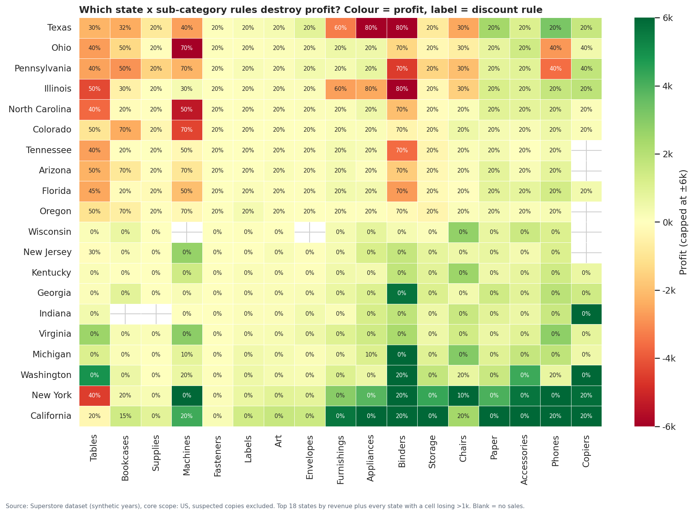
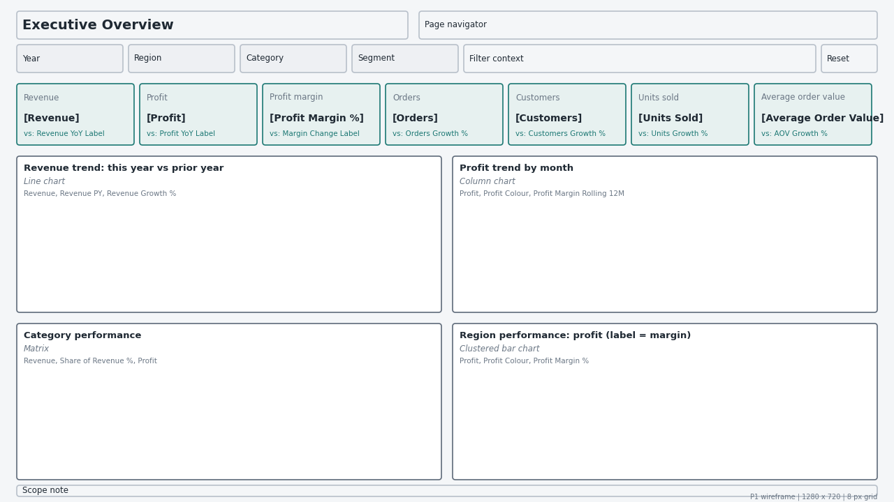
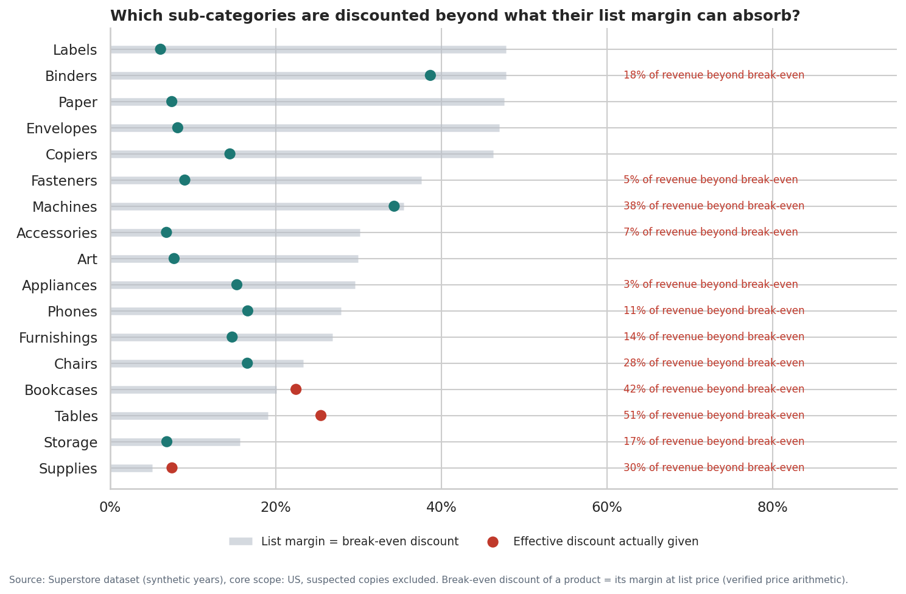
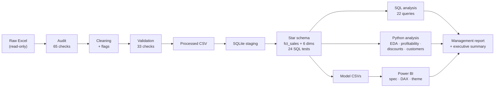

# Sales & Profitability Intelligence System

**An end-to-end analytics project on the Superstore retail dataset: from a raw Excel file to a validated star schema, SQL and Python analysis, a Power BI dashboard specification and a management report.**

The central question:

> *How is the company performing in terms of sales and profitability, what factors are associated with profitability, and where should management investigate or act?*

**Start here:** [Executive summary (1 page)](docs/executive_summary.md) · [Management insight report](docs/management_insight_report.md) · [Dashboard specification](docs/powerbi_dashboard_spec.md)

| | |
|---|---|
| **Roles targeted** | Data Analyst · Business Analyst · Commercial Analyst · Finance / FP&A Analyst |
| **Stack** | Python (pandas, NumPy, Matplotlib, seaborn) · SQL (SQLite) · Power BI / DAX · Git |
| **Reproducibility** | One command rebuilds every table, chart and report from the raw file (`python scripts/run_all.py`, about 30 s) |
| **Validation** | Every phase reconciles its totals to the previous one and stops on any mismatch; 13 unit tests |
| **Data** | Public Superstore sample dataset; years are synthetic (2023-2026) |

> **Status.** The analysis, SQL layer, data model, DAX measure library and dashboard specification are complete and validated. The Power BI `.pbix` file itself has not been built yet: the [specification](docs/powerbi_dashboard_spec.md), [DAX library](powerbi/dax_measures.dax), [theme](powerbi/spis_theme.json), [wireframes](powerbi/wireframes) and [acceptance values](reports/phase8/acceptance_values.csv) are ready for that build.

---

## Contents
1. [Project overview](#1-project-overview)
2. [Business problem](#2-business-problem)
3. [Objectives](#3-objectives)
4. [Dataset](#4-dataset)
5. [Data preparation](#5-data-preparation)
6. [Analytical methodology](#6-analytical-methodology)
7. [SQL analysis](#7-sql-analysis)
8. [Python analysis](#8-python-analysis)
9. [Power BI dashboard](#9-power-bi-dashboard)
10. [Key findings](#10-key-findings)
11. [Business implications](#11-business-implications)
12. [Limitations](#12-limitations)
13. [Technologies used](#13-technologies-used)
14. [Project architecture](#14-project-architecture)
15. [Folder structure](#15-folder-structure)
16. [How to reproduce](#16-how-to-reproduce)
17. [Future improvements](#17-future-improvements)

---

## 1. Project overview

This project treats a well-known sample dataset the way an analyst would treat company data: audit it first, model it properly, answer business questions with reproducible code, separate evidence from interpretation, and hand management a short list of things to investigate.

It is organised in ten phases. Each phase is a script that reads the previous phase's validated output, runs its own checks, and writes tables, charts and a report.

| Phase | Output |
|---|---|
| 1. Data quality audit | [Data-quality report](reports/phase1/data_quality_report.md): 65 checks, 19 issues, each corrected, flagged or documented |
| 2. Data model | [Star schema](docs/data_model.md) in SQLite with 24 data tests |
| 3. SQL analysis | [22 analytical queries](docs/sql_analysis_guide.md) reconciled to the model |
| 4. Exploratory analysis | [16 findings](reports/phase4/eda_findings.md), 10 charts |
| 5. Profitability analysis | [Product quadrants, loss diagnosis, pricing-rule analysis](reports/phase5/profitability_report.md) |
| 6. Discount analysis | [Discount vs sales, profit and margin, with an evidence ladder](reports/phase6/discount_report.md) |
| 7. Customer profitability | [Customer segmentation and stability test](reports/phase7/customer_report.md) |
| 8. Dashboard specification | [5-page Power BI design](docs/powerbi_dashboard_spec.md), wireframes, theme |
| 9. DAX layer | [66 measures explained and validated](docs/dax_guide.md) |
| 10. Management report | [Insight report](docs/management_insight_report.md) and [executive summary](docs/executive_summary.md) |

## 2. Business problem

The company sells office furniture, office supplies and technology across the United States. Revenue is growing, but management does not know:

- whether growth is **profitable** growth;
- which products, customers and locations **create** profit and which **destroy** it;
- whether **discounting** is helping or hurting;
- where to **look first**, given limited time.

A dashboard of totals would not answer these questions. The project therefore focuses on *where* profit is made and lost, *what is associated with* those losses, and *what the data can and cannot tell management*.

## 3. Objectives

1. Establish a trustworthy dataset: audit every column, document every cleaning decision, keep the raw file untouched.
2. Build a reusable analytical model (star schema) that SQL, Python and Power BI all read from.
3. Answer 11 business questions on sales, profitability, products, customers, geography and discounts.
4. Distinguish facts, calculated metrics, interpretations, assumptions and recommendations in every output.
5. Avoid causal claims the data cannot support, and state the limits explicitly.
6. Specify a decision-focused Power BI dashboard with validated DAX.
7. Make everything reproducible from one command.

## 4. Dataset

| Item | Detail |
|---|---|
| Source | Superstore sample workbook (`.xls`), three sheets: Orders, Returns, People |
| Size | 10,194 order lines × 21 columns; 296 returned orders; 4 regional managers |
| Grain | One row = one product line within one order |
| Period | Order dates 2023-01-03 to 2026-12-30 (**synthetic years**: orders are dated after the analysis date) |
| Coverage | 49 US states incl. DC (9,994 lines) and 10 Canadian provinces (200 lines) |
| Entities | 5,111 orders, 804 customer IDs, 1,862 product IDs, 3 categories, 17 sub-categories |
| Measures | Sales (net of discount), quantity, discount rate, profit. **No cost, list price or budget columns.** |

## 5. Data preparation

Principle: **RAW → AUDIT → CLEANING → VALIDATION → PROCESSED.** The raw file is read-only and its SHA-256 hash is checked before and after every run.

The audit ran 65 checks and found 19 issues. Each received one of three decisions:

| Decision | Examples |
|---|---|
| **Corrected** (4) | 2 duplicated lines removed; US postal codes restored to 5-digit text (leading zeros lost); customer ID and name casing fixed |
| **Flagged** (6) | A placeholder customer ("Sample Company A"); one customer split across 5 IDs; price anomalies; statistical outliers (kept, not deleted); **Canadian lines copied from other orders** |
| **Documented** (9) | Product IDs reused for different products (solved with a surrogate key); city names shared across states; returns recorded per order only; synthetic dates |

The most consequential finding: **about 55% of Canadian revenue consists of lines that duplicate other orders** (same order sequence, customer, product and sales value). The core analysis therefore covers US order lines only, with suspected copies excluded (9,993 lines). Canada remains in the model, flagged, and can be included with one configuration change.

Validation after cleaning (33 checks): row counts and sales, profit and quantity totals reconcile exactly to raw minus logged removals; no value in a remaining row changed; the CSV round-trip preserves postal codes.

## 6. Analytical methodology

- **Model before analysis.** A star schema with one fact table (grain: order line) and six dimensions. Every tool reads the same model, so numbers agree everywhere.
- **Ratios are ratios of sums.** Margin = total profit ÷ total revenue for each group, never an average of line margins (which would give 12.0% instead of 12.5%).
- **Thresholds are stated and tested.** Segmentations use the median and the company margin as cut-offs, with a minimum-evidence rule (3+ lines or orders), and are re-run with alternative thresholds to show the conclusions do not depend on them.
- **Comparisons hold things constant where the data allows.** Mix-adjusted margins (direct standardisation) compare regions as if they had the same discount mix; products are compared with themselves at full price and at a discount.
- **An explicit evidence ladder.** Every claim is labelled descriptive, correlation, explanation or causal. Causal conclusions are only drawn where the data contains the necessary variation, and the reports explain why most causal questions here cannot be answered.
- **Approaches are evaluated, not assumed.** For example, RFM segmentation was tested and rejected because recency and frequency explain under 1% of the variation in customer margin.

## 7. SQL analysis

The SQL layer runs on SQLite and contains all transformation logic, so it is reviewable and portable.

- **Schema and transformation:** [`sql/ddl`](sql/ddl), [`sql/transform`](sql/transform). Surrogate keys are generated deterministically with `ROW_NUMBER()`; the date dimension is generated with a recursive CTE.
- **Data tests (24):** grain, referential integrity, reconciliation of revenue, profit, units and orders to staging, a continuous calendar, and derived-field identities. A deliberately corrupted value is caught.
- **Analytical queries (22)** in [`sql/analysis`](sql/analysis) cover headline KPIs, yearly and monthly trends, category and sub-category, region and state, segment, top and bottom products, a product portfolio quadrant, discount bands and levels, customer profitability, customer deciles, repeat purchasing and retention.
- **Techniques:** CTEs, window functions (`LAG` for year-over-year growth, running `SUM` for Pareto curves, `RANK`, `NTILE`), a median computed with `ROW_NUMBER`, and conditional aggregation.
- **Validation:** 42 checks confirm every breakdown adds back to the total, and selected results are recomputed independently in pandas.

Each query's business question, logic and intended use are documented in the [SQL query guide](docs/sql_analysis_guide.md), generated from the query headers.

## 8. Python analysis

Python (pandas, NumPy, Matplotlib, seaborn) is organised as a package, [`src/spis`](src/spis): calculation, charting and narrative are separate modules. Every number in the reports is read from computed results, not typed by hand.

| Analysis | Method | Report |
|---|---|---|
| Exploratory analysis | Growth decomposition (orders × AOV), seasonality shares, loss concentration, mix-adjusted margins, correlation by level of aggregation | [EDA findings](reports/phase4/eda_findings.md) |
| Profitability | Product revenue × margin quadrants, threshold sensitivity, within-product full-price vs discounted margins, eta-squared driver comparison, pricing-rule ("policy cell") analysis | [Profitability report](reports/phase5/profitability_report.md) |
| Discounts | Band-scheme evaluation, break-even discount, price-arithmetic test, growth by band, basket-share and state-growth tests | [Discount report](reports/phase6/discount_report.md) |
| Customers | Revenue × margin segmentation, RFM evaluation, profit decomposition, persistence test across two periods | [Customer report](reports/phase7/customer_report.md) |

Charts are produced only where a picture answers the question better than a table. Each chart title is the business question it answers.

<p align="center">
  <br>
  <em>Profit by state × sub-category, labelled with the discount rule applied to that combination.</em>
</p>

## 9. Power BI dashboard

A five-page dashboard is fully specified: layout coordinates on an 8 px grid, visual types, fields, measures, filters, formatting and the business purpose of every visual. The specification is generated from a single Python file and checked automatically (386 checks: layout, overlaps, every measure exists in the DAX library, every field exists in the model).

| Page | Question |
|---|---|
| Executive Overview | How is the business performing, and is growth profitable? |
| Sales Performance | Where is revenue growth coming from? |
| Profitability | Where is profit made, and where is it destroyed? |
| Customer & Product | Which customers and products create profit, and which dilute it? |
| Discount & Management Insights | Is discounting eroding profit, and what should management investigate? |

- **DAX layer:** [66 measures](powerbi/dax_measures.dax), each explained with plain-language meaning, where to use it, common mistakes and SQL validation in the [DAX guide](docs/dax_guide.md). Prior-year measures are guarded so that no misleading growth figure appears when several years are selected.
- **Build assets:** a [theme file](powerbi/spis_theme.json), [page wireframes](powerbi/wireframes), [DAX validation queries](powerbi/validation_queries.dax) and [acceptance values](reports/phase8/acceptance_values.csv) for checking the finished report.

<p align="center">
  <br>
  <em>Wireframe of the Executive Overview page (the .pbix is not yet built).</em>
</p>

## 10. Key findings

Figures cover US order lines in the four synthetic dataset years: revenue 2.30M, profit 286.4k, margin 12.5%, 5,009 orders. Findings describe what the data shows; they are **associations, not proven causes**.

| Area | Finding | Evidence |
|---|---|---|
| Sales | Revenue growth came from more orders rather than larger orders. | Revenue +29.5% (2025) and +20.4% (2026); orders +26.7% and +28.3%; average order value +2.2% and −6.2%. |
| Profitability | Losses on individual lines give back about a third of the profit earned on profitable lines. Every loss-making line is a discounted line. | Loss-making lines lose 156.1k (35% of profit on profitable lines); no full-price line loses money. |
| Profitability | Furniture earns almost nothing, and not only because of discounting. | 32% of revenue, 6% of profit, 2.5% margin; 4.8% even at the company-average discount mix. Its full-price margins are lower than other categories'. |
| Products | Almost half of revenue comes from products that lose money as a group. | 346 high-revenue, low-margin products: 43% of revenue, −27.2k profit. 467 core products: 44% of revenue, 92% of profit. |
| Customers | Profit depends on a small group of customers, and customer profitability is not stable over time. | Top 10% of customers earn 58% of customer profit. Customer margin in 2023-24 vs 2025-26: rank correlation −0.00. |
| Geography | Every loss-making state applies deep discounts; regional margin gaps track discount levels. | 10 loss-making states, all with an effective discount ≥ 29.7%. Central's margin rises from 7.9% to 11.3% at the company-average discount mix. |
| Discounts | Discount is a fixed rule per state and sub-category, and a small number of rules accounts for most losses. | 0 of 656 rules vary; 0 changed in four years. 79 loss-making rules lose 145.7k (93% of line losses); all 32 rules above 40% lose money. |
| Discounts | There is no sign that discounts are associated with more volume. | Discount vs units per line: rank correlation 0.00; vs state revenue growth: −0.08. |

<p align="center">
  <br>
  <em>Each product breaks even at a discount equal to its list margin; some sub-categories are routinely discounted beyond it.</em>
</p>

## 11. Business implications

These are **questions and suggested next steps** for management, not measured results. No change was implemented, so no business impact has been measured.

1. **Review the discount rule table.** Losses are concentrated in identifiable state × sub-category rules, and the rules appear to be centrally set. Understanding who sets them, and why 11 states never sell at full price, is the first step.
2. **Prioritise the deepest rules.** The 32 rules above 40% account for 99.6k of losses. This is the size of the current loss, **not** a forecast of profit that would be recovered: the volume effect of changing a rule is unknown.
3. **Test before changing policy.** Because discounts never vary within a rule or over time, the data cannot show what a change would do. A controlled pilot in a few states is the only way to measure it.
4. **Investigate Furniture economics.** Thin full-price margins point to list price, purchase cost or freight. Cost data is needed to tell which.
5. **Use fairer comparisons.** Regional scorecards based on raw margin largely reflect discount rules; mix-adjusted margin is a more balanced measure.
6. **Do not act on individual "unprofitable customers".** Their losses follow the discount rules applied to their orders, and segment membership does not persist over time.

## 12. Limitations

- **Synthetic data.** The years are shifted, and profit appears to be generated mechanically from a fixed cost per product. Real data would be noisier, and some patterns (such as perfectly fixed discount rules) may not exist in a real business.
- **No counterfactual.** Discount never varies within a rule or over time, so the effect of discounting on volume and total profit cannot be estimated.
- **No cost, list-price or budget data.** The reasons behind thin margins cannot be identified, and performance can only be compared with the prior year.
- **Returns are recorded per order,** so profit is not net of returned goods.
- **Customer history is left-censored** (75% of customers already appear in the first year), so lifetime value, acquisition and churn are not estimated.
- **US scope only.** Canada is excluded from the core analysis because much of its data appears copied.
- **The Power BI report is specified but not yet built.**

## 13. Technologies used

| Technology | Used for |
|---|---|
| **Python 3** — pandas, NumPy | Ingestion, audit, cleaning, validation, analysis, report generation |
| **Matplotlib, seaborn** | Analytical charts and dashboard wireframes |
| **SQL (SQLite)** | Star schema, transformations, data tests, 22 analytical queries |
| **Power BI / DAX** | Dashboard specification, 66-measure library, theme, validation queries |
| **pytest** | Unit tests for cleaning and analysis rules |
| **Git / GitHub** | Version control and publication |

## 14. Project architecture



Every arrow is a validated hand-off: each stage reconciles its totals to the stage before it and stops the pipeline if they differ. See [docs/architecture.md](docs/architecture.md) for a description of each layer.

## 15. Folder structure

```
sales-profitability-intelligence/
├── README.md
├── requirements.txt
├── data/
│   ├── raw/            superstore_raw.xls (read-only source)
│   ├── processed/      cleaned orders, returns, regional managers (Phase 1)
│   ├── model/          star-schema tables + classification tables as CSV (Power BI source)
│   └── warehouse/      spis.sqlite (rebuilt by the pipeline, not committed)
├── src/spis/           reusable Python package
│   ├── config.py, io_utils.py                 paths, rules, I/O
│   ├── audit.py, issue_catalog.py, cleaning.py, validation.py
│   ├── modeling.py, sql_analysis.py           SQLite build and SQL runner
│   ├── eda.py, profitability.py, discount_analysis.py, customer_analysis.py
│   ├── charts*.py                             one chart per business question
│   ├── *_report.py, findings.py, reporting.py generated reports
│   └── dashboard_spec.py, dax_docs.py         Power BI specification and DAX docs
├── sql/
│   ├── ddl/ transform/ views/                 schema, transformations, analysis views
│   ├── tests/                                 data tests
│   └── analysis/                              22 analytical queries
├── scripts/            run_all.py + one runner per phase (1-10)
├── powerbi/            DAX library, optional measures, theme, wireframes, validation queries
├── docs/               data model, SQL guide, dashboard spec, DAX guide, architecture,
│                       management report, executive summary
├── reports/phase1-10/  generated reports, figures, tables and validation results
└── tests/              unit tests
```

## 16. How to reproduce

Requirements: Python 3.10+ and the packages in `requirements.txt`.

```bash
git clone <repository-url>
cd sales-profitability-intelligence
python -m venv .venv && source .venv/bin/activate        # Windows: .venv\Scripts\activate
pip install -r requirements.txt

python scripts/run_all.py      # rebuilds everything from the raw file (~30 s)
python -m pytest -q            # unit tests
```

A run from an empty output state reproduces the committed model tables and analysis reports exactly; only the run date stamped in the data-quality report changes. Individual phases can be run separately (`python scripts/run_phase5_profitability.py`, etc.).

**Power BI:** load the CSVs in `data/model/`, follow section 2 of the [dashboard specification](docs/powerbi_dashboard_spec.md), paste the measures from `powerbi/dax_measures.dax`, apply `powerbi/spis_theme.json`, and check the result with `powerbi/validation_queries.dax` against the [acceptance values](reports/phase8/acceptance_values.csv).

**Scope switch:** to include Canada in the core analysis, add `"Canada"` to `CORE_SCOPE_COUNTRIES` in `src/spis/config.py` and rerun. Suspected copied records stay excluded either way.

## 17. Future improvements

- **Build the Power BI report** from the specification and publish screenshots, checking every KPI against the acceptance values.
- **Excel management workbook:** a P&L summary, a break-even discount guardrail scenario with the volume assumption as an adjustable input, and a reconciliation sheet.
- **Margin bridge** decomposing the 2025-to-2026 margin change into discount, category-mix and regional-mix effects.
- **Pilot design:** a power calculation and a test/control state selection for a discount pilot.
- **Real data:** repeat the analysis on a dataset with costs, list prices and genuine dates to test whether the patterns hold.
- **Automation:** a GitHub Actions workflow running `run_all.py` and the tests on every commit.

---

**Author:** Dimple Kishor Sonone · Code released under the [MIT License](LICENSE). The Superstore dataset is publicly distributed sample data and remains the property of its owner.

