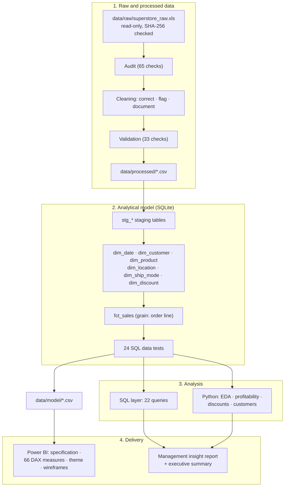

# Project Architecture

## Pipeline



### Plain-text version

```
raw .xls ──► audit ──► cleaning ──► validation ──► processed CSV
                                                       │
                                                       ▼
                          SQLite: staging ──► star schema (fct_sales + 6 dims) ──► 24 data tests
                                                       │
                      ┌────────────────────────────────┼────────────────────────────┐
                      ▼                                ▼                            ▼
              SQL analysis (22 queries)     Python analysis (Phases 4-7)    model CSVs ──► Power BI spec + DAX
                      └────────────────────────────────┼────────────────────────────┘
                                                       ▼
                                  management insight report + executive summary
```

## Layers

| Layer | What it does | Where | Validation |
|---|---|---|---|
| Raw | Original workbook, never modified | `data/raw/` | SHA-256 hash before and after every run |
| Audit and cleaning | 65 checks; 19 issues corrected, flagged or documented | `src/spis/audit.py`, `cleaning.py`, `issue_catalog.py` | Totals reconcile to raw minus logged removals (33 checks) |
| Model | Star schema built entirely in SQL | `sql/ddl`, `sql/transform`, `sql/views` | 24 SQL data tests + 28 independent pandas checks |
| SQL analysis | 22 business queries with documented intent | `sql/analysis` | Every breakdown adds back to the total (42 checks) |
| Python analysis | EDA, profitability, discount and customer analysis | `src/spis/*.py`, `scripts/run_phase4-7*.py` | Each phase reconciles to the SQL results |
| Power BI | Dashboard specification, DAX library, theme, wireframes | `src/spis/dashboard_spec.py`, `powerbi/` | 386 specification checks; DAX acceptance values |
| Reporting | Management report and executive summary | `scripts/run_phase10_management_report.py` | Headline figures reconcile to SQL and dashboard values |

## Design decisions

- **One model, many consumers.** SQL, Python and Power BI read the same star schema, so a number means the same thing everywhere.
- **Logic in code, not in documents.** Reports, the SQL guide, the dashboard specification and the DAX guide are generated from code, so they cannot drift from the analysis.
- **Fail loudly.** Each phase stops the pipeline if its reconciliation fails, and nothing downstream is written.
- **Scope as configuration.** The analysis scope (US, suspected copies excluded) is one setting in `src/spis/config.py`, applied as a flag in the model rather than by deleting data.
