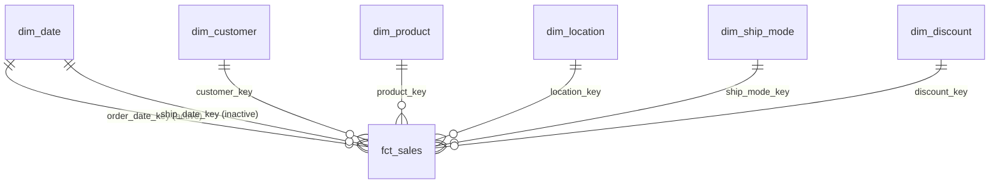

# Phase 2 — Analytical Data Model

**Project:** Sales & Profitability Intelligence System
**Model type:** Kimball star schema (one fact table, six conformed dimensions)
**Build:** `python scripts/run_phase2_build_model.py` → `data/warehouse/spis.sqlite` + `data/model/*.csv`

---

## 1. Grain

**One row = one order line**: one product line within one customer order. It is identified by the source `row_id`, stored as `sales_line_id`.

- `order_id + product_id` is **not** unique. nine order–product combinations appear on two separate lines (DQ16). That combination therefore cannot be the key.
- Every measure in the source (sales, quantity, discount, profit) is recorded at this level. Choosing the most detailed grain the source provides is the standard rule. Any higher level (order, customer, month) can be aggregated from it, but never the other way round.

## 2. Design decision: star schema

A star schema puts numeric events in a central **fact** table, and the descriptive context ("by what?") in surrounding **dimension** tables. It was chosen over keeping one flat table because:

1. **Power BI is optimised for it.** Filters flow cleanly from one-side dimensions to the many-side fact, and DAX time intelligence requires a separate, continuous date table.
2. **Each concept has exactly one home.** A product's category lives in one row of `dim_product`, not repeated 10,000 times.
3. **Fixes are localised.** For example, the Product ID conflict (DQ07) is solved once, with a surrogate key in `dim_product`.

### Changes from the initially proposed design

| Proposed | Decision | Reason |
|---|---|---|
| DIM SEGMENT | **Not created.** `segment` is an attribute of `dim_customer`. | Phase 1 verified that every customer belongs to exactly one segment. A separate 3-row table would add a join and a relationship but no information. If segment were stored separately, Power BI would need either a snowflake (`segment → customer → fact`) or a second key in the fact table. Both add complexity for nothing. |
| — | **Added `dim_ship_mode`** (4 rows) | Ship mode needs a business sort order (Same Day → Standard). A sort-by column belongs in a dimension. |
| — | **Added `dim_discount`** (12 rows) | Discount is a key driver question. Fixed 20-point bands, defined *before* analysis, give a consistent grouping in SQL, Python and Power BI. |
| DIM LOCATION | Kept, and **regional manager denormalised** into it | The People sheet maps region → manager. Folding it into `dim_location` avoids a snowflake (`manager → region → location`). |
| — | **No `dim_order`** | The only order-level attributes are dates, ship mode and the return flag. These are already covered by date keys, `dim_ship_mode` and a fact flag. `order_id` is kept in the fact table as a *degenerate dimension*: an identifier with no attributes of its own. |

## 3. Tables, keys and attributes

| Table | Rows | Primary key | Natural (business) key | Notes |
|---|---|---|---|---|
| `fct_sales` | 10,192 | `sales_line_id` | source `row_id` | Grain: order line |
| `dim_date` | 1,826 | `date_key` (yyyymmdd) | `date` | 2023-01-01 → 2027-12-31 (ship dates run into 2027) |
| `dim_customer` | 804 | `customer_key` | `customer_id` | Segment and data-quality flags as attributes |
| `dim_product` | 1,894 | `product_key` | (`product_id`, `product_name`) | 1,862 IDs, but 1,894 ID–name pairs (DQ07) |
| `dim_location` | 655 | `location_key` | (`country`, `state_province`, `city`, `postal_code`) | Ship-to location, not customer home |
| `dim_ship_mode` | 4 | `ship_mode_key` | `ship_mode` | `service_level_rank` for sorting |
| `dim_discount` | 12 | `discount_key` (whole %) | `discount_rate` | `discount_band` and its sort order |

**Why surrogate keys?**
- Customer and ship mode use surrogate keys for consistency, compact integer joins, and so that source IDs can change without breaking relationships.
- Product *requires* one, because `product_id` is not unique on its own.
- Location needs one, because its natural key spans four columns.
- Date keys use the readable `yyyymmdd` integer convention.
- Discount uses the whole-percent value (20 = 20%), because it is naturally unique and readable.

Keys are generated deterministically, by `ROW_NUMBER()` over the sorted natural key, so a rebuild on the same data gives the same keys.

**Why is location separate from customer?** The median customer receives orders at five different addresses. Location is a property of the *order*, not the customer, so it must join to the fact table directly.

**`product_label` and `city_state`.** These are unique display labels. Several products share a name under different IDs, and several cities share a name across states. Charting by `product_name` or `city` alone would silently merge different items.

## 4. Relationships (Power BI)

| From (one side) | To (many side) | Cardinality | Filter direction | Active |
|---|---|---|---|---|
| `dim_date[date_key]` | `fct_sales[order_date_key]` | 1 : * | Single | **Yes** |
| `dim_date[date_key]` | `fct_sales[ship_date_key]` | 1 : * | Single | No (use `USERELATIONSHIP`) |
| `dim_customer[customer_key]` | `fct_sales[customer_key]` | 1 : * | Single | Yes |
| `dim_product[product_key]` | `fct_sales[product_key]` | 1 : * | Single | Yes |
| `dim_location[location_key]` | `fct_sales[location_key]` | 1 : * | Single | Yes |
| `dim_ship_mode[ship_mode_key]` | `fct_sales[ship_mode_key]` | 1 : * | Single | Yes |
| `dim_discount[discount_key]` | `fct_sales[discount_key]` | 1 : * | Single | Yes |

- **Single direction only.** Bidirectional filters create ambiguous filter paths and can produce wrong totals. Nothing in this project needs them.
- **One active date relationship.** Power BI allows only one active path between two tables. Order date is the business date for revenue. Ship date is a *role-playing* use of the same date dimension, activated per measure only when needed.
- **Setup steps in Power BI:**
  - Mark `dim_date` as the date table.
  - Hide all `*_key` columns in report view.
  - Set sort-by columns: `month_name` by `month`, `ship_mode` by `service_level_rank`, `discount_band` by `discount_band_sort`.

## 5. Calculated fields (stored, row-level)

These are computed **once in SQL** because they belong to a single row, are additive, or are needed for slicing.

| Field | Formula | Why stored |
|---|---|---|
| `gross_sales` | `sales / (1 − discount_rate)` | Additive. Enables the sales-weighted discount rate. Relies on A1 (sales are net of discount). |
| `discount_amount` | `gross_sales − sales` | Additive value of the discount given away. |
| `days_to_ship` | `ship_date − order_date` | Row attribute. Identical on every line of an order (tested). |
| `is_loss_line` | `profit < 0` | Enables counting loss lines without a filter expression. |
| `is_returned_order` | `order_id` appears in Returns | Order-level flag carried on each line (DQ14). |
| `is_core_scope` | country in `CORE_SCOPE_COUNTRIES` **and** not a clone copy | One switch for the analysis scope (see section 8). |
| `discount_band` | 0 / 1–20 / 21–40 / 41–60 / 61–80% | Fixed bands for consistent grouping. |

**Deliberately *not* stored:**
- **Line profit margin.** It is a ratio, so storing it invites the "average of percentages" error.
- **Line "cost" (`sales − profit`).** The dataset gives no cost breakdown. A cost figure would look like COGS but is really "everything that is not profit". It is excluded to avoid false precision.

## 6. Where each metric is calculated

| Layer | Calculates | Reason |
|---|---|---|
| **SQL (transformation)** | Keys, row-level derived fields, flags, bands | Done once, tested, shared by every tool downstream. |
| **SQL (views)** | Fixed-grain summaries (`vw_order_summary`), the KPI reference (`vw_kpi_by_year`), the flat analysis view (`vw_sales_line`) | Phase 3 analysis needs them. They also serve as the *reference answer* that DAX must reconcile to. |
| **DAX (measures)** | Every KPI shown in the report: sums, distinct counts, ratios, growth | Ratios and distinct counts are **not additive**. Margin for "Furniture in the West in Q3" must be recomputed as Σprofit ÷ Σsales for exactly that filter. Only a measure, evaluated at query time, can do that. A stored ratio would be wrong as soon as it is re-aggregated. |
| **Python** | Independent re-computation for validation; statistical analysis (Phase 4) | A second method, independent of SQL, proves the logic. |

Rule of thumb: **store what belongs to a row; calculate what depends on the filter.**

## 7. KPI dictionary

All KPIs use order date for time attribution, and the core scope unless stated otherwise.

| KPI | Definition | SQL (`vw_kpi_by_year`) | DAX measure | Notes |
|---|---|---|---|---|
| Revenue | Σ sales | `SUM(sales)` | `Revenue` | Net of discount (A1), before returns (A3) |
| Profit | Σ profit | `SUM(profit)` | `Profit` | As recorded; composition of costs unknown |
| Profit Margin | Σ profit ÷ Σ sales | `profit / revenue` | `Profit Margin %` | Never an average of line margins |
| Orders | distinct order_id | `COUNT(DISTINCT order_id)` | `Orders` | Grain is line, so rows ≠ orders |
| Customers | distinct customers with activity | `COUNT(DISTINCT customer_key)` | `Customers` | Active customers in the period |
| Valid Customers | Customers excluding flagged ones | conditional distinct count | `Valid Customers` | Excludes DQ05/DQ06 |
| Units Sold | Σ quantity | `SUM(quantity)` | `Units Sold` | |
| Average Order Value | Revenue ÷ Orders | `revenue / orders` | `Average Order Value` | See filter caveat in the DAX file |
| Average Discount (primary) | Σ discount_amount ÷ Σ gross_sales | `effective_discount_rate` | `Effective Discount %` | Sales-weighted |
| Average Discount (secondary) | mean of line discount rates | `avg_line_discount_rate` | `Average Line Discount %` | Shown for transparency only |
| Profit per Order | Profit ÷ Orders | `profit / orders` | `Profit per Order` | |
| Profit per Customer | Profit of valid customers ÷ Valid Customers | `profit_per_customer` | `Profit per Customer` | Same population in numerator and denominator |
| Revenue Growth | (Rev_CY − Rev_PY) ÷ Rev_PY | `LAG()` window | `Revenue Growth %` | Blank for the first year |
| Profit Growth | (P_CY − P_PY) ÷ P_PY, only if P_PY > 0 | `LAG()` window | `Profit Growth %` | Blank when the base ≤ 0; use `Profit Change` instead |

Supporting KPIs (also supported by the data):
- Effective Discount %, Discounted Line Share %
- Loss Amount, Loss Line Share %
- Order Return Rate %, Revenue in Returned Orders (order-level only)
- Average Days to Ship (averaged per order)
- YTD and absolute-change variants

### Metrics deliberately NOT created

| Metric | Why it cannot be calculated correctly |
|---|---|
| Gross margin / COGS | No cost-of-goods column. Profit is net of unknown costs. |
| Net revenue after returns, refund value | Returns are flagged per order. Returned lines, quantities and values are unknown. |
| Customer lifetime value, CAC, churn rate | No acquisition cost. History starts at the data window, so "new" customers in 2023 cannot be distinguished from existing ones. |
| Budget / forecast variance | No budget or target data. Prior year is the only valid comparison baseline. |
| Market share, inventory, price elasticity | No market, stock or controlled price-change data. |
| Gross profit before discount | Would require knowing cost; only revenue before discount can be implied. |

## 8. Analysis scope

`is_core_scope = 1` when the country is in `config.CORE_SCOPE_COUNTRIES` (default: United States) **and** the line is not a suspected clone copy (DQ18).

- **All rows remain in the model.** A Power BI report filter or a SQL `WHERE is_core_scope = 1` applies the scope.
- **To include Canada,** add it to the config list and rebuild. Clone copies stay excluded either way.
- **Effect of the default:** 9,993 lines are in core scope; 199 Canadian lines are out of scope.

## 9. Validation

On every build:

- **23 SQL data tests:**
  - grain (one fact row per staging row, unique line ID);
  - reconciliation of revenue, profit, units and orders;
  - no orphan keys on any relationship;
  - a continuous, full-year calendar;
  - one-to-one attribute checks;
  - derived-field identities (`gross_sales − discount_amount = sales`);
  - the return flag, and the rule that clone copies are never in core scope.
- **SQLite `PRAGMA foreign_key_check`:** no foreign-key violations.
- **28 independent checks:** 7 KPIs × 4 years, recomputed in pandas directly from the Phase 1 file and compared with `vw_kpi_by_year`.

The build stops and exports nothing if any check fails. The tests were also confirmed to catch a deliberately corrupted value.

## 10. Assumptions

- **A1:** sales are net of discount.
- **A2:** all values are in one currency.
- **A3:** profit is not adjusted for returns.
- **A4:** implied list price = sales ÷ (quantity × (1 − discount)).
- **A5:** years are synthetic dataset years.
- **A6:** where a Canadian line duplicates a US line, the US line is the original.
- **A7:** the fiscal year equals the calendar year; there is no fiscal calendar in the source.
