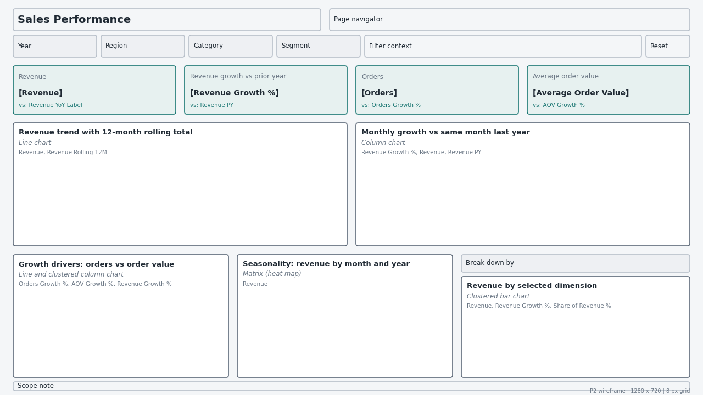
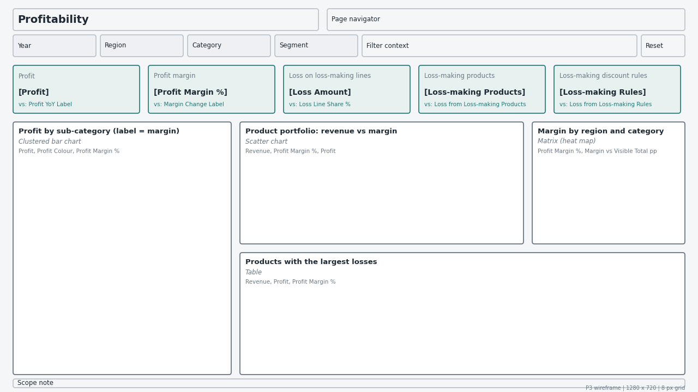
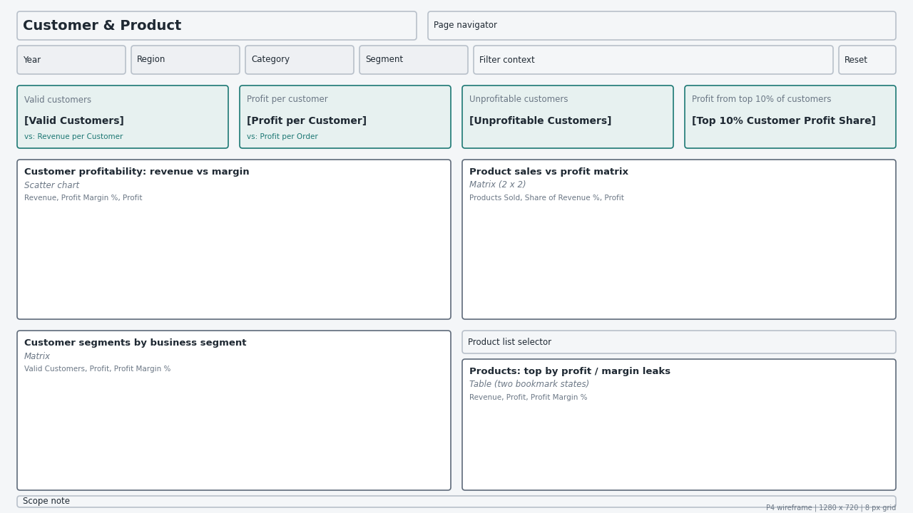
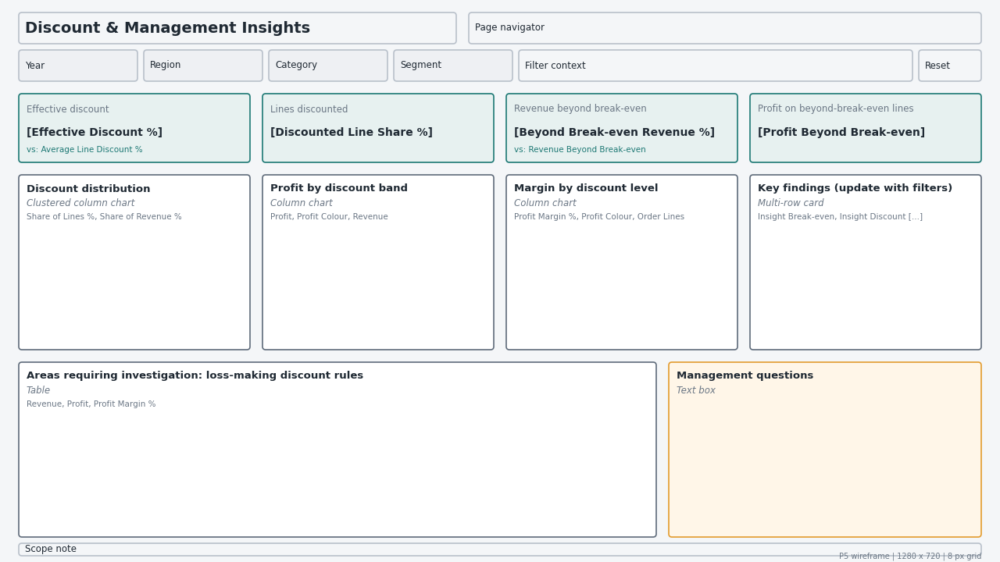

# Power BI Dashboard Specification — Sales & Profitability Intelligence System
_Generated by `scripts/run_phase8_dashboard.py` from `src/spis/dashboard_spec.py` (single source of truth). Edit the spec module, not this document._

**Layout and reference checks:** 386/386 passed (visuals inside the canvas, on the 8 px grid, no overlaps, every measure in the DAX library, every field in the model).

## 1. Design principles
1. **One question per page.** The page title states it; every visual must help answer it.
2. **Decision before decoration.** No pie, donut, gauge, 3-D or map visuals; no dual axes; no visual without a stated purpose.
3. **Uncluttered.** At most 10 data visuals per page (the busiest page has 6), plus KPI cards.
4. **Every KPI has a comparison.** Cards show the value and the change versus the prior year.
5. **Colour has meaning.** Teal = profit or above hurdle; red = loss or below hurdle; slate = neutral; amber = highlight. Colour is never decorative.
6. **Rankings state their metric.** Every top/bottom list says what it is ranked by (absolute profit, loss amount, margin).
7. **No causal language.** Dynamic findings describe; management questions ask. The scope note is visible on every page.

## 2. Data model setup
**Source:** the star-schema CSVs in `data/model/` (or the SQLite warehouse via ODBC). Import mode.

| Step | Action |
|---|---|
| 1 | Load `fct_sales`, `dim_date`, `dim_customer`, `dim_product`, `dim_location`, `dim_ship_mode`, `dim_discount`, `ref_product_portfolio`, `ref_customer_profitability` |
| 2 | Power Query: merge `ref_product_portfolio` into `dim_product` and `ref_customer_profitability` into `dim_customer` (left outer join on the key); expand the new columns; disable load of the two `ref_` queries |
| 3 | Relationships: one-to-many, single direction, dimension -> fact, as in `docs/data_model.md`. `dim_date[date_key]` -> `fct_sales[order_date_key]` active; -> `ship_date_key` inactive |
| 4 | Mark `dim_date` as the date table (`dim_date[date]`) |
| 5 | Sort by column: `month_name`/`month_short` by `month`; `discount_label` by `discount_key`; `discount_band` by `discount_band_sort`; `portfolio_label` by `portfolio_quadrant`; `profitability_label` by `profitability_segment` |
| 6 | Hide every `*_key` column, all `dq_*` flags and raw measures columns (users work only with measures and dimension attributes) |
| 7 | Create a blank `_Measures` table and paste the measures from `powerbi/dax_measures.dax`, using its display folders |
| 8 | Create the field parameter `Sales Breakdown` (definition at the end of the DAX file) |
| 9 | Report-level filter: fct_sales[is_core_scope] = 1 (report level, locked and hidden): US lines, suspected copies excluded |
| 10 | Apply the theme `powerbi/spis_theme.json` (View > Themes > Browse) |

Power Query merge (M) for the product classification:

```m
let
    Source = dim_product,
    Merged = Table.NestedJoin(Source, {"product_key"}, ref_product_portfolio, {"product_key"}, "ref", JoinKind.LeftOuter),
    Expanded = Table.ExpandTableColumn(Merged, "ref", {"portfolio_quadrant", "portfolio_label", "revenue_tier", "margin_tier"})
in
    Expanded
```

The classification columns are a **2023-2026 classification** (product revenue cut 339, margin hurdle 12.5%; Phases 5 and 7). They do not change with the year slicer; visuals that use them say so in their subtitle.

## 3. Design system
| Element | Specification |
|---|---|
| Canvas | 1280 x 720 (16:9), page background #F4F6F8 |
| Grid | 8 px; outer margin 24 px; 16 px between visuals |
| Bands | Header y=16 (40 px) - filter bar y=64 (40 px) - KPI row y=120 (88 px) - row A y=224 - row B y=464 (each 224 px) - footer y=696 |
| Typography | Segoe UI; titles Semibold 11 pt; KPI callouts Semibold 24-28 pt; labels 9 pt #6B7785 |
| Colours | profit `#1D7874`, loss `#C0392B`, neutral `#5F6B7A`, accent `#E39B2D`, muted `#B8C0CA`, page `#F4F6F8`, card `#FFFFFF`, text `#1F2933`, subtle `#6B7785` |
| Visual containers | White, no border, no shadow, 8/12 px padding, left-aligned titles |
| Slicers | Year, Region, Category, Segment in the filter bar of every page, synced across all five pages (View > Sync slicers) |
| Interactions | Cross-filter (not cross-highlight) between charts; KPI cards and the context card are not filtered by other visuals' selections, only by slicers |
| Accessibility | Alt text on every visual (its purpose), tab order top-left to bottom-right, colour never the only signal (labels and signs accompany red/teal) |

## Page 1 — Executive Overview
**Question:** How is the business performing, and is growth profitable?  
**Business purpose:** One-screen answer for senior management: the size and direction of the business, whether profit keeps pace with revenue, and which categories and regions drive the result. Every KPI is shown against the prior year.


**Layout** (pixels, top-left origin)

| id | visual | type | x | y | w | h |
|---|---|---|---|---|---|---|
| k_rev | Revenue | Card (new card visual) | 24 | 120 | 168 | 88 |
| k_profit | Profit | Card (new card visual) | 200 | 120 | 168 | 88 |
| k_margin | Profit margin | Card (new card visual) | 376 | 120 | 168 | 88 |
| k_orders | Orders | Card (new card visual) | 552 | 120 | 168 | 88 |
| k_cust | Customers | Card (new card visual) | 728 | 120 | 168 | 88 |
| k_units | Units sold | Card (new card visual) | 904 | 120 | 168 | 88 |
| k_aov | Average order value | Card (new card visual) | 1080 | 120 | 168 | 88 |
| v_rev_trend | Revenue trend: this year vs prior year | Line chart | 24 | 224 | 608 | 224 |
| v_profit_trend | Profit trend by month | Column chart | 648 | 224 | 608 | 224 |
| v_cat | Category performance | Matrix | 24 | 464 | 608 | 224 |
| v_region | Region performance: profit (label = margin) | Clustered bar chart | 648 | 464 | 608 | 224 |

**KPI cards**

| Card | Callout measure | Comparison (reference label) |
|---|---|---|
| Revenue | `Revenue` | `Revenue YoY Label` |
| Profit | `Profit` | `Profit YoY Label` |
| Profit margin | `Profit Margin %` | `Margin Change Label` |
| Orders | `Orders` | `Orders Growth %` |
| Customers | `Customers` | `Customers Growth %` |
| Units sold | `Units Sold` | `Units Growth %` |
| Average order value | `Average Order Value` | `AOV Growth %` |

**Visuals**

**v_rev_trend — Revenue trend: this year vs prior year**
- *Visual type:* Line chart
- *Fields:* `dim_date[month_start_date] (X, continuous)`
- *Measures:* `Revenue`, `Revenue PY`, `Revenue Growth %`
- *Filters:* page slicers + report scope filter
- *Formatting:* Revenue solid #1D7874; Revenue PY dashed #B8C0CA; Revenue Growth % in tooltip only; no markers; display units K
- *Business purpose:* Shows whether revenue is growing and how seasonal it is.

**v_profit_trend — Profit trend by month**
- *Visual type:* Column chart
- *Fields:* `dim_date[month_start_date] (X)`
- *Measures:* `Profit`, `Profit Colour`, `Profit Margin Rolling 12M`
- *Filters:* page slicers + report scope filter
- *Formatting:* Column colour = field value [Profit Colour] (red for loss months); [Profit Margin Rolling 12M] in tooltip
- *Business purpose:* Shows whether profit follows revenue, and flags loss-making months.

**v_cat — Category performance**
- *Visual type:* Matrix
- *Fields:* `dim_product[category] (rows)`
- *Measures:* `Revenue`, `Share of Revenue %`, `Profit`, `Share of Profit %`, `Profit Margin %`, `Revenue Growth %`, `Margin Colour`
- *Filters:* page slicers + report scope filter
- *Formatting:* Data bars on Revenue; font colour of Profit Margin % = [Margin Colour]; stepped layout off; totals row on; Revenue Growth % shows only when one year is selected
- *Business purpose:* Exposes the gap between where revenue is earned and where profit is earned (Furniture).

**v_region — Region performance: profit (label = margin)**
- *Visual type:* Clustered bar chart
- *Fields:* `dim_location[region] (Y)`; `dim_location[regional_manager] (tooltip)`
- *Measures:* `Profit`, `Profit Colour`, `Profit Margin %`, `Effective Discount %`, `Revenue`
- *Filters:* page slicers + report scope filter
- *Formatting:* Sorted by Profit descending; bar colour [Profit Colour]; data label = [Profit Margin %] (custom label); tooltip shows manager, revenue and effective discount
- *Business purpose:* Compares regions on profit and margin; the discount in the tooltip prevents misreading a discount-driven gap as a management gap.

**Filters on this page:** synced slicers (Year, Region, Category, Segment); report scope filter; visual-level filters as listed above.

**DAX measures required on this page:** `Report Context Title`, `Data Scope Note`, `Revenue`, `Revenue YoY Label`, `Profit`, `Profit YoY Label`, `Profit Margin %`, `Margin Change Label`, `Orders`, `Orders Growth %`, `Customers`, `Customers Growth %`, `Units Sold`, `Units Growth %`, `Average Order Value`, `AOV Growth %`, `Revenue PY`, `Revenue Growth %`, `Profit Colour`, `Profit Margin Rolling 12M`, `Share of Revenue %`, `Share of Profit %`, `Margin Colour`, `Effective Discount %`

## Page 2 — Sales Performance
**Question:** Where is revenue growth coming from?  
**Business purpose:** Explains revenue growth: the trend, growth against the same month last year, whether growth comes from more orders or larger orders, the seasonal pattern, and the breakdown by category, sub-category, segment or region (user-selectable).



**Layout** (pixels, top-left origin)

| id | visual | type | x | y | w | h |
|---|---|---|---|---|---|---|
| k2_rev | Revenue | Card (new card visual) | 24 | 120 | 296 | 88 |
| k2_growth | Revenue growth vs prior year | Card (new card visual) | 336 | 120 | 296 | 88 |
| k2_orders | Orders | Card (new card visual) | 648 | 120 | 296 | 88 |
| k2_aov | Average order value | Card (new card visual) | 960 | 120 | 296 | 88 |
| v2_trend | Revenue trend with 12-month rolling total | Line chart | 24 | 224 | 608 | 224 |
| v2_yoy | Monthly growth vs same month last year | Column chart | 648 | 224 | 608 | 224 |
| v2_decomp | Growth drivers: orders vs order value | Line and clustered column chart | 24 | 464 | 392 | 224 |
| v2_season | Seasonality: revenue by month and year | Matrix (heat map) | 432 | 464 | 392 | 224 |
| v2_breakdown_sel | Break down by | Slicer (buttons, single select) | 840 | 464 | 416 | 32 |
| v2_breakdown | Revenue by selected dimension | Clustered bar chart | 840 | 504 | 416 | 184 |

**KPI cards**

| Card | Callout measure | Comparison (reference label) |
|---|---|---|
| Revenue | `Revenue` | `Revenue YoY Label` |
| Revenue growth vs prior year | `Revenue Growth %` | `Revenue PY` |
| Orders | `Orders` | `Orders Growth %` |
| Average order value | `Average Order Value` | `AOV Growth %` |

**Visuals**

**v2_trend — Revenue trend with 12-month rolling total**
- *Visual type:* Line chart
- *Fields:* `dim_date[month_start_date] (X)`
- *Measures:* `Revenue`, `Revenue Rolling 12M`
- *Filters:* page slicers + report scope filter
- *Formatting:* Revenue line #1D7874 with markers off; [Revenue Rolling 12M] in the tooltip (it is on a different scale, so it is not plotted on the same axis)
- *Business purpose:* Separates the underlying trend from monthly noise.

**v2_yoy — Monthly growth vs same month last year**
- *Visual type:* Column chart
- *Fields:* `dim_date[month_start_date] (X)`
- *Measures:* `Revenue Growth %`, `Revenue`, `Revenue PY`
- *Filters:* page slicers + report scope filter
- *Formatting:* Conditional colour: growth >= 0 #1D7874, < 0 #C0392B; zero line visible; first year is blank by design
- *Business purpose:* Same-month comparison removes seasonality, which month-on-month comparison would not.

**v2_decomp — Growth drivers: orders vs order value**
- *Visual type:* Line and clustered column chart
- *Fields:* `dim_date[year] (X)`
- *Measures:* `Orders Growth %`, `AOV Growth %`, `Revenue Growth %`
- *Filters:* page slicers + report scope filter
- *Formatting:* Columns: Orders Growth % #1D7874, AOV Growth % #E39B2D; line: Revenue Growth % #1F2933; all on ONE % axis
- *Business purpose:* Shows whether growth comes from winning more orders or from larger orders (Phase 4, A1).

**v2_season — Seasonality: revenue by month and year**
- *Visual type:* Matrix (heat map)
- *Fields:* `dim_date[year] (rows)`; `dim_date[month_short] (columns, sorted by month)`
- *Measures:* `Revenue`
- *Filters:* page slicers + report scope filter
- *Formatting:* Background colour scale white to #1D7874; display units K; no totals on columns
- *Business purpose:* Makes the September/November/December peak and stability across years visible at a glance.

**v2_breakdown_sel — Break down by**
- *Visual type:* Slicer (buttons, single select)
- *Fields:* `Sales Breakdown (field parameter)`
- *Filters:* page slicers + report scope filter
- *Formatting:* Horizontal tiles: Category | Sub-category | Segment | Region

**v2_breakdown — Revenue by selected dimension**
- *Visual type:* Clustered bar chart
- *Fields:* `Sales Breakdown (Y axis)`
- *Measures:* `Revenue`, `Revenue Growth %`, `Share of Revenue %`
- *Filters:* page slicers + report scope filter
- *Formatting:* Sorted by Revenue; data label = [Revenue Growth %] (custom label); tooltip Share of Revenue %
- *Business purpose:* One visual answers category, sub-category, segment and region questions without four separate charts.

**Filters on this page:** synced slicers (Year, Region, Category, Segment); report scope filter; visual-level filters as listed above.

**DAX measures required on this page:** `Report Context Title`, `Data Scope Note`, `Revenue`, `Revenue YoY Label`, `Revenue Growth %`, `Revenue PY`, `Orders`, `Orders Growth %`, `Average Order Value`, `AOV Growth %`, `Revenue Rolling 12M`, `Share of Revenue %`

## Page 3 — Profitability
**Question:** Where is profit made, and where is it destroyed?  
**Business purpose:** Locates profit and losses: sub-categories that create or destroy profit, the product portfolio (high-sales/low-margin products), margins by region and category, and the products with the largest losses.



**Layout** (pixels, top-left origin)

| id | visual | type | x | y | w | h |
|---|---|---|---|---|---|---|
| k3_profit | Profit | Card (new card visual) | 24 | 120 | 232 | 88 |
| k3_margin | Profit margin | Card (new card visual) | 272 | 120 | 232 | 88 |
| k3_loss | Loss on loss-making lines | Card (new card visual) | 520 | 120 | 232 | 88 |
| k3_lossprod | Loss-making products | Card (new card visual) | 768 | 120 | 232 | 88 |
| k3_rules | Loss-making discount rules | Card (new card visual) | 1016 | 120 | 232 | 88 |
| v3_subcat | Profit by sub-category (label = margin) | Clustered bar chart | 24 | 224 | 400 | 464 |
| v3_scatter | Product portfolio: revenue vs margin | Scatter chart | 440 | 224 | 520 | 224 |
| v3_regcat | Margin by region and category | Matrix (heat map) | 976 | 224 | 280 | 224 |
| v3_negprod | Products with the largest losses | Table | 440 | 464 | 816 | 224 |

**KPI cards**

| Card | Callout measure | Comparison (reference label) |
|---|---|---|
| Profit | `Profit` | `Profit YoY Label` |
| Profit margin | `Profit Margin %` | `Margin Change Label` |
| Loss on loss-making lines | `Loss Amount` | `Loss Line Share %` |
| Loss-making products | `Loss-making Products` | `Loss from Loss-making Products` |
| Loss-making discount rules | `Loss-making Rules` | `Loss from Loss-making Rules` |

**Visuals**

**v3_subcat — Profit by sub-category (label = margin)**
- *Visual type:* Clustered bar chart
- *Fields:* `dim_product[sub_category] (Y)`; `dim_product[category] (tooltip)`
- *Measures:* `Profit`, `Profit Colour`, `Profit Margin %`, `Loss Amount`
- *Filters:* page slicers + report scope filter
- *Formatting:* Sorted by Profit descending so losses sit at the bottom; colour [Profit Colour]; data label [Profit Margin %]; tooltip adds category and Loss Amount (losses hidden inside positive totals)
- *Business purpose:* Shows which sub-categories create profit and which destroy it (Tables, Bookcases, Supplies).

**v3_scatter — Product portfolio: revenue vs margin**
- *Visual type:* Scatter chart
- *Fields:* `dim_product[product_label] (values)`; `dim_product[portfolio_label] (legend)`
- *Measures:* `Revenue`, `Profit Margin %`, `Profit`, `Effective Discount %`, `Order Lines`, `Portfolio Margin %`
- *Filters:* Visual: [Order Lines] >= 3 (evidence rule, Phase 5)
- *Formatting:* X = Revenue (log scale), Y = Profit Margin %; legend colours Q1 #1D7874, Q2 #C0392B, Q3 #4C8BD6, Q4 #E39B2D; Analytics: Y constant line = [Portfolio Margin %] (fx), X median line; tooltip Profit, discount, lines
- *Business purpose:* Identifies high-sales/low-margin products (margin leaks) and low-sales/high-margin products.

**v3_regcat — Margin by region and category**
- *Visual type:* Matrix (heat map)
- *Fields:* `dim_location[region] (rows)`; `dim_product[category] (columns)`
- *Measures:* `Profit Margin %`, `Margin vs Visible Total pp`
- *Filters:* page slicers + report scope filter
- *Formatting:* Background colour = diverging scale on [Margin vs Visible Total pp]: red below the visible total, white at 0, teal above
- *Business purpose:* Shows whether weak margins are regional, category-driven or both.

**v3_negprod — Products with the largest losses**
- *Visual type:* Table
- *Fields:* `dim_product[product_label]`; `dim_product[sub_category]`; `dim_product[portfolio_label]`
- *Measures:* `Revenue`, `Profit`, `Profit Margin %`, `Effective Discount %`, `Order Lines`
- *Filters:* Visual: [Profit] < 0; Visual: Top N = 15 products by Profit, ascending (largest loss first)
- *Formatting:* Red data bars on Profit; Effective Discount % >= 30% in red font; column header states 'ranked by loss amount'
- *Business purpose:* The product-level investigation list, ranked by loss amount (stated on the visual).

**Filters on this page:** synced slicers (Year, Region, Category, Segment); report scope filter; visual-level filters as listed above.

**DAX measures required on this page:** `Report Context Title`, `Data Scope Note`, `Profit`, `Profit YoY Label`, `Profit Margin %`, `Margin Change Label`, `Loss Amount`, `Loss Line Share %`, `Loss-making Products`, `Loss from Loss-making Products`, `Loss-making Rules`, `Loss from Loss-making Rules`, `Profit Colour`, `Revenue`, `Effective Discount %`, `Order Lines`, `Portfolio Margin %`, `Margin vs Visible Total pp`

## Page 4 — Customer & Product
**Question:** Which customers and products create profit, and which dilute it?  
**Business purpose:** Applies the same revenue x margin framework to customers and products. Left half: customer profitability segments and their composition by business segment. Right half: the product sales-vs-profit matrix and switchable product lists.



**Layout** (pixels, top-left origin)

| id | visual | type | x | y | w | h |
|---|---|---|---|---|---|---|
| k4_cust | Valid customers | Card (new card visual) | 24 | 120 | 296 | 88 |
| k4_ppc | Profit per customer | Card (new card visual) | 336 | 120 | 296 | 88 |
| k4_unprof | Unprofitable customers | Card (new card visual) | 648 | 120 | 296 | 88 |
| k4_top10 | Profit from top 10% of customers | Card (new card visual) | 960 | 120 | 296 | 88 |
| v4_cust_scatter | Customer profitability: revenue vs margin | Scatter chart | 24 | 224 | 608 | 224 |
| v4_cust_matrix | Customer segments by business segment | Matrix | 24 | 464 | 608 | 224 |
| v4_matrix2x2 | Product sales vs profit matrix | Matrix (2 x 2) | 648 | 224 | 608 | 224 |
| v4_toggle | Product list selector | Buttons (bookmarks) | 648 | 464 | 608 | 32 |
| v4_prodtable | Products: top by profit / margin leaks | Table (two bookmark states) | 648 | 504 | 608 | 184 |

**KPI cards**

| Card | Callout measure | Comparison (reference label) |
|---|---|---|
| Valid customers | `Valid Customers` | `Revenue per Customer` |
| Profit per customer | `Profit per Customer` | `Profit per Order` |
| Unprofitable customers | `Unprofitable Customers` | - |
| Profit from top 10% of customers | `Top 10% Customer Profit Share` | - |

**Visuals**

**v4_cust_scatter — Customer profitability: revenue vs margin**
- *Visual type:* Scatter chart
- *Fields:* `dim_customer[customer_id] (values)`; `dim_customer[profitability_label] (legend)`; `dim_customer[customer_name] (tooltip)`; `dim_customer[segment] (tooltip)`
- *Measures:* `Revenue`, `Profit Margin %`, `Profit`, `Orders`, `Beyond Break-even Revenue %`, `Portfolio Margin %`
- *Filters:* Visual: dim_customer[is_excluded_from_customer_analysis] = 0
- *Formatting:* X = Revenue (log), Y = Profit Margin %; Y constant line [Portfolio Margin %]; legend C1-C4 + Limited history
- *Business purpose:* Shows high-revenue/high-profit, high-revenue/low-profit, low-revenue/high-margin and low-value customers.

**v4_cust_matrix — Customer segments by business segment**
- *Visual type:* Matrix
- *Fields:* `dim_customer[profitability_label] (rows, sorted by code)`; `dim_customer[segment] (columns)`
- *Measures:* `Valid Customers`, `Profit`, `Profit Margin %`
- *Filters:* Visual: dim_customer[is_excluded_from_customer_analysis] = 0
- *Formatting:* Profit with red/teal font via [Profit Colour]; subtitle: 'Segments describe 2023-2026 and are not stable over time (Phase 7)'
- *Business purpose:* Sizes each profitability segment and shows that business segment does not explain profitability.

**v4_matrix2x2 — Product sales vs profit matrix**
- *Visual type:* Matrix (2 x 2)
- *Fields:* `dim_product[revenue_tier] (rows: High, Low)`; `dim_product[margin_tier] (columns: Above hurdle, Below hurdle)`
- *Measures:* `Products Sold`, `Share of Revenue %`, `Profit`
- *Filters:* page slicers + report scope filter
- *Formatting:* Cell background on Profit: teal positive, red negative; large font; tiers are the 2023-2026 classification
- *Business purpose:* The four product quadrants in one compact grid: how much revenue and profit each holds.

**v4_prodtable — Products: top by profit / margin leaks**
- *Visual type:* Table (two bookmark states)
- *Fields:* `dim_product[product_label]`; `dim_product[sub_category]`
- *Measures:* `Revenue`, `Profit`, `Profit Margin %`, `Effective Discount %`, `Product Profit Rank`
- *Filters:* State A: Top N = 10 by Profit (ranked by absolute profit); State B: dim_product[portfolio_quadrant] = 'Q2', Top N = 15 by Profit ascending
- *Formatting:* Data bars on Profit; title changes with the bookmark and states the ranking metric
- *Business purpose:* Lists the products to protect and the high-revenue products that leak margin.

**Filters on this page:** synced slicers (Year, Region, Category, Segment); report scope filter; visual-level filters as listed above.

**DAX measures required on this page:** `Report Context Title`, `Data Scope Note`, `Valid Customers`, `Revenue per Customer`, `Profit per Customer`, `Profit per Order`, `Unprofitable Customers`, `Top 10% Customer Profit Share`, `Revenue`, `Profit Margin %`, `Profit`, `Orders`, `Beyond Break-even Revenue %`, `Portfolio Margin %`, `Products Sold`, `Share of Revenue %`, `Effective Discount %`, `Product Profit Rank`

## Page 5 — Discount & Management Insights
**Question:** Is discounting eroding profit, and what should management investigate?  
**Business purpose:** Connects discounting to profit and turns the analysis into action: the discount distribution, profit and margin by discount, dynamic key findings, the loss-making discount rules to investigate, and the open management questions.



**Layout** (pixels, top-left origin)

| id | visual | type | x | y | w | h |
|---|---|---|---|---|---|---|
| k5_eff | Effective discount | Card (new card visual) | 24 | 120 | 296 | 88 |
| k5_share | Lines discounted | Card (new card visual) | 336 | 120 | 296 | 88 |
| k5_bbe | Revenue beyond break-even | Card (new card visual) | 648 | 120 | 296 | 88 |
| k5_bbe_profit | Profit on beyond-break-even lines | Card (new card visual) | 960 | 120 | 296 | 88 |
| v5_dist | Discount distribution | Clustered column chart | 24 | 224 | 296 | 224 |
| v5_profit | Profit by discount band | Column chart | 336 | 224 | 296 | 224 |
| v5_margin | Margin by discount level | Column chart | 648 | 224 | 296 | 224 |
| v5_findings | Key findings (update with filters) | Multi-row card | 960 | 224 | 296 | 224 |
| v5_investigate | Areas requiring investigation: loss-making discount rules | Table | 24 | 464 | 816 | 224 |
| v5_questions | Management questions | Text box | 856 | 464 | 400 | 224 |

**KPI cards**

| Card | Callout measure | Comparison (reference label) |
|---|---|---|
| Effective discount | `Effective Discount %` | `Average Line Discount %` |
| Lines discounted | `Discounted Line Share %` | - |
| Revenue beyond break-even | `Beyond Break-even Revenue %` | `Revenue Beyond Break-even` |
| Profit on beyond-break-even lines | `Profit Beyond Break-even` | - |

**Visuals**

**v5_dist — Discount distribution**
- *Visual type:* Clustered column chart
- *Fields:* `dim_discount[discount_label] (X, sorted by discount_key)`
- *Measures:* `Share of Lines %`, `Share of Revenue %`
- *Filters:* page slicers + report scope filter
- *Formatting:* Lines #B8C0CA, revenue #5F6B7A; no legend title
- *Business purpose:* How common each discount level is, by lines and by revenue.

**v5_profit — Profit by discount band**
- *Visual type:* Column chart
- *Fields:* `dim_discount[discount_band] (X, sorted by discount_band_sort)`
- *Measures:* `Profit`, `Profit Colour`, `Revenue`, `Order Lines`, `Loss Line Share %`
- *Filters:* page slicers + report scope filter
- *Formatting:* Colour [Profit Colour]; tooltip revenue, lines and loss-line share
- *Business purpose:* Discount vs profit: every band above 20% is loss-making in total.

**v5_margin — Margin by discount level**
- *Visual type:* Column chart
- *Fields:* `dim_discount[discount_label] (X, sorted by discount_key)`
- *Measures:* `Profit Margin %`, `Profit Colour`, `Order Lines`
- *Filters:* page slicers + report scope filter
- *Formatting:* Colour [Profit Colour] (red = negative margin; same sign as profit); zero line; tooltip shows lines so thin levels are visible
- *Business purpose:* Discount vs margin, at the exact levels used in pricing rules.

**v5_findings — Key findings (update with filters)**
- *Visual type:* Multi-row card
- *Measures:* `Insight Break-even`, `Insight Discount Margin`, `Insight Customer Concentration`, `Insight Loss Rules`
- *Filters:* page slicers + report scope filter
- *Formatting:* Four rows, 10 pt, left accent bar #E39B2D; descriptive statements only, no causal wording
- *Business purpose:* Plain-language findings that recalculate for any filter selection.

**v5_investigate — Areas requiring investigation: loss-making discount rules**
- *Visual type:* Table
- *Fields:* `dim_location[state_province]`; `dim_product[sub_category]`; `dim_discount[discount_label]`
- *Measures:* `Revenue`, `Profit`, `Profit Margin %`, `Order Lines`
- *Filters:* Visual: [Profit] < 0; Visual: Top N = 12 state x sub-category rows by Profit, ascending
- *Formatting:* Red data bars on Profit; header note 'ranked by loss amount; a rule = one state x sub-category, one discount'
- *Business purpose:* The concrete pricing rules behind most losses (Phase 5 priority list).

**v5_questions — Management questions**
- *Visual type:* Text box
- *Filters:* page slicers + report scope filter
- *Formatting:* Static, reviewed each quarter; each question cites the finding behind it
- *Business purpose:* Keeps the dashboard focused on decisions that the data cannot make on its own.
- *Content:*
  - Who sets the discount rule for each state and sub-category, and why do some states never sell at full price? (Phase 4, F3)
  - Should any discount above a product's list margin require approval? (Phase 6)
  - What volume would we expect to lose if the rules above 40% were removed? Can we pilot this in a few states? (Phase 6)
  - Why are Furniture margins thin even at full price: list price, purchase cost or freight? (Phase 4, B1)

**Filters on this page:** synced slicers (Year, Region, Category, Segment); report scope filter; visual-level filters as listed above.

**DAX measures required on this page:** `Report Context Title`, `Data Scope Note`, `Effective Discount %`, `Average Line Discount %`, `Discounted Line Share %`, `Beyond Break-even Revenue %`, `Revenue Beyond Break-even`, `Profit Beyond Break-even`, `Share of Lines %`, `Share of Revenue %`, `Profit`, `Profit Colour`, `Revenue`, `Order Lines`, `Loss Line Share %`, `Profit Margin %`, `Insight Break-even`, `Insight Discount Margin`, `Insight Customer Concentration`, `Insight Loss Rules`

## 9. Measure catalogue
All measures are defined in `powerbi/dax_measures.dax`. Measures used by the dashboard:

| measure | folder | format | note |
|---|---|---|---|
| Customers | 1 Base | #,0 | Total customers with at least one order line in the filter context. |
| Order Lines | 1 Base | #,0 | Number of order lines (the grain of the fact table). |
| Orders | 1 Base | #,0 | Total orders: distinct order IDs (one order has several lines). |
| Profit | 1 Base | #,0 | Total profit as recorded in the source. |
| Revenue | 1 Base | #,0 | Total sales: net revenue after discount (A1), before returns (A3). |
| Units Sold | 1 Base | #,0 | Total quantity. |
| Valid Customers | 1 Base | #,0 | Customers excluding placeholder and identity-anomaly records (DQ05, DQ06). |
| Average Line Discount % | 2 Ratios | 0.0% | Average discount (secondary): simple mean of line discount rates. |
| Average Order Value | 2 Ratios | #,0.00 | Revenue per distinct order. |
| Discounted Line Share % | 2 Ratios | 0.0% | Share of order lines sold with any discount. |
| Effective Discount % | 2 Ratios | 0.0% | Average discount (primary): share of list value given away. |
| Profit Margin % | 2 Ratios | 0.0% | Profit as a share of revenue (ratio of sums). |
| Profit per Customer | 2 Ratios | #,0.00 | Profit of valid customers / number of valid customers (same population). |
| Profit per Order | 2 Ratios | #,0.00 | Average profit earned per order. |
| Revenue per Customer | 2 Ratios | #,0 | Revenue of valid customers / number of valid customers. |
| Share of Lines % | 2 Ratios | 0.0% | Share of the visible order lines. |
| Share of Profit % | 2 Ratios | 0.0% | Share of the visible profit total. |
| Share of Revenue % | 2 Ratios | 0.0% | Share of the total currently visible (after slicers). |
| AOV Growth % | 3 Time Intelligence | 0.0% | Change in AOV vs the same period last year. |
| Customers Growth % | 3 Time Intelligence | 0.0% | Change in active customers vs the same period last year. |
| Orders Growth % | 3 Time Intelligence | 0.0% | Change in orders vs the same period last year. |
| Profit Margin Rolling 12M | 3 Time Intelligence | 0.0% | 12-month margin; smooths monthly volatility. |
| Revenue Growth % | 3 Time Intelligence | 0.0% | Sales growth / YoY sales growth: change vs the same period last year. |
| Revenue PY | 3 Time Intelligence | #,0 | Revenue in the same period one year earlier. |
| Revenue Rolling 12M | 3 Time Intelligence | #,0 | Revenue of the 12 months ending at the current point. |
| Units Growth % | 3 Time Intelligence | 0.0% | Change in units vs the same period last year. |
| Beyond Break-even Revenue % | 4 Losses & break-even | 0.0% | Share of revenue sold beyond break-even. |
| Loss Amount | 4 Losses & break-even | #,0 | Sum of negative line profits (a negative number). |
| Loss Line Share % | 4 Losses & break-even | 0.0% | Share of order lines that lose money. |
| Margin vs Visible Total pp | 4 Losses & break-even | +0.0%;-0.0% | Heat maps: each cell vs the visible total. |
| Portfolio Margin % | 4 Losses & break-even | 0.0% | Hurdle: margin of all products and customers under the date and region filters. |
| Profit Beyond Break-even | 4 Losses & break-even | #,0 | Profit on those lines (always <= 0). |
| Revenue Beyond Break-even | 4 Losses & break-even | #,0 | Revenue on lines discounted beyond the product's list margin (Phase 6). |
| Loss from Loss-making Products | 5 Products, customers & rules | #,0 | Combined profit of those products. |
| Loss from Loss-making Rules | 5 Products, customers & rules | #,0 | Combined profit of those rules. |
| Loss-making Products | 5 Products, customers & rules | #,0 | Products with negative profit in the filter context. |
| Loss-making Rules | 5 Products, customers & rules | #,0 | State x sub-category discount rules with negative profit. |
| Product Profit Rank | 5 Products, customers & rules | 0 | Rank by absolute profit among visible products. |
| Products Sold | 5 Products, customers & rules | #,0 | Distinct products sold. |
| Top 10% Customer Profit Share | 5 Products, customers & rules | 0.0% | Share of customer profit earned by the top 10% of customers. |
| Unprofitable Customers | 5 Products, customers & rules | #,0 | Valid customers with negative profit. |
| Data Scope Note | 6 Formatting & labels | footer card on every page. |  |
| Margin Change Label | 6 Formatting & labels | KPI card reference label. |  |
| Margin Colour | 6 Formatting & labels | conditional formatting - red when below the portfolio margin hurdle. |  |
| Profit Colour | 6 Formatting & labels | conditional formatting (field value) - red for loss, teal for profit. |  |
| Profit YoY Label | 6 Formatting & labels | KPI card reference label (falls back to the absolute change when % growth is undefined). |  |
| Report Context Title | 6 Formatting & labels | filter-context card in the header. |  |
| Revenue YoY Label | 6 Formatting & labels | KPI card reference label. |  |
| Insight Break-even | 7 Insight text | key findings card (page 5). |  |
| Insight Customer Concentration | 7 Insight text | key findings card (page 5). |  |
| Insight Discount Margin | 7 Insight text | key findings card (page 5). |  |
| Insight Loss Rules | 7 Insight text | key findings card (page 5). |  |

Key DAX patterns (full definitions in the library):

```dax
Profit Margin % = DIVIDE ( [Profit], [Revenue] )                      -- ratio of sums, never an average of ratios
Revenue Growth % = IF ( NOT ISBLANK ( [Revenue] ) && [Revenue PY] > 0, DIVIDE ( [Revenue] - [Revenue PY], [Revenue PY] ) )
Profit Growth %  = blank when prior-year profit <= 0 (a % change from a negative base is misleading)
Beyond Break-even Revenue % = DIVIDE ( CALCULATE ( [Revenue], fct_sales[is_beyond_break_even] = 1 ), [Revenue] )
Loss-making Rules = COUNTROWS ( FILTER ( SUMMARIZE ( fct_sales, dim_location[state_province], dim_product[sub_category] ), [Profit] < 0 ) )
```

## 10. Bookmarks and navigation
| bookmark | page | behaviour |
|---|---|---|
| Reset filters | All pages | Clears slicers to 'All'; data, display and current page off so it only resets filters |
| P4 - Top products | Customer & Product | Shows product table state A; selected button highlighted |
| P4 - Margin leaks | Customer & Product | Shows product table state B; selected button highlighted |

Navigation uses the page navigator in the header; the native page tabs are hidden in the published app.

## 11. Acceptance tests
After building, each KPI card must show the value below (core scope). These come from the Python/SQL pipeline, so a match proves the DAX is correct. Compare at the stated filter.

| measure | filter | expected |
|---|---|---|
| Revenue | All years | 2,296,919 |
| Profit | All years | 286,409 |
| Profit Margin % | All years | 12.5% |
| Orders | All years | 5,009 |
| Customers | All years | 793 |
| Units Sold | All years | 37,871 |
| Average Order Value | All years | 458.56 |
| Valid Customers | All years | 792 |
| Profit per Customer | All years | 360.35 |
| Unprofitable Customers | All years | 155 |
| Top 10% Customer Profit Share | All years | 57.9% |
| Loss Amount | All years | -156,119 |
| Loss-making Products | All years | 306 |
| Loss-making Rules | All years | 79 |
| Loss from Loss-making Rules | All years | -145,722 |
| Effective Discount % | All years | 19.8% |
| Discounted Line Share % | All years | 52.0% |
| Beyond Break-even Revenue % | All years | 20.4% |
| Profit Beyond Break-even | All years | -156,119 |
| Revenue | Year = 2026 | 733,215 |
| Profit | Year = 2026 | 93,439 |
| Profit Margin % | Year = 2026 | 12.7% |
| Orders | Year = 2026 | 1,687 |
| Average Order Value | Year = 2026 | 434.63 |
| Revenue Growth % | Year = 2026 | 20.4% |
| Profit Growth % | Year = 2026 | 14.2% |
| Margin Change pp | Year = 2026 | -0.7 pp |
| Orders Growth % | Year = 2026 | 28.3% |
| AOV Growth % | Year = 2026 | -6.2% |

## 12. Deliberately not shown
| element | reason |
|---|---|
| Pie, donut, gauge, 3-D and map visuals | Harder to compare than bars; four regions do not need a map |
| Dual-axis charts | Two scales invite false comparisons; related % measures share one axis instead |
| Customer lifetime value, churn, forecast | Not supported by the data (left-censored history, no costs, synthetic years) |
| Causal 'impact of discount' figures | No variation within rules or over time; the dashboard shows associations only |
| Returns netted from profit | Returns are recorded per order only |

## 13. Build checklist
- [ ] Model loads with 0 relationship warnings; all keys hidden
- [ ] Date table marked; time-intelligence measures return blank for the first year
- [ ] All acceptance values in section 11 match (tolerance: rounding)
- [ ] Each page: title states the question; no visual without a purpose; scope note visible
- [ ] Slicers synced on all pages; Reset bookmark restores 'All'
- [ ] Performance Analyzer: every visual < 1 s on refresh
- [ ] Alt text and tab order set; report reviewed in the colour-blind simulator

## 14. Validation details
| result |
|---|
| All 386 checks passed |