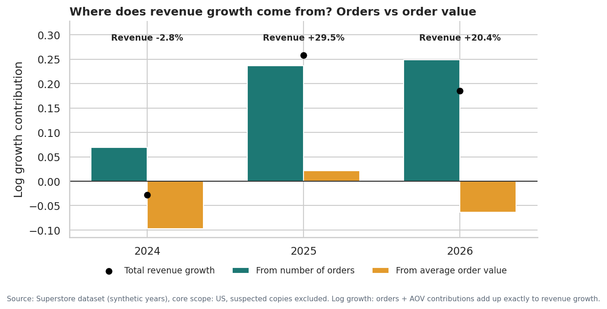
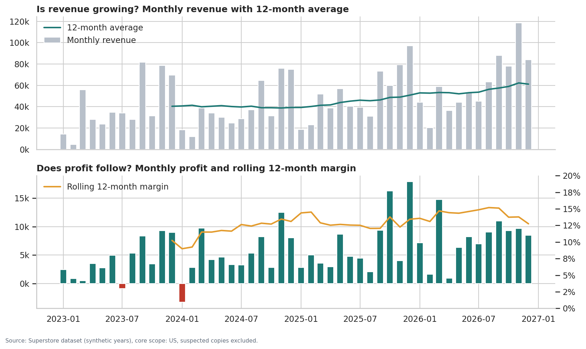
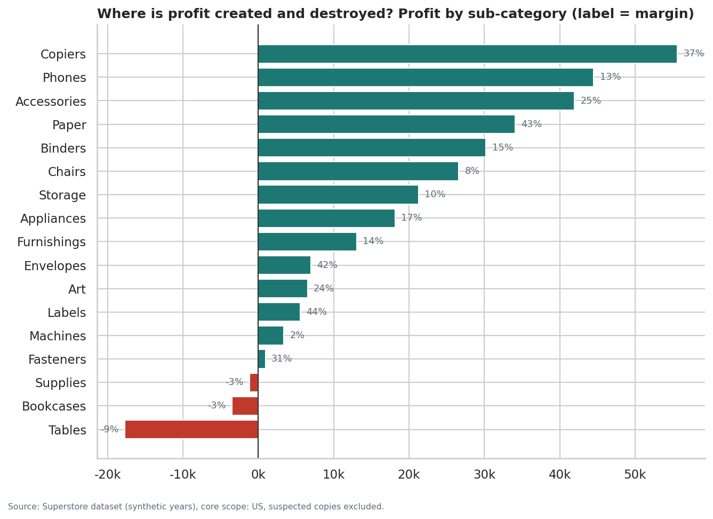
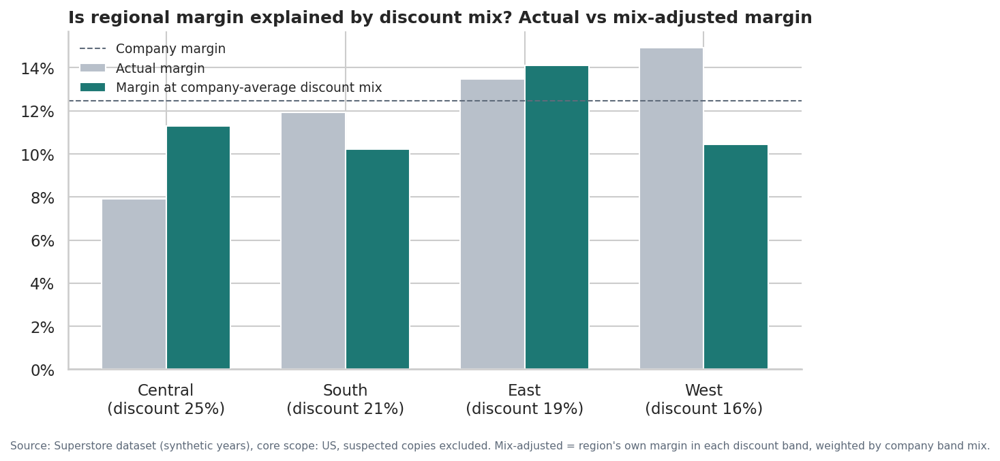
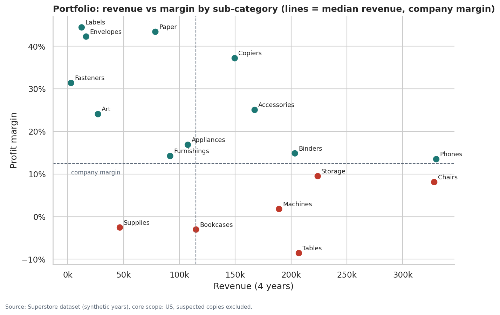
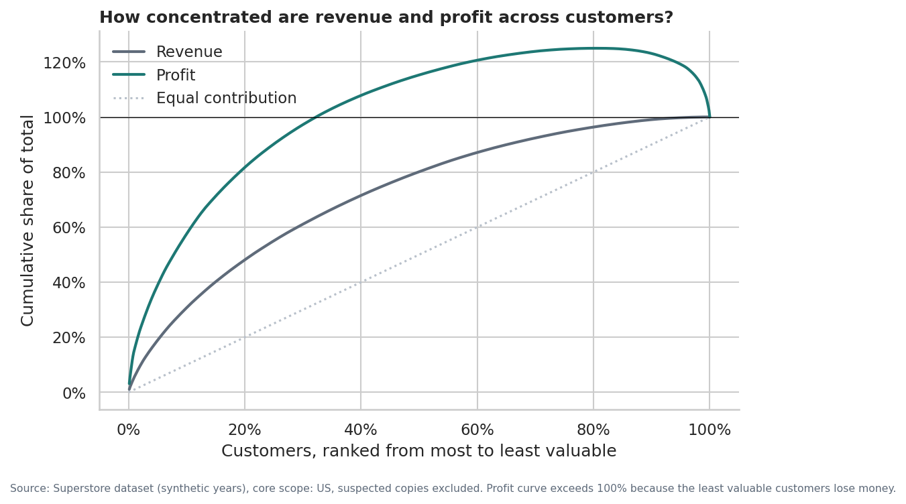
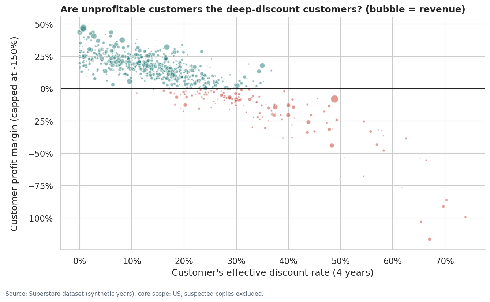
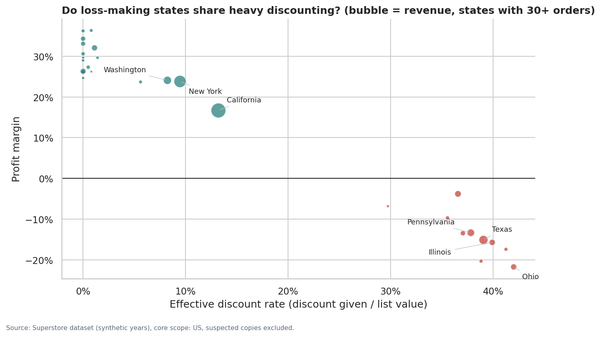
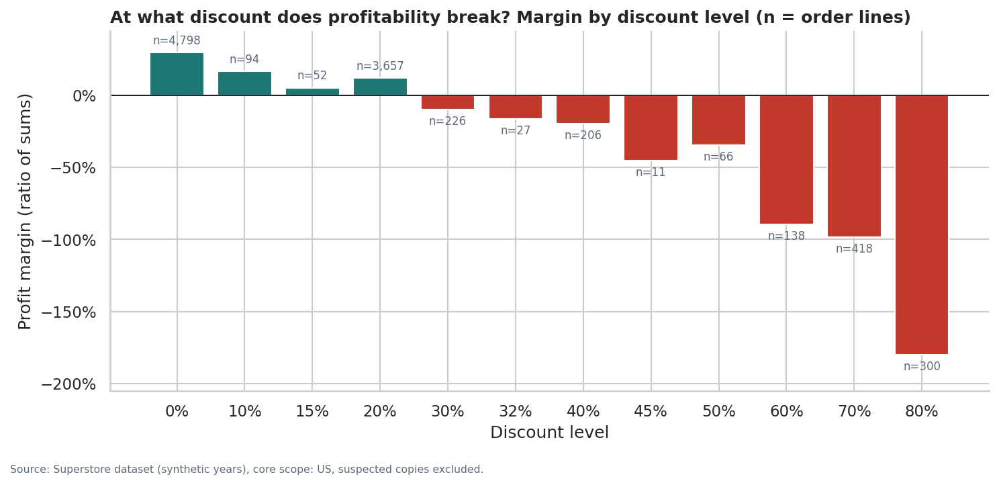
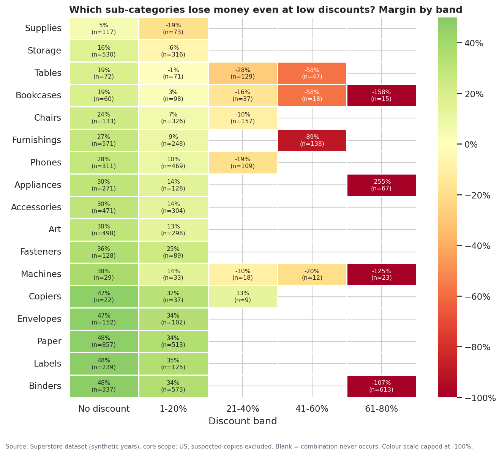

# Phase 4 — Exploratory Data Analysis: Findings
**Project:** Sales & Profitability Intelligence System  
**Scope:** core scope (US order lines; suspected Canadian copies excluded); customer analysis also excludes flagged customers.  
**Baseline:** revenue 2,296.9k, profit 286.4k, margin 12.5%, 5,009 orders, effective discount 19.8% (four dataset years).  
**Validation:** 17/17 reconciliation checks against the Phase 3 SQL results passed.

_Generated by `scripts/run_phase4_eda.py`. All numbers are computed at run time._

## How to read this report
- **Fact / calculation:** the *Finding* and *Calculation* sections.
- **Interpretation:** a plausible business reading. It is not proof of cause.
- **Confidence:** High = large samples and consistent across cuts; Medium = consistent but confounded or few observations; Low = thin data.
- **Mix-adjusted margin:** a group's own margin inside each discount band, re-weighted to the company's discount mix. If the gap to the company margin shrinks, discount mix accounts for that part of the gap.

## 1. Analysis plan (business question first)
| Area | Analysis | Business question | Method | Chart |
|---|---|---|---|---|
| A | Revenue trend, monthly revenue, YoY growth | Is the business growing, and is growth steady? | Monthly series, rolling 12-month totals, same-month-last-year growth | F01 |
| A | Order volume and average order value | Is growth driven by more orders or bigger orders, and is AOV representative? | Exact log decomposition of revenue growth into orders x AOV; order-value distribution | F02 |
| B | Profit trend and margin | Is profit growing with revenue, or is margin eroding? | Yearly and rolling 12-month margin (ratio of sums) | F01 |
| B | Profit by category / sub-category | Where is profit created and where is it destroyed? | Profit, margin and loss amounts; loss concentration (Pareto) | F03 |
| B | Profit by region / segment | Are weak groups weak in themselves, or because of their discount mix? | Direct standardisation: margin at the company's discount mix | F07 |
| C | Product rankings and portfolio | Which products are margin leaks, and which are high-margin niche items? | Sales quintiles vs company margin, minimum 3 lines per product | F04 |
| D | Customer sales, profit and profitability | How dependent are we on a few customers, and why are some customers unprofitable? | Lorenz/Pareto curves; customer discount vs margin; worst-line test | F09, F10 |
| D | Order frequency and segments | Are frequent buyers more valuable? Does segment matter? | Frequency bands, inter-order gaps, year-to-year retention | - |
| E | Region, state, city | Where are losses located, and what do loss-making locations have in common? | Ranked tables with volume thresholds; state discount vs margin correlation | F08 |
| F | Discount vs sales, profit, margin | Do discounts buy volume, and at what point do they destroy profit? | Margin by discount level; within-sub-category quantity comparison; policy-structure test | F05, F06 |

Charts were only produced where a picture answers the question better than a table. Order frequency, segments and cities are reported as tables.

## 2. Key findings at a glance
| ID | Finding | Confidence |
|---|---|---|
| A1 | Growth since 2025 comes from more orders, not bigger orders | High |
| A2 | Revenue is strongly seasonal: September, November and December carry the year | High |
| A3 | Profit grew faster than revenue until 2025; margin slipped in 2026 as discounting rose | Medium |
| B1 | Furniture earns almost nothing, and not only because of discounting | High |
| B2 | Losses are concentrated: three sub-categories account for two-thirds of all losses | High |
| B3 | Central's weak margin is largely associated with its heavier discounting | Medium |
| B4 | Customer segment is a weak differentiator of profitability | Medium |
| C1 | Margin leaks are large; high-margin niche products are too small to offset them | Medium |
| D1 | Profit is highly concentrated in a minority of customers | High |
| D2 | Unprofitable customers are mostly deep-discount customers, driven by a few transactions | High |
| D3 | Repeat buyers carry the business; frequency adds volume, not margin | Medium |
| E1 | Every loss-making state is a heavy-discount state | High |
| E2 | City losses concentrate in a few large cities, but city data is thin | Low |
| F1 | Margin falls steadily with discount; at 30% and above, order lines almost always lose money | High |
| F2 | There is no evidence that discounts increase the volume of each sale | Medium |
| F3 | Discount is set by a fixed rule (state x sub-category), so it is a controllable policy | High |

## 3. Detailed findings

### A. Sales performance

#### A1 — Growth since 2025 comes from more orders, not bigger orders
**1. Finding.** Revenue grew 29.5% in 2025 and 20.4% in 2026. Order count grew 26.7% and 28.3%, while average order value changed 2.2% and -6.2%. In 2024 revenue fell 2.8% even though orders rose 7.1%, because AOV fell 9.2%.

**2. Supporting calculation.**

Revenue = orders x AOV, so ln(revenue growth) = ln(order growth) + ln(AOV growth) exactly.

| order_year | sales | orders | aov | sales_yoy | orders_yoy | aov_yoy |
|---|---|---|---|---|---|---|
| 2023 | 484.0k | 969 | 499 |  |  |  |
| 2024 | 470.5k | 1,038 | 453 | -2.8% | 7.1% | -9.2% |
| 2025 | 609.2k | 1,315 | 463 | 29.5% | 26.7% | 2.2% |
| 2026 | 733.2k | 1,687 | 435 | 20.4% | 28.3% | -6.2% |

**3. Possible interpretation.** The business is winning more transactions rather than larger baskets. AOV is a weak signal on its own: the mean order is about 3.0x the median and the top 5% of orders carry 34%-39% of revenue each year, so a few large orders move AOV. Median order value is stable (146-162).

**4. Limitations.** Dataset years are synthetic. Orders are counted per order ID; we cannot see order intent, quotes or lost deals.

**5. What management should investigate next.** Track median order value alongside AOV, and check whether the AOV decline in 2026 comes from fewer large Technology/Furniture orders (mix) or lower prices.

#### A2 — Revenue is strongly seasonal: September, November and December carry the year
**1. Finding.** On average, September, November and December produce 43.5% of annual revenue; January and February together produce 6.5%. The pattern is stable across all four years. Monthly margin is volatile (between -18.1% and 27.2%); 2 months were loss-making (Jul 2023, Jan 2024).

**2. Supporting calculation.**

Each month's share of its own year's revenue, averaged over 2023-2026:

| order_month | mean_share | min_share | max_share |
|---|---|---|---|
| Jan | 4.0% | 2.9% | 6.0% |
| Feb | 2.5% | 0.9% | 3.8% |
| Mar | 9.1% | 8.0% | 11.5% |
| Apr | 6.1% | 5.0% | 7.3% |
| May | 6.7% | 4.9% | 9.4% |
| Jun | 6.6% | 5.3% | 7.2% |
| Jul | 6.4% | 6.1% | 7.0% |
| Aug | 6.8% | 5.1% | 8.6% |
| Sep | 13.7% | 12.0% | 16.9% |
| Oct | 8.4% | 6.5% | 10.6% |
| Nov | 15.4% | 13.0% | 16.2% |
| Dec | 14.4% | 11.4% | 15.9% |

**3. Possible interpretation.** Month-on-month comparisons are misleading; performance should be judged against the same month last year or on a rolling 12-month basis.

**4. Limitations.** Single loss months can be caused by a handful of large discounted orders; monthly margins rest on few transactions in quiet months.

**5. What management should investigate next.** Report monthly KPIs as same-month-prior-year and rolling 12 months. Review the large discounted orders behind the two loss months.

### B. Profitability

#### A3 — Profit grew faster than revenue until 2025; margin slipped in 2026 as discounting rose
**1. Finding.** Margin rose from 10.2% (2023) to 13.4% (2025), then fell to 12.7% in 2026. Over the same years the effective discount rate moved 22.2% -> 18.4% -> 19.9%. Profit growth was 32.7% in 2025 but 14.2% in 2026.

**2. Supporting calculation.**

| order_year | profit | profit_margin | effective_discount | profit_yoy |
|---|---|---|---|---|
| 2023 | 49.6k | 10.2% | 22.2% |  |
| 2024 | 61.6k | 13.1% | 18.8% | 24.3% |
| 2025 | 81.8k | 13.4% | 18.4% | 32.7% |
| 2026 | 93.4k | 12.7% | 19.9% | 14.2% |

**3. Possible interpretation.** Margin and discount move in opposite directions year to year. This is consistent with the discount findings (F1-F3) but four annual points cannot establish cause; product and regional mix also change between years.

**4. Limitations.** Four yearly observations; association only.

**5. What management should investigate next.** Decompose the 2025-2026 margin change into discount-rate, category-mix and regional-mix effects (a margin bridge) before drawing conclusions.

#### B1 — Furniture earns almost nothing, and not only because of discounting
**1. Finding.** Furniture generates 32.3% of revenue but 6.4% of profit (margin 2.5%, vs 17.4% Technology and 17.0% Office Supplies). Its effective discount (20.0%) is the same as the other categories. At the company's discount mix its margin would still be only 4.8%. Even without any discount, Furniture sub-categories earn 19%-27%, against a median of 36% for other sub-categories.

**2. Supporting calculation.**

| category | sales | profit | profit_margin | share_of_sales | share_of_profit | effective_discount |
|---|---|---|---|---|---|---|
| Technology | 836.2k | 145.5k | 17.4% | 36.4% | 50.8% | 19.5% |
| Office Supplies | 719.0k | 122.5k | 17.0% | 31.3% | 42.8% | 20.0% |
| Furniture | 741.7k | 18.5k | 2.5% | 32.3% | 6.4% | 20.0% |

Mix-adjusted margin (direct standardisation to the company discount mix):

| category | profit_margin | mix_adjusted_margin |
|---|---|---|
| Furniture | 2.5% | 4.8% |
| Office Supplies | 17.0% | 14.2% |
| Technology | 17.4% | 16.8% |

**3. Possible interpretation.** Furniture's problem appears to be structural: thin margins at list price (pricing, cost, or freight for bulky items), which any discount then pushes into losses. Tables and Bookcases are loss-making overall.

**4. Limitations.** The dataset has no cost breakdown, so we cannot tell whether the cause is purchase cost, shipping or price. Office Supplies has no sales in the 21-60% bands, so its adjusted figure uses company-level margins for those bands.

**5. What management should investigate next.** Review Furniture list prices and landed cost (especially freight) for Tables and Bookcases; test whether these lines should carry a lower maximum discount.

#### B2 — Losses are concentrated: three sub-categories account for two-thirds of all losses
**1. Finding.** Loss-making order lines lose 156.1k in total, equal to 35.3% of the profit earned on profitable lines. Binders, Tables, Machines account for 64.7% of all losses. Binders are profitable overall (14.9% margin) yet lose 38.5k on individual lines, with an effective discount of 38.7%.

**2. Supporting calculation.**

| sub_category | loss_amount | share_of_all_losses | cumulative_share |
|---|---|---|---|
| Binders | -38.5k | 24.7% | 24.7% |
| Tables | -32.4k | 20.8% | 45.4% |
| Machines | -30.1k | 19.3% | 64.7% |
| Bookcases | -12.2k | 7.8% | 72.5% |
| Chairs | -9.9k | 6.3% | 78.8% |
| Appliances | -8.6k | 5.5% | 84.4% |

**3. Possible interpretation.** Total profit hides how much is given back on loss-making lines. Fixing losses in a few sub-categories would have a larger effect than growing high-margin niches.

**4. Limitations.** Line-level losses depend on how profit is allocated to lines in the source system, which is not documented.

**5. What management should investigate next.** Build a loss-line drill-down (sub-category x state x discount) in Power BI and size the profit at stake under a discount cap.

#### B3 — Central's weak margin is largely associated with its heavier discounting
**1. Finding.** Central has the lowest margin (7.9%) and the highest effective discount (24.6%). If Central had the company's discount mix, its margin would be 11.3%, closing about 74% of its gap to the company margin (12.5%). West's lead disappears after adjustment (14.9% -> 10.4%), because West discounts least (15.6%).

**2. Supporting calculation.**

| region | profit_margin | effective_discount | mix_adjusted_margin | gap_actual | gap_adjusted |
|---|---|---|---|---|---|
| Central | 7.9% | 24.6% | 11.3% | -4.5% | -1.2% |
| South | 11.9% | 21.3% | 10.2% | -0.5% | -2.3% |
| East | 13.5% | 19.5% | 14.1% | 1.0% | 1.7% |
| West | 14.9% | 15.6% | 10.4% | 2.5% | -2.0% |

**3. Possible interpretation.** Regional performance differences look more like differences in discount policy than in regional management or demand. Regional managers should not be compared on raw margin alone.

**4. Limitations.** Standardisation controls for discount band only, not for product mix within bands. Because discounts are set by state and sub-category (see F3), region and discount cannot be fully separated.

**5. What management should investigate next.** Compare regions within the same sub-category and discount level; agree with management who sets the discount rules for each state.

### D. Customers

#### B4 — Customer segment is a weak differentiator of profitability
**1. Finding.** Segment margins range only from 11.5% to 14.0%, and profit per customer from 328 to 403. Consumer is the largest segment (47.0% of profit) because it has the most customers, not because each customer is worth more. Orders per customer are similar (6.1-6.4).

**2. Supporting calculation.**

| segment | sales | profit | profit_margin | customers | profit_per_customer | orders_per_customer | effective_discount |
|---|---|---|---|---|---|---|---|
| Consumer | 1,161.4k | 134.1k | 11.5% | 409 | 328 | 6.32 | 20.3% |
| Corporate | 706.1k | 92.0k | 13.0% | 236 | 390 | 6.42 | 18.3% |
| Home Office | 424.7k | 59.3k | 14.0% | 147 | 403 | 6.12 | 21.0% |

Mix-adjusted margin: Consumer 11.9%, Corporate 11.2%, Home Office 14.8%

**3. Possible interpretation.** Category and discount explain far more of the profit variation than segment. Segment-specific strategies are unlikely to be the main lever for margin.

**4. Limitations.** Segment is a broad label; we have no firmographic data (company size, industry).

**5. What management should investigate next.** Deprioritise segment as a margin lever; use it mainly for go-to-market planning.

### C. Products

#### C1 — Margin leaks are large; high-margin niche products are too small to offset them
**1. Finding.** 97 products in the top sales quintile are loss-making: they generate 418.2k revenue (18.2% of total) and lose 54.6k. Most are Tables, Chairs, Bookcases, Storage. A further 86 high-sales products earn below the company margin. By contrast, the 385 low-sales products with at least double the company margin generate only 36.2k revenue (1.6%) and 14.1k profit. 3 of the 10 best-selling products earn zero or negative profit.

**2. Supporting calculation.**

Classes: top sales quintile vs company margin; 'low sales, high margin' = bottom two quintiles with margin >= 2x company margin; 269 products with fewer than 3 lines are excluded as insufficient data.

| portfolio_class | products | sales | profit |
|---|---|---|---|
| High sales, below-average margin | 86 | 432.8k | 30.7k |
| High sales, loss-making | 97 | 418.2k | -54.6k |
| Insufficient data | 269 | 183.2k | 21.4k |
| Low sales, high margin | 385 | 36.2k | 14.1k |
| Other | 1,057 | 1,226.5k | 274.8k |

Top 10 products by revenue:

| product_label | sales | profit | profit_margin | orders |
|---|---|---|---|---|
| Canon imageCLASS 2200 Advanced Copier [TEC-CO-10004722] | 61.6k | 25.2k | 40.9% | 5 |
| Fellowes PB500 Electric Punch Plastic Comb Binding Machine with Manual Bind [OFF-BI-10003527] | 27.5k | 7.8k | 28.2% | 10 |
| Cisco TelePresence System EX90 Videoconferencing Unit [TEC-MA-10002412] | 22.6k | -1.8k | -8.0% | 1 |
| HON 5400 Series Task Chairs for Big and Tall [FUR-CH-10002024] | 21.9k | 0 | 0.0% | 8 |
| GBC DocuBind TL300 Electric Binding System [OFF-BI-10001359] | 19.8k | 2.2k | 11.3% | 11 |
| GBC Ibimaster 500 Manual ProClick Binding System [OFF-BI-10000545] | 19.0k | 761 | 4.0% | 9 |
| Hewlett Packard LaserJet 3310 Copier [TEC-CO-10001449] | 18.8k | 7.0k | 37.1% | 8 |
| HP Designjet T520 Inkjet Large Format Printer - 24" Color [TEC-MA-10001127] | 18.4k | 4.1k | 22.3% | 3 |
| GBC DocuBind P400 Electric Binding System [OFF-BI-10004995] | 18.0k | -1.9k | -10.5% | 6 |
| High Speed Automatic Electric Letter Opener [OFF-SU-10000151] | 17.0k | -262 | -1.5% | 3 |

**3. Possible interpretation.** The profit opportunity lies in repairing high-volume products, not in promoting niche high-margin products, which are mostly low-priced paper, art and labels.

**4. Limitations.** Most products sell only a handful of times over four years, so individual product margins are noisy. Product IDs are reused for different names (DQ07), handled with a composite key.

**5. What management should investigate next.** Review pricing and discount eligibility for the high-sales loss-making list, starting with Tables and Chairs; treat single-order products with caution.

### D. Customers

#### D1 — Profit is highly concentrated in a minority of customers
**1. Finding.** The top 10% of customers generate 57.9% of profit but 30.9% of revenue; the top 20% generate 81.8% of profit. 155 customers (19.6%) are unprofitable over four years, costing 71.2k.

**2. Supporting calculation.**

| metric | top_customers_share | customers | share_of_total |
|---|---|---|---|
| sales | 5.0% | 40 | 19.1% |
| sales | 10.0% | 80 | 30.9% |
| sales | 20.0% | 159 | 48.2% |
| sales | 50.0% | 396 | 80.1% |
| profit | 5.0% | 40 | 39.2% |
| profit | 10.0% | 80 | 57.9% |
| profit | 20.0% | 159 | 81.8% |
| profit | 50.0% | 396 | 115.3% |

**3. Possible interpretation.** Losing a small number of top customers would have an outsized effect on profit; the unprofitable tail gives back a meaningful part of what the top customers earn.

**4. Limitations.** Customer profit is measured over the four-year data window only; lifetime value cannot be estimated.

**5. What management should investigate next.** Create a key-account watch list for the top 10% of customers and review the unprofitable tail (see D2).

#### D2 — Unprofitable customers are mostly deep-discount customers, driven by a few transactions
**1. Finding.** Among customers whose effective discount is 30% or more, 84% are unprofitable; among those below 10%, 0% are. The rank correlation between a customer's effective discount and their margin is -0.81. 103 of the 155 unprofitable customers would be profitable if their single worst order line were removed.

**2. Supporting calculation.**

| discount_group | customers | unprofitable | share_unprofitable | profit_margin |
|---|---|---|---|---|
| 0-10% | 219 | 0 | 0.0% | 26.0% |
| 10-20% | 300 | 13 | 4.3% | 16.6% |
| 20-30% | 165 | 51 | 30.9% | 3.9% |
| 30%+ | 108 | 91 | 84.3% | -18.1% |

**3. Possible interpretation.** Customer unprofitability looks transaction-driven (a few heavily discounted lines) rather than a property of the customer. The lever is discount rules on specific products and locations, not dropping customers.

**4. Limitations.** Customer discount is itself determined by where the customer ships and what they buy (F3), so 'customer' and 'discount' effects overlap.

**5. What management should investigate next.** Review the worst lines of unprofitable customers: which product, state and discount produced them?

#### D3 — Repeat buyers carry the business; frequency adds volume, not margin
**1. Finding.** Customers with 7-10 orders are 38.8% of customers but earn 50.1% of profit. Margin is similar for all bands with 4+ orders (12.3%-12.9%); customers with 1-3 orders earn only 5.2%. The median gap between a customer's orders is 128 days. Year-to-year retention rose from 73.4% to 87.4%.

**2. Supporting calculation.**

| frequency_band | customers | share_of_customers | share_of_profit | profit_margin | median_customer_profit |
|---|---|---|---|---|---|
| 1-3 orders | 99 | 12.5% | 1.9% | 5.2% | 55 |
| 4-6 orders | 337 | 42.6% | 36.2% | 12.7% | 185 |
| 7-10 orders | 307 | 38.8% | 50.1% | 12.9% | 342 |
| 11+ orders | 49 | 6.2% | 11.8% | 12.3% | 579 |

| base_year | active | retained_next_year | retention_rate |
|---|---|---|---|
| 2,023 | 594 | 436 | 73.4% |
| 2,024 | 572 | 451 | 78.8% |
| 2,025 | 637 | 557 | 87.4% |

**3. Possible interpretation.** Retention is strong and improving, and value grows with the number of orders. Frequent buyers are worth more because they buy more, not because they buy at better margins.

**4. Limitations.** History starts in 2023 (left-censored): order counts partly reflect how long a customer has been visible, and 'new' customers cannot be identified.

**5. What management should investigate next.** Monitor retention as a KPI; investigate why 1-3 order customers have low margins (are their few orders heavily discounted?).

### E. Geography

#### E1 — Every loss-making state is a heavy-discount state
**1. Finding.** 10 states are loss-making, together losing 98.2k on 30.7% of revenue. All of them have an effective discount of at least 29.7%. Across the 28 states with 30+ orders, the rank correlation between effective discount and margin is -0.87. Texas is the 3rd-largest state by revenue but the largest loss (-25.7k, discount 39.1%).

**2. Supporting calculation.**

| state_province | region | sales | profit | profit_margin | effective_discount | orders |
|---|---|---|---|---|---|---|
| Texas | Central | 170.2k | -25.7k | -15.1% | 39.1% | 487 |
| Ohio | East | 78.0k | -17.0k | -21.7% | 42.0% | 236 |
| Pennsylvania | East | 116.5k | -15.6k | -13.4% | 37.8% | 288 |
| Illinois | Central | 80.2k | -12.6k | -15.7% | 39.9% | 276 |
| North Carolina | South | 55.6k | -7.5k | -13.5% | 37.1% | 136 |
| Colorado | West | 32.1k | -6.5k | -20.3% | 38.8% | 79 |
| Tennessee | South | 30.7k | -5.3k | -17.4% | 41.3% | 91 |
| Arizona | West | 35.3k | -3.4k | -9.7% | 35.6% | 108 |
| Florida | South | 89.5k | -3.4k | -3.8% | 36.6% | 200 |
| Oregon | West | 17.4k | -1.2k | -6.8% | 29.7% | 56 |

**3. Possible interpretation.** Geographic losses and discounting are tightly linked. Whether a state loses money is better predicted by its discount rules than by its region.

**4. Limitations.** 21 states have fewer than 30 orders and are excluded from the correlation. Correlation is not causation, and state and discount are confounded by design (F3).

**5. What management should investigate next.** Obtain the discount rule table by state and check who approved deep discounts in Texas, Ohio, Pennsylvania and Illinois.

#### E2 — City losses concentrate in a few large cities, but city data is thin
**1. Finding.** 138 cities are loss-making (104.9k in total). The five largest loss cities account for 43.0% of city-level losses, led by Philadelphia, Pennsylvania; Houston, Texas; San Antonio, Texas. Only 14 of 604 cities have 30+ orders.

**2. Supporting calculation.**

| city_state | sales | profit | profit_margin | effective_discount | orders |
|---|---|---|---|---|---|
| Philadelphia, Pennsylvania | 109.1k | -13.8k | -12.7% | 37.2% | 265 |
| Houston, Texas | 64.5k | -10.2k | -15.7% | 41.3% | 188 |
| Chicago, Illinois | 48.5k | -6.7k | -13.7% | 40.3% | 171 |
| Dallas, Texas | 20.1k | -2.8k | -14.1% | 37.5% | 80 |
| Jacksonville, Florida | 39.1k | -2.4k | -6.2% | 42.5% | 38 |
| Miami, Florida | 8.7k | -1.2k | -13.3% | 44.2% | 34 |
| Columbus, Ohio | 15.6k | -717 | -4.6% | 34.7% | 55 |
| Columbus, Georgia | 14.8k | 4.1k | 27.6% | 0.0% | 40 |
| San Diego, California | 47.5k | 6.4k | 13.4% | 14.5% | 88 |
| Detroit, Michigan | 42.4k | 13.2k | 31.1% | 1.3% | 53 |
| San Francisco, California | 112.7k | 17.5k | 15.5% | 12.5% | 265 |
| Seattle, Washington | 119.5k | 29.2k | 24.4% | 8.4% | 212 |
| Los Angeles, California | 175.9k | 30.4k | 17.3% | 13.4% | 384 |
| New York City, New York | 256.4k | 62.0k | 24.2% | 9.3% | 450 |

**3. Possible interpretation.** The big loss cities sit inside the heavy-discount states; city adds little beyond state-level discount rules.

**4. Limitations.** Most cities have too few orders for reliable margins; city is reported for the largest cities only.

**5. What management should investigate next.** Use city only for drill-down within loss-making states, not as a separate decision level.

### F. Discounts

#### F1 — Margin falls steadily with discount; at 30% and above, order lines almost always lose money
**1. Finding.** Margin is 29.5% at no discount and 11.8% at 20%, then negative at every level from 30% upward. At 30%+ discount, 96.8% of lines lose money; these lines are 13.9% of all lines but produce -135.4k profit. The rank correlation between discount and line margin is -0.64.

**2. Supporting calculation.**

| discount_rate | lines | sales | profit | profit_margin | loss_line_share |
|---|---|---|---|---|---|
| 0.00 | 4,798 | 1,087.9k | 321.0k | 29.5% | 0.0% |
| 0.10 | 94 | 54.4k | 9.0k | 16.6% | 4.3% |
| 0.15 | 52 | 27.6k | 1.4k | 5.1% | 32.7% |
| 0.20 | 3,657 | 764.6k | 90.3k | 11.8% | 13.7% |
| 0.30 | 226 | 102.9k | -10.4k | -10.1% | 91.6% |
| 0.32 | 27 | 14.5k | -2.4k | -16.5% | 100.0% |
| 0.40 | 206 | 116.4k | -23.1k | -19.8% | 87.4% |
| 0.45 | 11 | 5.5k | -2.5k | -45.5% | 100.0% |
| 0.50 | 66 | 58.9k | -20.5k | -34.8% | 100.0% |
| 0.60 | 138 | 6.6k | -5.9k | -89.5% | 100.0% |
| 0.70 | 418 | 40.6k | -40.1k | -98.7% | 100.0% |
| 0.80 | 300 | 17.0k | -30.5k | -180.0% | 100.0% |

**3. Possible interpretation.** Deep discounts are the single clearest pattern associated with losses. The break-even point lies between 20% and 30%.

**4. Limitations.** The relationship is strong but observational. The dataset may generate profit from discount mechanically (synthetic data), which would exaggerate its strength.

**5. What management should investigate next.** Model the profit impact of capping discounts at 20%, explicitly stating the assumed volume loss, before any policy change.

#### F2 — There is no evidence that discounts increase the volume of each sale
**1. Finding.** The rank correlation between discount and units per line is 0.00, and between discount and line revenue -0.06. Within the same sub-category, discounted lines carry fewer units than full-price lines in 12 of 17 sub-categories.

**2. Supporting calculation.**

| sub_category | Full price | Discounted | difference |
|---|---|---|---|
| Machines | 4.76 | 3.51 | -1.25 |
| Tables | 4.31 | 3.77 | -0.54 |
| Copiers | 3.73 | 3.30 | -0.42 |
| Storage | 3.86 | 3.53 | -0.33 |
| Labels | 3.95 | 3.64 | -0.31 |
| Chairs | 4.06 | 3.76 | -0.30 |
| Furnishings | 3.79 | 3.63 | -0.16 |
| Art | 3.82 | 3.68 | -0.15 |
| Accessories | 3.90 | 3.75 | -0.14 |
| Appliances | 3.77 | 3.63 | -0.14 |
| Envelopes | 3.61 | 3.51 | -0.10 |
| Supplies | 3.42 | 3.38 | -0.04 |
| Paper | 3.77 | 3.80 | 0.03 |
| Binders | 3.83 | 3.95 | 0.12 |
| Phones | 3.54 | 3.78 | 0.24 |
| Bookcases | 3.52 | 3.91 | 0.39 |
| Fasteners | 3.94 | 4.61 | 0.67 |

**3. Possible interpretation.** If discounts are meant to buy volume, they do not appear to do so at the order-line level.

**4. Limitations.** This tests units per line only. Discounts might still attract additional orders or customers, which cannot be tested because discount levels are fixed by state and sub-category (F3): there is no comparison group.

**5. What management should investigate next.** Before any change, run a controlled pilot (e.g. lower the discount ceiling in a few states) and measure order volume, not only margin.

#### F3 — Discount is set by a fixed rule (state x sub-category), so it is a controllable policy
**1. Finding.** In all 656 state x sub-category combinations, every order line has exactly the same discount (100% of combinations). State alone explains 50% of the variation in discount, sub-category 26%, and the two together 100%. 11 states never sell at full price; 21 states always do. Storage, Supplies, Tables lose money even at 1-20% discount.

**2. Supporting calculation.**

R-squared of discount explained by group means (1.0 = the grouping fully determines the discount).

| measure | value |
|---|---|
| state_subcategory_cells | 656.000 |
| share_cells_single_discount | 1.000 |
| r2_state | 0.505 |
| r2_sub_category | 0.257 |
| r2_state_x_sub_category | 1.000 |
| states | 49.000 |
| states_never_full_price | 11.000 |
| states_always_full_price | 21.000 |

**3. Possible interpretation.** Discounting is not negotiated deal by deal: it behaves like a rule table by state and sub-category. That is good news for management, because the losses come from rules that can be changed. It also means the effect of discount cannot be separated statistically from the effect of location.

**4. Limitations.** This pattern may be an artefact of how the synthetic dataset was generated; in a real business it should be confirmed against the pricing policy.

**5. What management should investigate next.** Obtain or reconstruct the discount rule table; prioritise rules that put Tables, Bookcases, Machines and Binders at 30%+ or that put Storage, Supplies and Tables at any discount.

## 4. What this data cannot tell us
- **Why** margins are low (no cost, freight or list-price data).
- Whether discounts **bring in** extra orders or customers: discount is fixed by state and sub-category, so there is no comparison group.
- The value of **returned** goods (returns are recorded per order only).
- Customer **lifetime value or acquisition** (history starts in 2023; no acquisition cost).
- Real-world timing: the dataset years are synthetic.

## 5. Consolidated investigation agenda for management
1. **Discount rules:** obtain the state x sub-category discount table; quantify the profit at stake for lines at 30%+ (F1, F3, E1).
2. **Furniture economics:** list price, landed cost and freight for Tables and Bookcases (B1, C1).
3. **Loss concentration:** Binders, Tables and Machines losses by state and discount (B2).
4. **Regional scorecards:** judge managers on mix-adjusted margin, not raw margin (B3).
5. **Controlled discount pilot:** measure order volume as well as margin before changing policy (F2).
6. **Key accounts:** protect the top 10% of customers; review the worst lines behind unprofitable customers (D1, D2).

## 6. Validation
| check | pandas | sql | status |
|---|---|---|---|
| Total sales | 2,296,919.4883 | 2,296,919.4900 | PASS |
| Total profit | 286,409.0805 | 286,409.0800 | PASS |
| Orders | 5,009.0000 | 5,009.0000 | PASS |
| Valid customers | 792.0000 | 792.0000 | PASS |
| Sales 2023 | 483,966.1261 | 483,966.1300 | PASS |
| Margin 2023 | 0.1024 | 0.1024 | PASS |
| Sales 2024 | 470,532.5090 | 470,532.5100 | PASS |
| Margin 2024 | 0.1310 | 0.1310 | PASS |
| Sales 2025 | 609,205.5980 | 609,205.6000 | PASS |
| Margin 2025 | 0.1343 | 0.1343 | PASS |
| Sales 2026 | 733,215.2552 | 733,215.2600 | PASS |
| Margin 2026 | 0.1274 | 0.1274 | PASS |
| Profit West | 108,418.4489 | 108,418.4500 | PASS |
| Profit East | 91,534.8388 | 91,534.8400 | PASS |
| Profit South | 46,749.4303 | 46,749.4300 | PASS |
| Profit Central | 39,706.3625 | 39,706.3600 | PASS |
| Discount band lines | 9,993.0000 | 9,993.0000 | PASS |