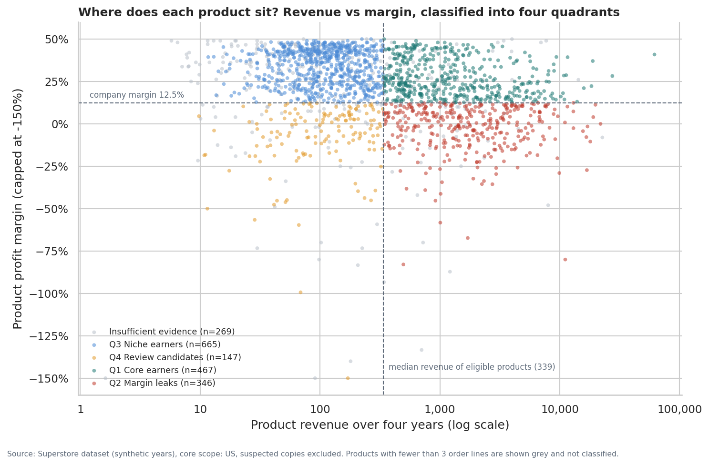
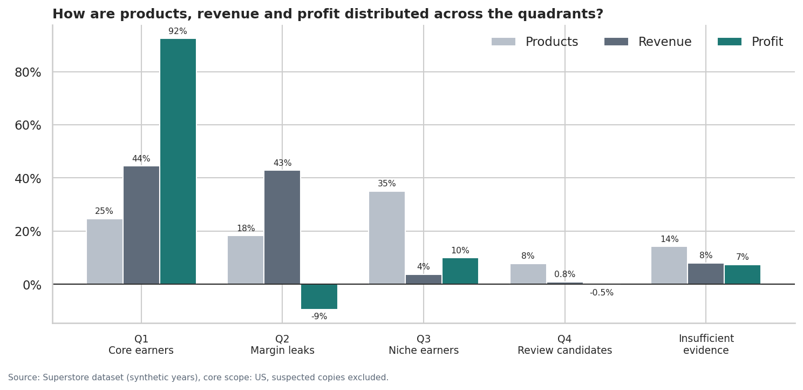
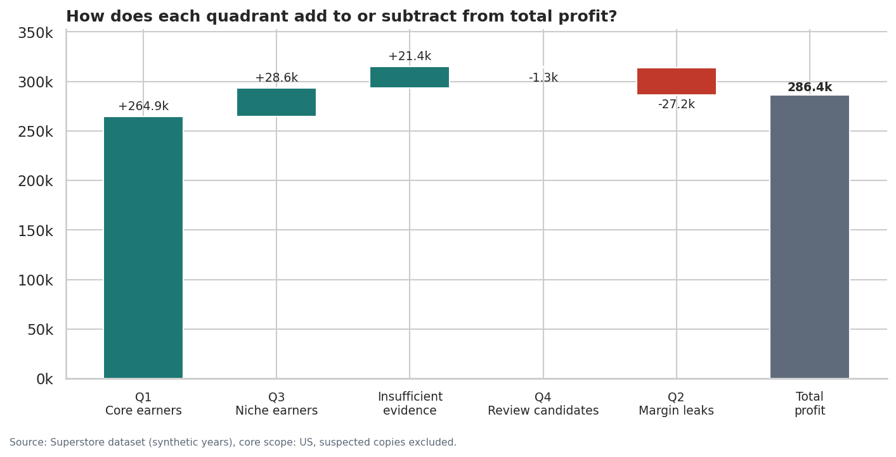
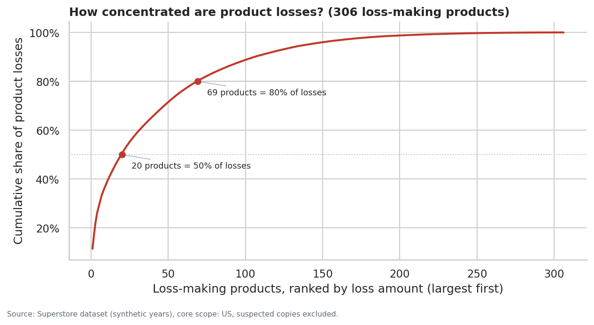
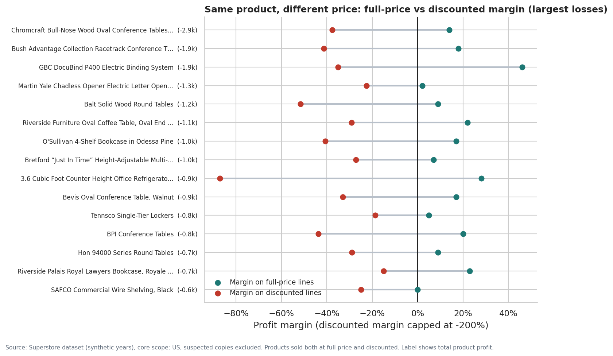
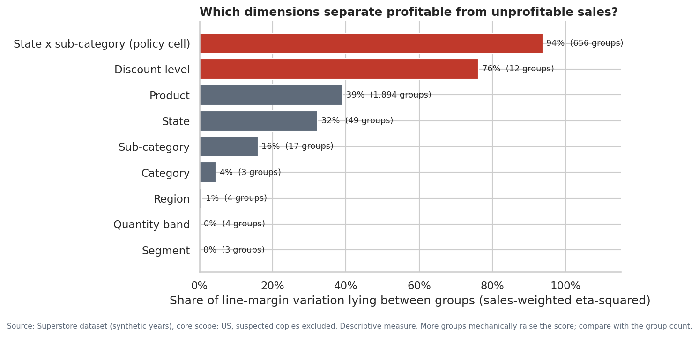
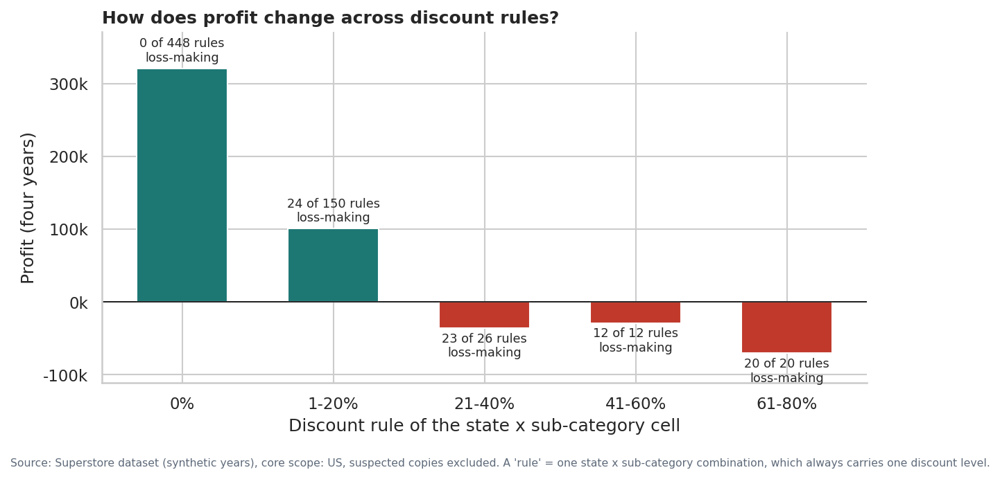

# Phase 5 — Profitability Analysis: Where Is Profit Made and Where Is It Destroyed?
**Project:** Sales & Profitability Intelligence System  
**Scope:** core scope (US, suspected copies excluded). Revenue 2,296.9k, profit 286.4k, margin 12.5%, 1,894 products, 9,993 order lines.  
**Validation:** 12/12 checks passed (totals reconcile to the SQL layer).  
_Generated by `scripts/run_phase5_profitability.py`; all figures are computed at run time._

## 1. Executive summary
- **Profit is made by a quarter of the products.** Q1 core earners are 25% of products, 44% of revenue and 92% of profit (margin 25.9%).
- **Almost as much revenue earns nothing.** Q2 margin leaks carry 43% of revenue but lose 27.2k as a group, at an effective discount of 24.7% (Q1: 13.0%).
- **No product loses money at full price.** Every loss-making line in the data is a discounted line. Of the 306 loss-making products, 208 are profitable on their own full-price sales; the other 98 were never sold at full price.
- **Discount is the dimension that best separates profitable from unprofitable sales.** Discount level accounts for 76% of line-margin variation; region and segment for less than 1%.
- **Losses sit in a small number of discount rules.** The 32 state x sub-category rules above 40% are all loss-making and together lose 99.6k on 128.6k revenue.
- **None of this proves cause.** Discount is fixed by state and sub-category, so discount, location and product cannot be fully separated. The evidence identifies where to investigate, not what will happen if rules change.

## 2. Analytical framework
| Element | Definition | Why |
|---|---|---|
| Unit | Product (`product_key`), plus the policy cell (state x sub-category) | Products are what management prices; the policy cell is where discount is decided |
| Evidence rule | A product needs at least 3 order lines to be classified | Prevents single-sale products from being labelled leaders or losers |
| Sales axis | Revenue >= median of eligible products (339) = high | Median is robust to the long tail of very large products |
| Profit axis | Margin >= company margin (12.5%) = high | The hurdle every product must clear to avoid diluting overall margin |
| Deep discount | Effective discount >= 30% | Phase 4: at 30%+ almost all lines lose money |
| Ranking metric | Always stated: absolute profit (impact), margin (efficiency) or loss amount (damage) | Avoids unexplained 'best' or 'worst' labels |

**Quadrants**

- **Q1** — High sales, high margin (core earners)
- **Q2** — High sales, low margin (margin leaks)
- **Q3** — Low sales, high margin (niche earners)
- **Q4** — Low sales, low margin (review candidates)
- **NA** — Insufficient evidence (< 3 order lines)

## 3. Quadrant results

| quadrant | products | share_of_products | sales | share_of_sales | profit | share_of_profit | profit_margin | effective_discount | loss_products | avg_quantity_per_line |
|---|---|---|---|---|---|---|---|---|---|---|
| Q1 | 467 | 24.7% | 1,021.8k | 44.5% | 264.9k | 92.5% | 25.9% | 13.0% | 0 | 3.91 |
| Q2 | 346 | 18.3% | 985.5k | 42.9% | -27.2k | -9.5% | -2.8% | 24.7% | 173 | 3.77 |
| Q3 | 665 | 35.1% | 86.8k | 3.8% | 28.6k | 10.0% | 33.0% | 11.4% | 0 | 3.73 |
| Q4 | 147 | 7.8% | 19.5k | 0.8% | -1.3k | -0.5% | -6.6% | 37.5% | 83 | 3.69 |
| NA | 269 | 14.2% | 183.2k | 8.0% | 21.4k | 7.5% | 11.7% | 27.1% | 50 | 3.75 |

### Q1 — High sales, high margin (core earners)
**Metrics.** 467 products, revenue 1,021.8k (44.5%), profit 264.9k (92.5%), margin 25.9%, effective discount 13.0%, 0 loss-making products. Largest sub-categories by revenue share: Phones 17%, Copiers 14%, Accessories 13%.

**Examples** (selected by largest absolute profit impact, i.e. |profit|):

| product_label | sub_category | sales | profit | profit_margin | effective_discount | lines | full_price_margin | discounted_margin |
|---|---|---|---|---|---|---|---|---|
| Canon imageCLASS 2200 Advanced Copier [TEC-CO-10004722] | Copiers | 61.6k | 25.2k | 40.9% | 12.0% | 5 | 48.0% | 25.7% |
| Fellowes PB500 Electric Punch Plastic Comb Binding Machine with Manual Bind [OFF-BI-10003527] | Binders | 27.5k | 7.8k | 28.2% | 30.3% | 10 | 50.0% | 5.7% |
| Hewlett Packard LaserJet 3310 Copier [TEC-CO-10001449] | Copiers | 18.8k | 7.0k | 37.1% | 17.4% | 8 | 48.0% | 28.3% |
| Canon PC1060 Personal Laser Copier [TEC-CO-10003763] | Copiers | 11.6k | 4.6k | 39.3% | 12.6% | 4 | 47.0% | 33.7% |
| HP Designjet T520 Inkjet Large Format Printer - 24" Color [TEC-MA-10001127] | Machines | 18.4k | 4.1k | 22.3% | 12.5% | 3 | 32.0% | -36.0% |

**Business meaning.** These products carry the business: large revenue at margins above the company hurdle. They are the profit base to protect. Their lower effective discount suggests they are mostly sold at or near list price.

**Limitations.** Membership depends on thresholds (tested below). A product can be Q1 overall while still having loss-making discounted lines; its full-price vs discounted margins are shown for that reason.

**Implication for management.** Protect: keep discount eligibility tight and monitor stock availability and price changes.

### Q2 — High sales, low margin (margin leaks)
**Metrics.** 346 products, revenue 985.5k (42.9%), profit -27.2k (-9.5%), margin -2.8%, effective discount 24.7%, 173 loss-making products. Largest sub-categories by revenue share: Tables 20%, Chairs 20%, Phones 13%.

**Examples** (selected by largest absolute profit impact, i.e. |profit|):

| product_label | sub_category | sales | profit | profit_margin | effective_discount | lines | full_price_margin | discounted_margin |
|---|---|---|---|---|---|---|---|---|
| Cubify CubeX 3D Printer Double Head Print [TEC-MA-10000418] | Machines | 11.1k | -8.9k | -80.0% | 58.9% | 3 |  | -80.0% |
| Lexmark MX611dhe Monochrome Laser Printer [TEC-MA-10000822] | Machines | 16.8k | -4.6k | -27.3% | 45.0% | 4 |  | -27.3% |
| Chromcraft Bull-Nose Wood Oval Conference Tables & Bases [FUR-TA-10000198] | Tables | 9.9k | -2.9k | -29.0% | 33.3% | 5 | 14.0% | -37.6% |
| GBC DocuBind TL300 Electric Binding System [OFF-BI-10001359] | Binders | 19.8k | 2.2k | 11.3% | 40.3% | 11 | 47.0% | -18.3% |
| Bush Advantage Collection Racetrack Conference Table [FUR-TA-10001889] | Tables | 9.5k | -1.9k | -20.3% | 31.8% | 7 | 18.0% | -41.4% |

**Business meaning.** These products generate revenue comparable to the core earners, but as a group they lose money. They are where revenue is earned without profit. Their effective discount is roughly double that of Q1, and their own full-price lines are profitable (see the examples), which points to discounting rather than the products themselves.

**Limitations.** Association, not cause: deep discounts happen in particular states (discount is fixed by state x sub-category), so product, location and discount are intertwined. Low margins may also reflect cost or freight, which the data does not contain.

**Implication for management.** Fix first: review the discount rules applied to these products, starting with the largest absolute losses.

### Q3 — Low sales, high margin (niche earners)
**Metrics.** 665 products, revenue 86.8k (3.8%), profit 28.6k (10.0%), margin 33.0%, effective discount 11.4%, 0 loss-making products. Largest sub-categories by revenue share: Paper 26%, Furnishings 15%, Art 12%.

**Examples** (selected by largest absolute profit impact, i.e. |profit|):

| product_label | sub_category | sales | profit | profit_margin | effective_discount | lines | full_price_margin | discounted_margin |
|---|---|---|---|---|---|---|---|---|
| Personal Creations Ink Jet Cards and Labels [OFF-PA-10004530] | Paper | 321 | 158 | 49.0% | 0.0% | 4 | 49.0% |  |
| Xerox 226 [OFF-PA-10003441] | Paper | 334 | 156 | 46.6% | 2.6% | 11 | 48.0% | 35.0% |
| White Business Envelopes with Contemporary Seam, Recycled White Business Envelopes [OFF-EN-10001335] | Envelopes | 337 | 151 | 44.8% | 9.4% | 6 | 50.0% | 37.5% |
| Easy-staple paper [OFF-PA-10003127] | Paper | 327 | 142 | 43.4% | 4.6% | 6 | 46.0% | 32.5% |
| Xerox 1979 [OFF-PA-10003625] | Paper | 328 | 141 | 42.9% | 3.6% | 3 | 45.0% | 31.2% |

**Business meaning.** Many small, high-margin items (paper, art, labels, envelopes). They are efficient but small in revenue terms, so growing them is a much smaller lever than repairing the loss-making discount rules (section 8).

**Limitations.** Low revenue per product means few transactions; margins are reliable as a group, less so per product.

**Implication for management.** Maintain: useful for basket building and margin mix; not a primary lever for the profit problem.

### Q4 — Low sales, low margin (review candidates)
**Metrics.** 147 products, revenue 19.5k (0.8%), profit -1.3k (-0.5%), margin -6.6%, effective discount 37.5%, 83 loss-making products. Largest sub-categories by revenue share: Binders 39%, Phones 15%, Furnishings 11%.

**Examples** (selected by largest absolute profit impact, i.e. |profit|):

| product_label | sub_category | sales | profit | profit_margin | effective_discount | lines | full_price_margin | discounted_margin |
|---|---|---|---|---|---|---|---|---|
| Euro Pro Shark Stick Mini Vacuum [OFF-AP-10000390] | Appliances | 171 | -326 | -190.7% | 74.5% | 3 |  | -190.7% |
| Belkin F9S820V06 8 Outlet Surge [OFF-AP-10000055] | Appliances | 266 | -120 | -45.1% | 51.8% | 4 | 30.0% | -250.0% |
| Acco 6 Outlet Guardian Premium Plus Surge Suppressor [OFF-AP-10001947] | Appliances | 289 | -114 | -39.3% | 49.0% | 6 | 29.0% | -255.0% |
| Acco D-Ring Binder w/DublLock [OFF-BI-10001098] | Binders | 235 | -103 | -43.7% | 64.5% | 9 |  | -43.7% |
| GBC Linen Binding Covers [OFF-BI-10001575] | Binders | 208 | -82 | -39.7% | 62.8% | 6 |  | -39.7% |

**Business meaning.** Small revenue and negative margin, with the highest effective discount of any quadrant. They add complexity and losses without meaningful revenue.

**Limitations.** Very small sample per product; some may be clearance items or one-off promotions that the data cannot identify.

**Implication for management.** Review: candidates for removing discount eligibility or rationalising the range, after checking their role in larger orders.

### Insufficient evidence (< 3 lines)
269 products (8.0% of revenue) are not classified. Machines make up 63% of this group's revenue: high-value items sold only once or twice, whose margins depend on single transactions. They are reviewed transaction by transaction in section 5.

### Robustness: do the quadrants survive different thresholds?
| scenario | products_reclassified | share_reclassified | q2_products | q2_sales | q2_profit |
|---|---|---|---|---|---|
| Base: median sales, company margin | 0 | 0.0% | 346 | 985.5k | -27.2k |
| Sales cut at 60th percentile | 163 | 10.0% | 299 | 965.4k | -26.5k |
| Sales cut at 40th percentile | 162 | 10.0% | 379 | 994.3k | -27.7k |
| Margin hurdle 10% | 67 | 4.1% | 293 | 802.9k | -47.5k |
| Margin hurdle 15% | 75 | 4.6% | 400 | 1,128.4k | -7.3k |

Moving the sales threshold by 10 percentiles reclassifies about 10% of products, but the margin-leak quadrant keeps losing money in every scenario (-7.3k to -47.5k). The conclusion does not depend on the exact cut-off.

## 4. Products with negative profit
**Metrics.** 306 products lose money, 77.1k in total (256 of them have 3+ lines). Ranked by loss amount: the top 20 account for 50% of product losses and the top 69 for 80%.

| sub_category | products | loss | share_of_product_losses |
|---|---|---|---|
| Machines | 24 | -25.4k | 33.0% |
| Tables | 43 | -21.5k | 27.9% |
| Bookcases | 33 | -7.0k | 9.1% |
| Chairs | 24 | -5.5k | 7.1% |
| Storage | 39 | -4.4k | 5.7% |
| Binders | 51 | -4.3k | 5.6% |

**What each loss-making product's own history shows** (diagnosis based on its full-price vs discounted lines):

| diagnosis | products | loss | share_of_loss | sales | median_discount |
|---|---|---|---|---|---|
| Profitable at full price, loss when discounted | 208 | -39.1k | 50.7% | 404.2k | 19.6% |
| Only ever sold discounted (cannot test) | 98 | -38.0k | 49.3% | 151.4k | 40.9% |

**Examples** (ranked by loss amount):

| product_label | sub_category | sales | profit | profit_margin | effective_discount | lines | full_price_margin | discounted_margin |
|---|---|---|---|---|---|---|---|---|
| Cubify CubeX 3D Printer Double Head Print [TEC-MA-10000418] | Machines | 11.1k | -8.9k | -80.0% | 58.9% | 3 |  | -80.0% |
| Lexmark MX611dhe Monochrome Laser Printer [TEC-MA-10000822] | Machines | 16.8k | -4.6k | -27.3% | 45.0% | 4 |  | -27.3% |
| Cubify CubeX 3D Printer Triple Head Print [TEC-MA-10004125] | Machines | 8.0k | -3.8k | -48.0% | 50.0% | 1 |  | -48.0% |
| Chromcraft Bull-Nose Wood Oval Conference Tables & Bases [FUR-TA-10000198] | Tables | 9.9k | -2.9k | -29.0% | 33.3% | 5 | 14.0% | -37.6% |
| Bush Advantage Collection Racetrack Conference Table [FUR-TA-10001889] | Tables | 9.5k | -1.9k | -20.3% | 31.8% | 7 | 18.0% | -41.4% |
| GBC DocuBind P400 Electric Binding System [OFF-BI-10004995] | Binders | 18.0k | -1.9k | -10.5% | 51.1% | 6 | 46.0% | -35.0% |
| Cisco TelePresence System EX90 Videoconferencing Unit [TEC-MA-10002412] | Machines | 22.6k | -1.8k | -8.0% | 50.0% | 1 |  | -8.0% |
| Martin Yale Chadless Opener Electric Letter Opener [OFF-SU-10002881] | Supplies | 16.7k | -1.3k | -7.8% | 9.1% | 6 | 2.0% | -22.5% |
| Balt Solid Wood Round Tables [FUR-TA-10001950] | Tables | 6.5k | -1.2k | -18.4% | 23.2% | 4 | 9.0% | -51.7% |
| BoxOffice By Design Rectangular and Half-Moon Meeting Room Tables [FUR-TA-10004289] | Tables | 1.7k | -1.1k | -67.3% | 48.0% | 3 |  | -67.3% |

**Business meaning.** Losses are concentrated in a few dozen products, mostly Machines and Tables, and in this dataset they arise only on discounted lines. There is no product that is unprofitable at list price.

**Limitations.** Product totals for high-value items rest on very few transactions. 'Profitable at full price' is measured on that product's own full-price lines, which may have been sold in different states or years than its discounted lines.

## 5. Products with unusually high discount
Two stated lenses are used, because 'unusually high' can mean high in absolute terms or high for the product's sub-category:

- **Absolute:** effective discount >= 30%.
- **Relative:** effective discount above the 90th percentile of eligible products in the same sub-category.

| high_discount_lens | products | sales | profit | median_margin | median_discount |
|---|---|---|---|---|---|
| Absolute (>=30%) | 140 | 226.1k | 2.1k | 8.0% | 40.7% |
| Both | 55 | 47.3k | -19.6k | -27.6% | 48.0% |
| Relative (> sub-category P90) | 113 | 96.4k | 4.8k | 15.6% | 17.5% |

**Examples flagged by both lenses** (ranked by loss amount):

| product_label | sub_category | sales | profit | profit_margin | effective_discount | lines | full_price_margin | discounted_margin |
|---|---|---|---|---|---|---|---|---|
| Cubify CubeX 3D Printer Double Head Print [TEC-MA-10000418] | Machines | 11.1k | -8.9k | -80.0% | 58.9% | 3 |  | -80.0% |
| BoxOffice By Design Rectangular and Half-Moon Meeting Room Tables [FUR-TA-10004289] | Tables | 1.7k | -1.1k | -67.3% | 48.0% | 3 |  | -67.3% |
| Riverside Furniture Oval Coffee Table, Oval End Table, End Table with Drawer [FUR-TA-10004154] | Tables | 4.4k | -1.1k | -25.8% | 38.0% | 5 | 22.0% | -29.1% |
| O'Sullivan 4-Shelf Bookcase in Odessa Pine [FUR-BO-10001972] | Bookcases | 2.7k | -975 | -35.6% | 38.8% | 7 | 17.0% | -40.7% |
| 3.6 Cubic Foot Counter Height Office Refrigerator [OFF-AP-10002534] | Appliances | 2.9k | -872 | -29.6% | 44.4% | 5 | 28.0% | -87.2% |
| BPI Conference Tables [FUR-TA-10002533] | Tables | 2.2k | -796 | -35.5% | 41.0% | 5 | 20.0% | -43.8% |
| Bestar Classic Bookcase [FUR-BO-10004467] | Bookcases | 1.9k | -613 | -32.3% | 38.8% | 8 | 19.0% | -50.6% |
| Bevis Rectangular Conference Tables [FUR-TA-10000849] | Tables | 1.0k | -587 | -58.3% | 46.9% | 4 |  | -58.3% |

**Business meaning.** Products flagged by both lenses are where discounting is extreme in every sense, and they lose money as a group. Products flagged only on the absolute lens can stay profitable overall because their full-price sales subsidise the discounted ones.

**Limitations.** A product's effective discount reflects where it was sold (state rules), not a product-specific decision.

## 6. Where discounts appear associated with weak profitability
**Method: compare each product with itself.** For every product sold both at full price and at a discount, its margin on full-price lines is compared with its margin on discounted lines. This holds the product constant, which comparisons across products cannot do.

**Metrics.** 1,461 products qualify. In 100% of them the discounted margin is lower. The median gap is -18.5 percentage points.

| diagnosis | products | profit | median_full_price_margin | median_discounted_margin | median_gap |
|---|---|---|---|---|---|
| Profitable at full price, loss when discounted | 450 | 3.0k | 23.0% | -20.0% | -40.0% |
| Profitable in both, lower margin when discounted | 1,011 | 263.9k | 42.0% | 20.0% | -16.5% |

**Business meaning.** For 450 products, the full-price business is profitable and the discounted business loses money. These are the clearest candidates for tighter discount limits.

**Limitations.** The full-price and discounted lines of a product were sold in different states (because discount is set by state), so the gap mixes the discount with any state differences. This is a strong association, not a causal estimate.

## 7. How the dimensions relate to profitability
**Method.** For each dimension, the sales-weighted share of line-margin variation that lies *between* its groups (eta-squared). 1.0 means the groups fully separate high- and low-margin sales; 0 means the dimension tells us nothing about margin. This is descriptive, and dimensions with more groups score higher mechanically.

| dimension | groups | eta_squared |
|---|---|---|
| State x sub-category (policy cell) | 656 | 93.8% |
| Discount level | 12 | 76.2% |
| Product | 1,894 | 39.0% |
| State | 49 | 32.3% |
| Sub-category | 17 | 16.0% |
| Category | 3 | 4.5% |
| Region | 4 | 0.6% |
| Quantity band | 4 | 0.1% |
| Segment | 3 | 0.1% |

**Reading.** Discount level (76%, only 12 groups) separates margins far better than product (39%, 1,894 groups): the same product earns very different margins at different discounts. State x sub-category, the unit at which discount is set, accounts for 94%. Region (0.6%), segment (0.1%) and quantity (0.1%) add almost nothing.

**Supporting tables**

*Category*

| category | sales | profit | profit_margin | effective_discount | share_of_sales | share_of_profit |
|---|---|---|---|---|---|---|
| Furniture | 741.7k | 18.5k | 2.5% | 20.0% | 32.3% | 6.4% |
| Office Supplies | 719.0k | 122.5k | 17.0% | 20.0% | 31.3% | 42.8% |
| Technology | 836.2k | 145.5k | 17.4% | 19.5% | 36.4% | 50.8% |

*Customer segment*

| segment | sales | profit | profit_margin | effective_discount | share_of_sales | share_of_profit |
|---|---|---|---|---|---|---|
| Consumer | 1,161.4k | 134.1k | 11.5% | 20.3% | 50.6% | 46.8% |
| Corporate | 706.1k | 92.0k | 13.0% | 18.3% | 30.7% | 32.1% |
| Home Office | 429.4k | 60.3k | 14.0% | 20.9% | 18.7% | 21.1% |

*Region*

| region | sales | profit | profit_margin | effective_discount | share_of_sales | share_of_profit |
|---|---|---|---|---|---|---|
| Central | 501.2k | 39.7k | 7.9% | 24.6% | 21.8% | 13.9% |
| East | 678.5k | 91.5k | 13.5% | 19.5% | 29.5% | 32.0% |
| South | 391.7k | 46.7k | 11.9% | 21.3% | 17.1% | 16.3% |
| West | 725.5k | 108.4k | 14.9% | 15.6% | 31.6% | 37.9% |

*Quantity per line*

| quantity_band | sales | profit | profit_margin | effective_discount | share_of_sales |
|---|---|---|---|---|---|
| 1-2 | 342.1k | 45.9k | 13.4% | 18.8% | 14.9% |
| 3-4 | 745.7k | 101.2k | 13.6% | 18.7% | 32.5% |
| 5-7 | 862.7k | 94.1k | 10.9% | 21.8% | 37.6% |
| 8+ | 346.4k | 45.1k | 13.0% | 17.9% | 15.1% |

**Limitations.** Eta-squared measures separation, not influence. The dataset appears to generate profit largely from discount, which would inflate the discount score.

## 8. Policy cells: where exactly is profit destroyed?
Discount is fixed per state x sub-category, so each of the 656 combinations behaves like one pricing rule. 79 rules are loss-making and together lose 145.7k, which is 93% of all line-level losses.

| rule_band | cells | loss_cells | share_cells_loss_making | sales | profit | profit_margin |
|---|---|---|---|---|---|---|
| 0% | 448 | 0 | 0.0% | 1,087.9k | 321.0k | 29.5% |
| 1-20% | 150 | 24 | 16.0% | 846.5k | 100.8k | 11.9% |
| 21-40% | 26 | 23 | 88.5% | 233.9k | -35.8k | -15.3% |
| 41-60% | 12 | 12 | 100.0% | 71.0k | -28.9k | -40.7% |
| 61-80% | 20 | 20 | 100.0% | 57.6k | -70.6k | -122.6% |

**The 15 most loss-making rules** (ranked by profit, most negative first):

| state_province | sub_category | discount_rule | sales | profit | profit_margin | lines |
|---|---|---|---|---|---|---|
| Texas | Binders | 80.0% | 9.0k | -14.7k | -162.6% | 153 |
| Ohio | Machines | 70.0% | 9.0k | -11.8k | -131.1% | 8 |
| Illinois | Binders | 80.0% | 4.5k | -7.2k | -158.7% | 80 |
| Texas | Appliances | 80.0% | 2.4k | -6.1k | -255.3% | 47 |
| North Carolina | Machines | 50.0% | 12.6k | -5.4k | -42.7% | 4 |
| Pennsylvania | Binders | 70.0% | 6.3k | -4.6k | -72.9% | 98 |
| New York | Tables | 40.0% | 13.8k | -4.5k | -32.9% | 28 |
| Colorado | Machines | 70.0% | 3.3k | -4.4k | -132.3% | 3 |
| Illinois | Tables | 50.0% | 6.6k | -4.3k | -65.8% | 18 |
| North Carolina | Tables | 40.0% | 9.7k | -3.7k | -38.1% | 8 |
| Tennessee | Binders | 70.0% | 5.1k | -3.6k | -70.6% | 29 |
| Pennsylvania | Phones | 40.0% | 19.7k | -3.6k | -18.3% | 62 |
| Texas | Furnishings | 60.0% | 3.8k | -3.3k | -87.9% | 81 |
| Pennsylvania | Bookcases | 50.0% | 5.2k | -2.9k | -55.4% | 10 |
| Ohio | Phones | 40.0% | 14.6k | -2.8k | -19.0% | 47 |

**Limitations.** Some rules rest on few lines (e.g. Machines), so their losses come from a handful of orders. Whether the rule pattern exists in the real business must be confirmed against the actual pricing policy.

## 9. What should management investigate first?
**Ranking metric:** profit destroyed (sum of negative profit) in the unit, read together with the number of order lines behind it (evidence strength). 'Loss at stake' is the size of the current loss, **not** a forecast of profit gained by changing the rule: volumes might fall if discounts are reduced, and that cannot be measured from this data.

| priority | focus | units | revenue | loss_at_stake | order_lines | evidence | main_sub_categories |
|---|---|---|---|---|---|---|---|
| 1 | Discount rules above 40% (all loss-making) | 32 rules | 128,632 | -99,559 | 933 | High | Binders, Machines, Tables |
| 2 | Loss-making rules at 21-40% discount | 23 rules | 213,180 | -38,314 | 445 | High | Tables, Chairs, Phones |
| 3 | Loss-making rules at 1-20% discount | 24 rules | 142,166 | -7,849 | 485 | High | Storage, Supplies, Tables |
| 4 | Cross-cutting: loss-making Machines products (overlaps the rules above) | 24 products | 79,845 | -25,405 | 41 | Medium | Machines (few, high-value transactions) |

**Suggested sequence**
1. **Confirm the discount rule table** with the commercial team: who sets discounts by state and sub-category, and why some states never sell at full price.
2. **Review the rules above 40%** (priority 1): every one loses money. Ask what each was intended to achieve.
3. **Review 21-40% rules** (priority 2), starting with the largest losses (Tables, Chairs, Phones).
4. **Check the 1-20% rules that still lose money** (priority 3): these point to thin list-price margins (Storage, Supplies, Tables) rather than discounting alone.
5. **Audit the few high-value Machines transactions** (priority 4): large losses from very few orders; check whether they were approved exceptions.
6. **Before changing any rule, run a controlled pilot** in a few states and measure order volume as well as margin.

## 10. What this analysis does not show
- That lowering discounts would increase profit: volume effects are unknown, and there is no comparison group.
- Why Furniture list-price margins are thin: there is no cost or freight data.
- Product profitability net of returns: returns are recorded per order only.

## 11. Validation
| check | expected | actual | status |
|---|---|---|---|
| Total revenue = SQL Q01 | 2,296,919.49 | 2,296,919.49 | PASS |
| Total profit = SQL Q01 | 286,409.08 | 286,409.08 | PASS |
| Quadrant revenue sums to total | 2,296,919.49 | 2,296,919.49 | PASS |
| Quadrant profit sums to total | 286,409.08 | 286,409.08 | PASS |
| Quadrant products = all products | 1,894.00 | 1,894.00 | PASS |
| Policy-cell profit sums to total | 286,409.08 | 286,409.08 | PASS |
| Rule-band revenue sums to total | 2,296,919.49 | 2,296,919.49 | PASS |
| Full-price + discounted revenue = product revenue | 2,296,919.49 | 2,296,919.49 | PASS |
| Loss diagnosis covers all loss products | 306.00 | 306.00 | PASS |
| Every policy cell has one discount rule | 656.00 | 656.00 | PASS |
| Eta-squared within [0, 1] | 1.00 | 1.00 | PASS |
| No loss-making full-price lines (premise of diagnosis) | 0.00 | 0.00 | PASS |