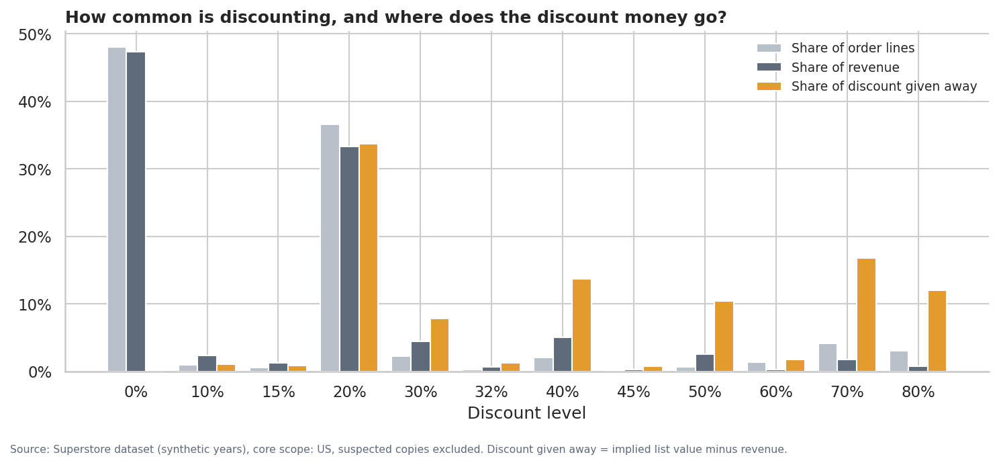
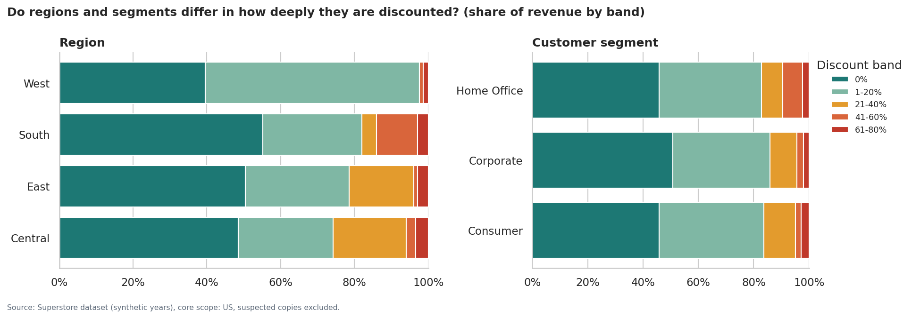
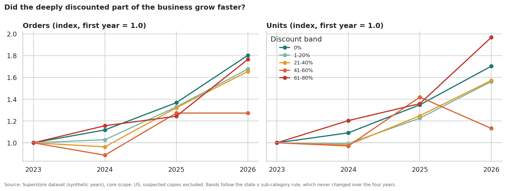
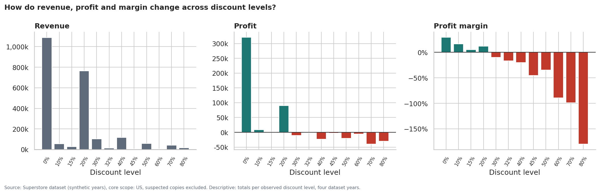
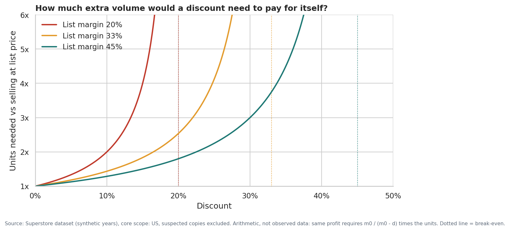
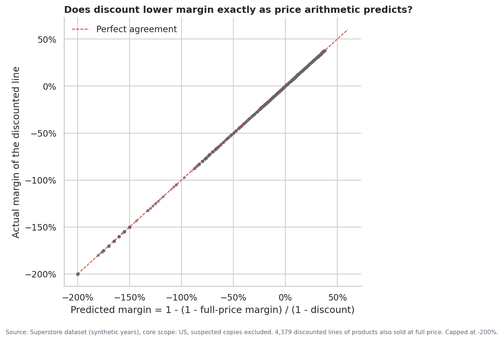

# Phase 6 — Discount and Profitability Analysis
**Business question:** Is discounting helping the business generate profitable growth, or is it eroding profitability?  
**Scope:** core scope (US, suspected copies excluded): revenue 2,296.9k, profit 286.4k, 9,993 order lines.  
**Validation:** 14/14 checks passed.  
_Generated by `scripts/run_phase6_discount.py`; all figures are computed at run time._

## How claims are labelled
| Label | Meaning | What it can support |
|---|---|---|
| [Descriptive] | What the numbers are | 'Deep-discount lines lose money' |
| [Correlation] | How strongly two variables move together (Spearman rank correlation) | 'Higher discount goes with lower margin' |
| [Explanation] | A mechanism verified in the data, or a plausible business reason | 'Margin falls because price falls while unit cost stays fixed' |
| [Causal] | What would happen if discount were changed | Only claims the data's variation can actually support (see section 9) |

## 1. Short answer
- **[Descriptive]** The business gave away 566.6k of list value through discounts, about 2.0x its total profit (286.4k).
- **[Descriptive]** Moderate discounting is still profitable: discounted lines more than 10 points below their product's break-even earn 83.7k at 29.0% margin. Discounting **beyond** break-even (20.4% of revenue) loses 156.1k, which is all of the line-level losses in the business.
- **[Explanation]** The mechanism is verified price arithmetic: each product has a fixed unit cost, so a discount lowers its margin by an exactly predictable amount. Verified: the implied list margin is constant within every product, and predicts the margin of every discounted line exactly. It follows that a line loses money when its discount exceeds the product's list margin.
- **[Correlation]** There is no sign that discounting buys volume or growth: discount vs units per line rho = 0.00; discount vs state revenue growth rho = -0.08. Order growth over the period was 1.80x at full price and 1.27-1.77x in the discounted bands; unit growth was 1.70x vs 1.13-1.97x. There is no consistent pattern of faster growth where discounts are deeper.
- **[Causal]** A causal estimate of what would happen to **total** profit and volume if discounts changed is **not possible** from this data: discount never varies within a state x sub-category rule (0 of 656 rules vary) and no rule changed over four years (0 of 517).
- **Management reading:** discounting as currently applied is not visibly generating profitable growth. The part beyond break-even erodes profit on every unit sold. Whether removing it would also lose sales is unknown and should be tested with a controlled pilot.

## 2. What is the 'average discount'?
**[Descriptive]** The answer depends on the definition, so all are shown. The effective discount rate is used throughout this report because it answers the business question 'what share of list value did we give up?'

| measure | value | meaning |
|---|---|---|
| Simple average of line discount rates | 15.6% | Every line counts equally, a 2-dollar line as much as a 2,000-dollar line. |
| Average weighted by net revenue | 14.0% | Weights by revenue after discount, which under-weights deeply discounted lines. |
| Effective discount rate (recommended) | 19.8% | Discount given away / list value. Answers: what share of list value did we give up? |
| Share of lines discounted | 52.0% | How common discounting is. |
| Share of lines at 30%+ discount | 13.9% | How common deep discounting is. |

## 3. Discount distribution
**[Descriptive]** Discount takes only 12 distinct values. 48.0% of lines are at full price and 36.6% at exactly 20%. Lines at 30% or more are 13.9% of lines but account for 64.3% of all discount given away.

| discount_rate | lines | share_of_lines | sales | share_of_sales | discount_amount | share_of_discount_given |
|---|---|---|---|---|---|---|
| 0.00 | 4,798 | 48.0% | 1,087.9k | 47.4% | 0 | 0.0% |
| 0.10 | 94 | 0.9% | 54.4k | 2.4% | 6.0k | 1.1% |
| 0.15 | 52 | 0.5% | 27.6k | 1.2% | 4.9k | 0.9% |
| 0.20 | 3,657 | 36.6% | 764.6k | 33.3% | 191.1k | 33.7% |
| 0.30 | 226 | 2.3% | 102.9k | 4.5% | 44.1k | 7.8% |
| 0.32 | 27 | 0.3% | 14.5k | 0.6% | 6.8k | 1.2% |
| 0.40 | 206 | 2.1% | 116.4k | 5.1% | 77.6k | 13.7% |
| 0.45 | 11 | 0.1% | 5.5k | 0.2% | 4.5k | 0.8% |
| 0.50 | 66 | 0.7% | 58.9k | 2.6% | 58.9k | 10.4% |
| 0.60 | 138 | 1.4% | 6.6k | 0.3% | 10.0k | 1.8% |
| 0.70 | 418 | 4.2% | 40.6k | 1.8% | 94.8k | 16.7% |
| 0.80 | 300 | 3.0% | 17.0k | 0.7% | 67.9k | 12.0% |

## 4. Are the proposed discount bands appropriate?
The proposed bands (0%, 1-10%, 10-20%, 20-30%, 30%+) were evaluated against two alternatives and the 12 raw levels using four stated criteria: explanatory power (share of the margin detail in the 12 raw levels that the bands retain), smallest band size, homogeneity (largest margin range between levels grouped into one band), and whether a boundary sits at the profit break-even (20% to 30%).

| scheme | bands | eta_squared | share_of_level_detail_retained | smallest_band_lines | max_margin_range_within_band | boundary_at_break_even_20_30 |
|---|---|---|---|---|---|---|
| A. Proposed: 0 \| 1-10 \| 10-20 \| 20-30 \| 30+ | 5 | 54.4% | 71.4% | 94 | 163.5% | True |
| B. Model bands: 0 \| 1-20 \| 21-40 \| 41-60 \| 61-80 | 5 | 71.9% | 94.3% | 215 | 81.4% | True |
| C. Alternative: 0 \| 1-20 \| 21-40 \| 41-50 \| 51-80 | 5 | 72.3% | 94.9% | 77 | 90.6% | True |
| Reference: 12 raw discount levels | 12 | 76.2% | 100.0% | 11 | 0.0% | True |

**Problems with the proposed bands, specific to this dataset:**
- The boundaries overlap as written (is 10% in '1-10%' or '10-20%'?). They were implemented as (0,10], (10,20], (20,30], >30.
- '1-10%' contains a single discount level (10%) with 94 lines, and '20-30%' contains only 30%.
- '30%+' groups 7 levels whose margins range over 164% (from -10.1% at 30% to -180.0% at 80%), hiding the difference between moderate and extreme discounting.

**Decision:** keep the model bands (0 | 1-20 | 21-40 | 41-60 | 61-80). They retain 94% of the raw-level detail with every band above 215 lines, they match the bands already used in SQL and Power BI, and the 20% boundary sits exactly at the break-even transition. Alternative C scores marginally higher but creates a 77-line band, which is too thin for stable reporting.

| band | levels_in_band | lines | sales | share_of_sales | profit | profit_margin | margin_range_within_band |
|---|---|---|---|---|---|---|---|
| 0% | 1 | 4,798 | 1,087.9k | 47.4% | 321.0k | 29.5% | 0.0% |
| 1-20% | 3 | 3,803 | 846.5k | 36.9% | 100.8k | 11.9% | 11.5% |
| 21-40% | 3 | 459 | 233.9k | 10.2% | -35.8k | -15.3% | 9.7% |
| 41-60% | 3 | 215 | 71.0k | 3.1% | -28.9k | -40.7% | 54.7% |
| 61-80% | 2 | 718 | 57.6k | 2.5% | -70.6k | -122.6% | 81.4% |

**A more meaningful band for decisions:** because each product breaks even at its own list margin (section 8), the most useful grouping for management is distance from break-even rather than the raw discount rate:

| headroom_band | lines | sales | share_of_sales | profit | share_of_profit | profit_margin | loss_line_share |
|---|---|---|---|---|---|---|---|
| Full price | 4,798 | 1,087.9k | 47.4% | 321.0k | 112.1% | 29.5% | 0.0% |
| Discounted, >10 pp below break-even | 2,017 | 288.9k | 12.6% | 83.7k | 29.2% | 29.0% | 0.0% |
| Discounted, within 10 pp of break-even | 1,308 | 451.7k | 19.7% | 37.8k | 13.2% | 8.4% | 0.0% |
| Discounted beyond break-even | 1,870 | 468.4k | 20.4% | -156.1k | -54.5% | -33.3% | 100.0% |

## 5. Where is discount applied?
**[Descriptive]** 'List margin' is the sales-weighted margin the products would earn at full price, which is also their break-even discount. 'Beyond break-even' is the share of revenue sold at a discount larger than the product's own list margin.

### Category
| category | sales | profit | profit_margin | effective_discount | avg_line_discount | share_lines_discounted | share_lines_deep | list_margin | share_sales_beyond_break_even |
|---|---|---|---|---|---|---|---|---|---|
| Furniture | 741.7k | 18.5k | 2.5% | 20.0% | 17.4% | 60.6% | 25.5% | 22.0% | 34.7% |
| Office Supplies | 719.0k | 122.5k | 17.0% | 20.0% | 15.7% | 48.1% | 11.3% | 33.6% | 12.7% |
| Technology | 836.2k | 145.5k | 17.4% | 19.5% | 13.2% | 54.9% | 9.3% | 33.5% | 14.3% |

### Sub-category
| sub_category | sales | profit | profit_margin | effective_discount | avg_line_discount | share_lines_discounted | share_lines_deep | list_margin | share_sales_beyond_break_even |
|---|---|---|---|---|---|---|---|---|---|
| Binders | 203.4k | 30.2k | 14.9% | 38.7% | 37.2% | 77.9% | 40.2% | 47.8% | 17.8% |
| Machines | 189.2k | 3.4k | 1.8% | 34.3% | 30.6% | 74.8% | 46.1% | 35.5% | 38.3% |
| Tables | 207.0k | -17.7k | -8.6% | 25.5% | 26.1% | 77.4% | 55.2% | 19.1% | 50.7% |
| Bookcases | 114.9k | -3.5k | -3.0% | 22.5% | 21.1% | 73.7% | 30.7% | 20.1% | 41.8% |
| Phones | 330.0k | 44.5k | 13.5% | 16.6% | 15.5% | 65.0% | 12.3% | 27.9% | 10.8% |
| Chairs | 328.2k | 26.6k | 8.1% | 16.6% | 17.0% | 78.4% | 25.5% | 23.3% | 27.9% |
| Appliances | 107.5k | 18.1k | 16.9% | 15.3% | 16.7% | 41.8% | 14.4% | 29.6% | 3.1% |
| Furnishings | 91.7k | 13.1k | 14.2% | 14.8% | 13.8% | 40.3% | 14.4% | 26.9% | 14.0% |
| Copiers | 149.5k | 55.6k | 37.2% | 14.5% | 16.2% | 67.6% | 13.2% | 46.3% | 0.0% |
| Fasteners | 3.0k | 950 | 31.4% | 9.0% | 8.2% | 41.0% | 0.0% | 37.6% | 4.9% |
| Envelopes | 16.5k | 7.0k | 42.3% | 8.2% | 8.0% | 40.2% | 0.0% | 47.0% | 0.0% |
| Art | 27.1k | 6.5k | 24.1% | 7.7% | 7.5% | 37.4% | 0.0% | 30.0% | 0.0% |
| Supplies | 46.7k | -1.2k | -2.5% | 7.5% | 7.7% | 38.4% | 0.0% | 5.1% | 30.1% |
| Paper | 78.5k | 34.1k | 43.4% | 7.5% | 7.5% | 37.4% | 0.0% | 47.6% | 0.0% |
| Storage | 223.8k | 21.3k | 9.5% | 6.9% | 7.5% | 37.4% | 0.0% | 15.7% | 16.9% |
| Accessories | 167.4k | 41.9k | 25.1% | 6.8% | 7.8% | 39.2% | 0.0% | 30.2% | 6.5% |
| Labels | 12.5k | 5.5k | 44.4% | 6.1% | 6.9% | 34.3% | 0.0% | 47.8% | 0.0% |

### Region
| region | sales | profit | profit_margin | effective_discount | avg_line_discount | share_lines_discounted | share_lines_deep | list_margin | share_sales_beyond_break_even |
|---|---|---|---|---|---|---|---|---|---|
| Central | 501.2k | 39.7k | 7.9% | 24.6% | 24.0% | 64.4% | 27.7% | 30.5% | 28.2% |
| South | 391.7k | 46.7k | 11.9% | 21.3% | 14.7% | 50.3% | 10.6% | 30.7% | 23.4% |
| East | 678.5k | 91.5k | 13.5% | 19.5% | 14.5% | 49.1% | 16.2% | 30.3% | 23.7% |
| West | 725.5k | 108.4k | 14.9% | 15.6% | 10.9% | 46.4% | 3.7% | 28.2% | 10.3% |

### Customer segment
| segment | sales | profit | profit_margin | effective_discount | avg_line_discount | share_lines_discounted | share_lines_deep | list_margin | share_sales_beyond_break_even |
|---|---|---|---|---|---|---|---|---|---|
| Home Office | 429.4k | 60.3k | 14.0% | 20.9% | 14.7% | 48.9% | 13.3% | 32.0% | 20.8% |
| Consumer | 1,161.4k | 134.1k | 11.5% | 20.3% | 15.8% | 52.6% | 14.2% | 29.5% | 21.3% |
| Corporate | 706.1k | 92.0k | 13.0% | 18.3% | 15.8% | 52.7% | 13.9% | 28.9% | 18.7% |

**Reading.** **[Descriptive]** Categories receive almost identical effective discounts (19.5%-20.0%), but sub-categories differ widely (from 6.1% to 38.7%). What matters is the discount *relative to list margin*: Tables have a list margin of only 19.1% yet an effective discount of 25.5%, so 51% of Tables revenue is sold beyond break-even. Binders and Machines carry high list margins but receive the deepest discounts. Regions differ sharply (Central 24.6% vs West 15.6%); segments barely differ (18.3%-20.9%).

## 6. Discount → Sales
**[Descriptive]** Revenue at each discount level mostly reflects how many lines carry that level, not demand. Units per line are the fair comparison: median line value mainly reflects which products carry each level (10-50% rules apply largely to high-value Machines, Tables and Phones; 60-80% rules mainly to low-priced Binders and Appliances). Units per line barely change with discount:

| discount_rate | lines | sales | units_per_line | median_line_sales | median_line_list_value |
|---|---|---|---|---|---|
| 0.00 | 4,798 | 1,087.9k | 3.81 | 54 | 54 |
| 0.10 | 94 | 54.4k | 3.97 | 328 | 364 |
| 0.15 | 52 | 27.6k | 3.81 | 359 | 423 |
| 0.20 | 3,657 | 764.6k | 3.74 | 52 | 65 |
| 0.30 | 226 | 102.9k | 3.75 | 359 | 513 |
| 0.32 | 27 | 14.5k | 3.89 | 328 | 483 |
| 0.40 | 206 | 116.4k | 3.82 | 314 | 524 |
| 0.45 | 11 | 5.5k | 4.09 | 383 | 697 |
| 0.50 | 66 | 58.9k | 3.65 | 302 | 604 |
| 0.60 | 138 | 6.6k | 3.63 | 22 | 56 |
| 0.70 | 418 | 40.6k | 3.97 | 12 | 41 |
| 0.80 | 300 | 17.0k | 3.96 | 9 | 44 |

**[Descriptive]** **Growth by band.** Each band is a fixed set of state x sub-category rules (rules never changed), so its growth can be compared:

| band | revenue_index_2026_vs_2023 | units_index_2026_vs_2023 | orders_index_2026_vs_2023 | revenue_cagr | profit_first_year | profit_last_year |
|---|---|---|---|---|---|---|
| 0% | 1.62 | 1.70 | 1.80 | 17.5% | 58.6k | 104.2k |
| 1-20% | 1.68 | 1.56 | 1.68 | 18.9% | 19.0k | 36.9k |
| 21-40% | 1.11 | 1.57 | 1.65 | 3.6% | -9.0k | -12.2k |
| 41-60% | 0.57 | 1.13 | 1.27 | -17.0% | -6.4k | -10.1k |
| 61-80% | 2.06 | 1.97 | 1.77 | 27.2% | -12.7k | -25.3k |

**[Correlation]** Three tests of whether discount is associated with more demand:

| relationship | level | n | spearman_rho | strength |
|---|---|---|---|---|
| Discount vs units per line | Order line | 9,993 | -0.00 | None / negligible |
| Discount vs line revenue | Order line | 9,993 | -0.06 | None / negligible |
| Effective discount vs revenue growth 2023-2026 | State (30+ orders) | 28 | -0.08 | None / negligible |
| Relative discount vs share of the state's purchases (revenue) | State x sub-category | 405 | 0.03 | None / negligible |
| Relative discount vs share of the state's purchases (units) | State x sub-category | 405 | 0.06 | None / negligible |

**[Explanation]** **Possible business explanations.** If discounts were winning extra business, we would expect larger baskets on discounted lines, a larger share of purchases going to sub-categories a state discounts more heavily, or faster growth in high-discount states. None appears. Possible explanations: discounts are given where customers would have bought anyway; or the rules respond to local competition and only prevent sales from being lower (which this data cannot show).

**[Causal]** **Causal conclusion:** none. The absence of an association is consistent with discounts not buying volume, but it is not proof, because discount, location and product are confounded and there is no comparison group.

## 7. Discount → Profit
**[Descriptive]** Profit by discount band (recommended bands):

| band | lines | sales | profit | profit_margin |
|---|---|---|---|---|
| 0% | 4,798 | 1,087.9k | 321.0k | 29.5% |
| 1-20% | 3,803 | 846.5k | 100.8k | 11.9% |
| 21-40% | 459 | 233.9k | -35.8k | -15.3% |
| 41-60% | 215 | 71.0k | -28.9k | -40.7% |
| 61-80% | 718 | 57.6k | -70.6k | -122.6% |

**[Descriptive]** Full-price lines produce 112% of total profit; the 1-20% band adds 100.8k; every band above 20% is loss-making in total. Measured by distance from break-even, the 20.4% of revenue sold beyond break-even loses 156.1k, while all other discounted revenue earns 121.5k.

**[Explanation]** **What a discount would need to deliver** (arithmetic, not observed data). With unit cost fixed, a discount must raise unit volume by the factor below just to keep profit unchanged:

| discount | list margin 20% | list margin 33% | list margin 45% |
|---|---|---|---|
| 5% | 1.3x | 1.2x | 1.1x |
| 10% | 2.0x | 1.4x | 1.3x |
| 15% | 4.0x | 1.8x | 1.5x |
| 20% | not possible | 2.5x | 1.8x |
| 30% | not possible | 11.0x | 3.0x |
| 40% | not possible | not possible | 9.0x |

The median product has a list margin of 33%. A 20% discount on such a product needs about 2.5x the units to earn the same profit, while section 6 shows discounted lines carry no more units than full-price lines.

## 8. Discount → Profit margin
**[Descriptive]** Margin falls broadly as discount rises. It is not strictly lower at every step (e.g. 15% vs 20%, 45% vs 50%), because each discount level applies to a different mix of products with different list margins:

| discount_rate | lines | profit_margin | loss_line_share | profit_per_line |
|---|---|---|---|---|
| 0.00 | 4,798 | 29.5% | 0.0% | 67 |
| 0.10 | 94 | 16.6% | 4.3% | 96 |
| 0.15 | 52 | 5.1% | 32.7% | 27 |
| 0.20 | 3,657 | 11.8% | 13.7% | 25 |
| 0.30 | 226 | -10.1% | 91.6% | -46 |
| 0.32 | 27 | -16.5% | 100.0% | -89 |
| 0.40 | 206 | -19.8% | 87.4% | -112 |
| 0.45 | 11 | -45.5% | 100.0% | -227 |
| 0.50 | 66 | -34.8% | 100.0% | -311 |
| 0.60 | 138 | -89.5% | 100.0% | -43 |
| 0.70 | 418 | -98.7% | 100.0% | -96 |
| 0.80 | 300 | -180.0% | 100.0% | -102 |

**[Correlation]** Correlations between discount and margin at different levels of aggregation:

| relationship | level | n | spearman_rho | strength |
|---|---|---|---|---|
| Discount vs line margin | Order line | 9,993 | -0.64 | Strong |
| Discount vs line margin, within sub-category (median of 17) | Order line | 9,993 | -0.81 | Strong |
| Effective discount vs margin | Customer | 792 | -0.81 | Strong |
| Effective discount vs margin | State (30+ orders) | 28 | -0.87 | Strong |

**[Explanation]** **Verified mechanism.** If unit cost is fixed and a discount only lowers the price, a product with list margin m0 sold at discount d must earn margin 1 - (1 - m0) / (1 - d). Tested on the data:

- The list margin implied by each line is constant within every product (largest spread across 1,894 products: 3.3e-16).
- For 4,379 discounted lines of products also sold at full price, the predicted margin matches the actual margin (largest error 1.3e-15, i.e. exact).
- Consequently a line loses money exactly when its discount exceeds its product's list margin. (On its own, that line-level equivalence is an algebraic identity; the evidence is the two tests above, which show the list margin is a fixed property of each product.)

This also confirms assumption A1 (sales are recorded net of discount) and shows that, in this dataset, profit is generated by a fixed cost per product. That exactness is typical of synthetic data; real cost data would be noisier.

## 9. What can and cannot be concluded
| Claim | Type | Evidence | Status |
|---|---|---|---|
| Deep discounts coincide with losses | Descriptive | Every band above 20% loses money; beyond-break-even revenue loses 156.1k | Established |
| Higher discount goes with lower margin | Correlation | rho -0.64 (lines), -0.87 (states) | Established |
| Discount lowers the margin of the unit it is applied to, by a known amount | Explanation (price arithmetic) | Exact fit of 1 - (1-m0)/(1-d) | Established for unit economics, given fixed unit cost |
| Discounts are associated with more volume or growth | Correlation | rho near 0 on units, basket share and state growth | Not supported |
| Removing deep discounts would raise total profit | Causal | Requires knowing how volume responds; no variation within rules or over time | **Cannot be concluded** |
| Discounting caused the 2026 margin decline | Causal | Four yearly observations; mix also changed | **Cannot be concluded** |

**Why the causal question stays open.** To estimate what a discount *does* to total profit, we would need comparable sales with and without it: the same rule at different times, or different discounts within one rule. Neither exists: 0 of 656 rules have more than one discount level, and 0 of 517 rules seen in several years ever changed.

## 10. Management interpretation
**Is discounting helping the business generate profitable growth?** On the evidence available, discounting as currently applied is not visibly doing so:

1. **Moderate discounts look sustainable; deep ones do not.** Discounts well within list margin remain profitable (83.7k). Discounts beyond break-even (20.4% of revenue) lose money on every such unit, by construction.
2. **No visible volume payoff.** Discounted lines do not carry larger baskets, heavily discounted sub-categories do not take a larger share of a state's purchases, and high-discount states have not grown faster. Order growth over the period was 1.80x at full price and 1.27-1.77x in the discounted bands; unit growth was 1.70x vs 1.13-1.97x. There is no consistent pattern of faster growth where discounts are deeper.
3. **The problem is concentrated and rule-based.** Losses come from specific state x sub-category rules (Phase 5), so the fix is a policy decision, not a broad price cut or customer action.
4. **Discount should be set relative to list margin.** A single company-wide cap ignores that Tables break even at about 19% while Binders break even near 48%.

**Recommended actions (in order)**
1. Introduce a guardrail: no discount above the product's list margin without explicit approval.
2. Review the rules that sell beyond break-even, starting with the largest losses (Phase 5 priority list).
3. Run a controlled pilot: lower the deepest rules in a few states, keep comparable states unchanged, and measure orders, units and profit for at least two quarters.
4. Report effective discount and beyond-break-even revenue share as standing KPIs in the dashboard.

## 11. Limitations
- **Synthetic, mechanically generated profit.** The exact price-arithmetic fit shows profit is computed from a fixed unit cost; real businesses have volume discounts, rebates and variable costs.
- **No counterfactual.** No variation in discount within rules or over time; associations with volume cannot be read as effects.
- **No cost, competitor or promotion data.** We cannot see why rules were set, or whether discounts matched competitor prices.
- **Returns not netted.** Returns are recorded per order only and are not deducted from profit.
- **Dataset years are synthetic.**

## 12. Validation
| check | expected | actual | status |
|---|---|---|---|
| Revenue = SQL Q01 | 2,296,919.4900 | 2,296,919.4883 | PASS |
| Profit = SQL Q01 | 286,409.0800 | 286,409.0805 | PASS |
| Distribution revenue sums to total | 2,296,919.4883 | 2,296,919.4883 | PASS |
| Headroom bands profit sums to total | 286,409.0805 | 286,409.0805 | PASS |
| Beyond-break-even profit = all line losses | -156,119.2269 | -156,119.2269 | PASS |
| Price-arithmetic identity: max error | 0.0000 | 0.0000 | PASS |
| Model-band profit = SQL Q15 | 286,409.0700 | 286,409.0805 | PASS |
| Rules that changed over time (expected 0, Phase 4) | 0.0000 | 0.0000 | PASS |
| Band scheme sums to revenue: A. | 2,296,919.4883 | 2,296,919.4883 | PASS |
| Band scheme sums to revenue: B. | 2,296,919.4883 | 2,296,919.4883 | PASS |
| Band scheme sums to revenue: C. | 2,296,919.4883 | 2,296,919.4883 | PASS |
| category profit sums to total | 286,409.0805 | 286,409.0805 | PASS |
| region profit sums to total | 286,409.0805 | 286,409.0805 | PASS |
| segment profit sums to total | 286,409.0805 | 286,409.0805 | PASS |