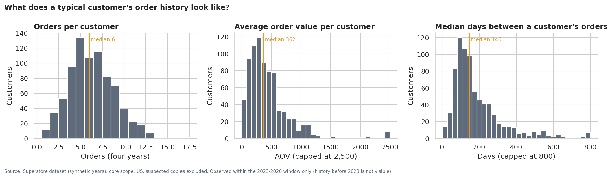
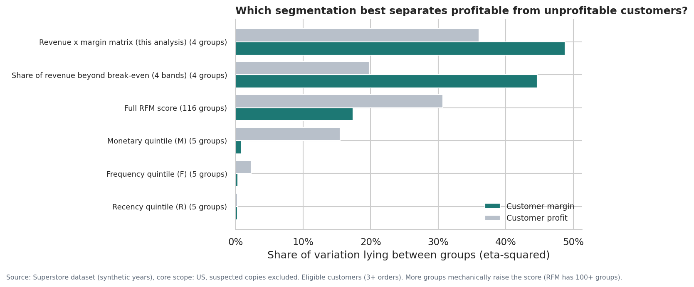
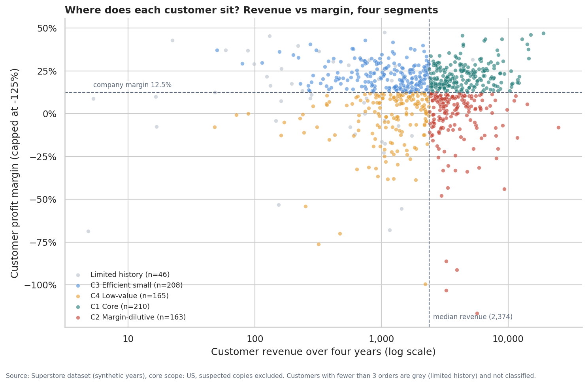
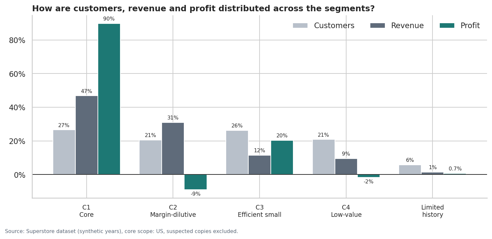
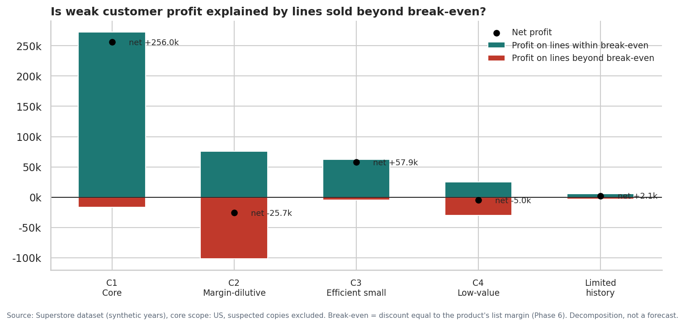
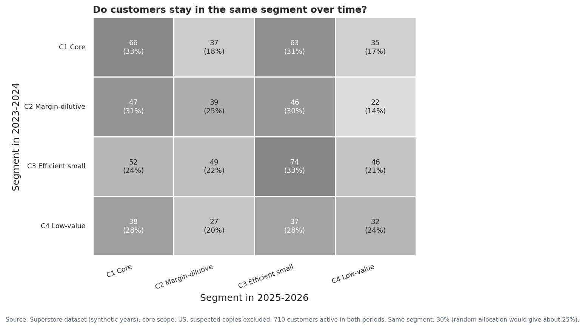

# Phase 7 — Customer Profitability Analysis
**Business question:** Which customers create profit, which dilute it, and which customer groups deserve further commercial investigation?  
**Population:** 792 valid customers (core scope; placeholder and identity-anomaly customers excluded). Revenue 2,292.3k, profit 285.4k, margin 12.5%.  
**Validation:** 9/9 checks passed.  
_Generated by `scripts/run_phase7_customers.py`; all figures are computed at run time._

## 1. Executive summary
- **Profit is concentrated.** Core accounts (C1) are 27% of customers, 47% of revenue and 90% of profit. The top 10% of customers by profit generate 58% of all customer profit.
- **A large block of revenue earns nothing.** Margin-dilutive accounts (C2) are 21% of customers and 31% of revenue, but lose 25.7k as a group.
- **Customer losses trace back to specific lines.** All 155 unprofitable customers bought at least one line beyond break-even; 154 of them are profitable on their remaining lines.
- **Customer profitability is not a stable trait in this data.** A customer's margin in 2023-2024 has no relationship with their margin in 2025-2026 (rho = -0.00); only 30% of customers stay in the same segment.
- **Implication:** commercial investigation should focus on the transactions and discount rules behind weak customer profit, and on protecting core accounts. It should not label individual customers as 'bad customers'.

## 2. Population and what the data can say about customer history
- 75% of customers are first seen in the first data year, so most customer histories are **left-censored**: we cannot tell whether they are new or long-standing.
- 87% ordered in the final year, so recency barely separates customers.
- 5.8% of customers have fewer than 3 orders and are not classified ('limited history').
- **Supported:** revenue, profit, orders, AOV, observed tenure, days between orders, days since last order, active years.
- **Not supported:** true customer lifetime value, acquisition date or cost, churn (no definition of a lost customer), and any customer-level cost to serve.

## 3. Customer metrics
Distributions are skewed, so medians are the representative figure; means are shown for reference.

| metric | mean | 10% | 25% | 50% | 75% | 90% |
|---|---|---|---|---|---|---|
| Revenue per customer | 2,894 | 583 | 1,144 | 2,255 | 3,771 | 6,044 |
| Profit per customer | 360 | -188 | 37 | 228 | 559 | 1,158 |
| Orders per customer | 6.3 | 3.0 | 5.0 | 6.0 | 8.0 | 10.0 |
| Average order value | 460 | 119 | 213 | 362 | 552 | 870 |
| Profit margin | 11.0% | -10.5% | 4.2% | 14.4% | 22.3% | 29.5% |
| Observed tenure (days, first to last order) | 999 | 558 | 829 | 1,092 | 1,221 | 1,324 |
| Median days between orders | 188 | 65 | 98 | 146 | 237 | 357 |
| Days since last order (to data end) | 147 | 12 | 30 | 76 | 183 | 406 |
| Active years (of 4) | 3.2 | 2.0 | 3.0 | 3.0 | 4.0 | 4.0 |
| Ship-to states per customer | 5.1 | 3.0 | 4.0 | 5.0 | 6.0 | 8.0 |

Company-level reference: AOV 458, revenue per customer 2.9k, profit per customer 360, orders per customer 6.3.

## 4. Choosing the segmentation
Candidate approaches were compared by how much of the variation in customer **margin** and customer **profit** lies between their groups (eta-squared). A useful profitability segmentation must separate customers who earn money from those who do not.

| segmentation | groups | eta_margin | eta_profit |
|---|---|---|---|
| Recency quintile (R) | 5 | 0.3% | 0.3% |
| Frequency quintile (F) | 5 | 0.4% | 2.3% |
| Monetary quintile (M) | 5 | 0.9% | 15.5% |
| Full RFM score | 116 | 17.4% | 30.7% |
| Revenue x margin matrix (this analysis) | 4 | 48.8% | 36.1% |
| Share of revenue beyond break-even (4 bands) | 4 | 44.7% | 19.8% |

**Why RFM is not used as the primary segmentation:**
- Recency and frequency tell us almost nothing about customer margin (R: 0.3%, F: 0.4%).
- RFM ranks customers by revenue (monetary), not profit, so it cannot distinguish a high-revenue profitable customer from a high-revenue loss-making one.
- The full RFM score needs 116 groups to reach 17%, whereas a four-group revenue x margin matrix reaches 49%.
- RFM was designed to predict response to marketing contact; this question is about profitability.

**Chosen approach: revenue x margin matrix**
| Element | Definition | Why |
|---|---|---|
| Evidence rule | At least 3 orders | Avoids classifying customers on one or two transactions |
| Revenue axis | Revenue >= median of eligible customers (2.4k) | Robust to the skewed revenue distribution |
| Profit axis | Margin >= company margin (12.5%) | Absolute profit largely mirrors revenue; margin measures profit quality independent of size. 'Low revenue, high profit' only makes sense as high margin |

The matrix is identical in logic to the product framework (Phase 5), so products and customers are judged by the same rules.

## 5. Segment results

| cust_segment | customers | share_of_customers | revenue | share_of_revenue | profit | share_of_profit | profit_margin | effective_discount | beyond_be_share | unprofitable |
|---|---|---|---|---|---|---|---|---|---|---|
| C1 | 210 | 26.5% | 1,072.1k | 46.8% | 256.0k | 89.7% | 23.9% | 10.8% | 6.4% | 0 |
| C2 | 163 | 20.6% | 708.2k | 30.9% | -25.7k | -9.0% | -3.6% | 30.2% | 40.9% | 65 |
| C3 | 208 | 26.3% | 263.9k | 11.5% | 57.9k | 20.3% | 22.0% | 11.6% | 7.3% | 0 |
| C4 | 165 | 20.8% | 216.5k | 9.4% | -5.0k | -1.7% | -2.3% | 28.2% | 38.0% | 76 |
| NA | 46 | 5.8% | 31.7k | 1.4% | 2.1k | 0.7% | 6.6% | 24.9% | 26.9% | 14 |

**Per-customer view (medians and averages)**

| cust_segment | median_revenue | median_profit | median_orders | median_aov | revenue_per_customer | profit_per_customer | orders_per_customer |
|---|---|---|---|---|---|---|---|
| C1 | 4.3k | 874 | 7.00 | 613 | 5.1k | 1.2k | 7.45 |
| C2 | 3.5k | 141 | 8.00 | 509 | 4.3k | -157 | 7.82 |
| C3 | 1.3k | 247 | 5.00 | 217 | 1.3k | 279 | 5.60 |
| C4 | 1.3k | 12 | 5.00 | 233 | 1.3k | -30 | 5.55 |
| NA | 483 | 26 | 2.00 | 241 | 689 | 45 | 1.74 |

### C1 — High revenue, high margin (core accounts)
**Metrics.** 210 customers, revenue 1,072.1k (46.8%), profit 256.0k (89.7%), margin 23.9%, effective discount 10.8%, 6.4% of revenue beyond break-even, 0 unprofitable customers. Median customer: revenue 4.3k, profit 874, 7 orders.

**Examples** (ranked by absolute profit impact, |profit|):

| customer_id | customer_name | segment | revenue | profit | profit_margin | orders | effective_discount | beyond_be_share |
|---|---|---|---|---|---|---|---|---|
| TC-20980 | Tamara Chand | Corporate | 19.1k | 9.0k | 47.1% | 5 | 0.7% | 0.1% |
| RB-19360 | Raymond Buch | Consumer | 15.1k | 7.0k | 46.1% | 6 | 0.6% | 0.1% |
| SC-20095 | Sanjit Chand | Consumer | 14.1k | 5.8k | 40.7% | 9 | 2.7% | 5.2% |
| HL-15040 | Hunter Lopez | Consumer | 12.9k | 5.6k | 43.7% | 6 | 0.0% | 0.0% |
| AB-10105 | Adrian Barton | Consumer | 14.5k | 5.4k | 37.6% | 10 | 8.1% | 5.4% |

**What it means.** The accounts that carry the business: above-median revenue at margins above the company average, bought mostly at or near list price. They are the profit base and the main concentration risk.

**Limitations.** Membership is based on four years of history and is not stable over time (section 7); the label describes the past, not a customer type.

### C2 — High revenue, low margin (margin-dilutive accounts)
**Metrics.** 163 customers, revenue 708.2k (30.9%), profit -25.7k (-9.0%), margin -3.6%, effective discount 30.2%, 40.9% of revenue beyond break-even, 65 unprofitable customers. Median customer: revenue 3.5k, profit 141, 8 orders.

**Examples** (ranked by absolute profit impact, |profit|):

| customer_id | customer_name | segment | revenue | profit | profit_margin | orders | effective_discount | beyond_be_share |
|---|---|---|---|---|---|---|---|---|
| CS-12505 | Cindy Stewart | Consumer | 5.7k | -6.6k | -116.5% | 6 | 67.1% | 87.1% |
| GT-14635 | Grant Thornton | Corporate | 9.4k | -4.1k | -43.9% | 3 | 48.3% | 96.2% |
| LF-17185 | Luke Foster | Consumer | 3.9k | -3.6k | -91.2% | 7 | 69.7% | 68.2% |
| SR-20425 | Sharelle Roach | Home Office | 3.2k | -3.3k | -103.1% | 5 | 65.4% | 85.0% |
| HG-14965 | Henry Goldwyn | Corporate | 3.2k | -2.8k | -86.2% | 12 | 70.3% | 67.1% |

**What it means.** Customers who buy a lot but earn the company little or nothing as a group. Their revenue is concentrated in lines sold beyond the product's break-even discount; on their other lines they are profitable.

**Limitations.** Low margin reflects which state and sub-category rules their orders fell under; the data does not show the customer asking for or negotiating discounts.

### C3 — Low revenue, high margin (efficient small accounts)
**Metrics.** 208 customers, revenue 263.9k (11.5%), profit 57.9k (20.3%), margin 22.0%, effective discount 11.6%, 7.3% of revenue beyond break-even, 0 unprofitable customers. Median customer: revenue 1.3k, profit 247, 5 orders.

**Examples** (ranked by absolute profit impact, |profit|):

| customer_id | customer_name | segment | revenue | profit | profit_margin | orders | effective_discount | beyond_be_share |
|---|---|---|---|---|---|---|---|---|
| KC-16255 | Karen Carlisle | Corporate | 2.1k | 846 | 39.9% | 6 | 0.8% | 3.1% |
| NM-18520 | Neoma Murray | Consumer | 2.2k | 789 | 36.5% | 10 | 7.2% | 3.5% |
| BE-11410 | Bobby Elias | Consumer | 2.3k | 756 | 33.4% | 5 | 6.3% | 0.0% |
| RF-19735 | Roland Fjeld | Consumer | 2.3k | 712 | 30.4% | 7 | 3.7% | 0.0% |
| FH-14350 | Fred Harton | Consumer | 2.3k | 706 | 31.1% | 4 | 5.3% | 7.1% |

**What it means.** Smaller customers who are efficient: they buy little, but at good margins and modest discounts. Their absolute profit contribution is limited by their size.

**Limitations.** There is no evidence on whether these customers could buy more; small revenue per customer limits the reliability of individual margins.

### C4 — Low revenue, low margin (low-value accounts)
**Metrics.** 165 customers, revenue 216.5k (9.4%), profit -5.0k (-1.7%), margin -2.3%, effective discount 28.2%, 38.0% of revenue beyond break-even, 76 unprofitable customers. Median customer: revenue 1.3k, profit 12, 5 orders.

**Examples** (ranked by absolute profit impact, |profit|):

| customer_id | customer_name | segment | revenue | profit | profit_margin | orders | effective_discount | beyond_be_share |
|---|---|---|---|---|---|---|---|---|
| NC-18415 | Nathan Cano | Consumer | 2.2k | -2.2k | -99.4% | 6 | 73.9% | 77.6% |
| SN-20560 | Skye Norling | Home Office | 1.9k | -717 | -38.5% | 6 | 62.5% | 41.7% |
| MG-17875 | Michael Grace | Home Office | 1.2k | -471 | -37.9% | 5 | 40.7% | 76.3% |
| RA-19945 | Ryan Akin | Consumer | 1.7k | -446 | -26.4% | 5 | 47.3% | 64.8% |
| DV-13045 | Darrin Van Huff | Corporate | 1.1k | -427 | -38.2% | 5 | 39.0% | 93.7% |

**What it means.** Small customers whose purchases fall heavily in deeply discounted lines. Small revenue, net losses as a group.

**Limitations.** Many have only 3-6 orders; one deeply discounted line can decide their classification.

### Limited history (< 3 orders)
46 customers, 1.4% of revenue. Not classified; monitored separately.

### Robustness
| scenario | reclassified | share_reclassified | c2_customers | c2_profit |
|---|---|---|---|---|
| Base: median revenue, company margin | 0 | 0.0% | 163 | -25.7k |
| Revenue cut at 60th percentile | 74 | 9.9% | 125 | -25.0k |
| Revenue cut at 40th percentile | 75 | 10.1% | 197 | -26.3k |
| Margin hurdle 10% | 54 | 7.2% | 134 | -38.5k |
| Margin hurdle 15% | 57 | 7.6% | 186 | -10.1k |

Shifting either threshold reclassifies 7-10% of customers, but the margin-dilutive segment loses money in every scenario. The pattern does not depend on the exact cut-offs.

## 6. Why are some customers low-margin?

Each customer's profit is split into lines sold within the product's break-even discount and lines sold beyond it (Phase 6). Every segment is profitable on its within-break-even lines. C2's net loss comes from 41% of its revenue sold beyond break-even, which loses 101.6k.

| group | customers | profit |
|---|---|---|
| Unprofitable customers | 155 | -71,212 |
| ... with no line beyond break-even | 0 | 0 |
| ... profitable on their within-break-even lines | 154 | -71,209 |
| ... profitable if their single worst line is excluded | 103 | -34,500 |

**What the data shows about discounts and customers.** Discount is fixed by state x sub-category (Phase 4), so every customer receives the same discount as any other customer buying the same sub-category in the same state. Differences in customer discount therefore reflect where they ship and what they buy, not a customer-specific deal. The data contains no evidence of customers negotiating discounts.

## 7. Is customer profitability a stable customer trait?
Customers active in both 2023-2024 and 2025-2026 (710) were classified separately in each period.

| Measure | Value |
|---|---|
| Rank correlation of margin, period 1 vs period 2 | -0.00 |
| Rank correlation of revenue | 0.05 |
| Rank correlation of profit | 0.07 |
| Low-margin in period 2, if low-margin in period 1 | 42% |
| Low-margin in period 2, if high-margin in period 1 | 40% |
| Same segment in both periods | 30% (about 25% expected by chance) |

**Reading.** Past profitability does not predict future profitability at customer level: being low-margin in the first period barely changes the chance of being low-margin in the second. Segment membership describes the past four years, not a lasting customer type. This is a strong reason not to act on individual customers (for example, by dropping them) on the basis of these segments.

**Limitation.** The synthetic dataset may assign orders to customers with little real-world structure, which would also produce this result. In a real business, this test should be repeated before any customer-level action.

## 8. Business segment composition
| segment | C1 | C2 | C3 | C4 | NA |
|---|---|---|---|---|---|
| Consumer | 23.2% | 23.0% | 28.4% | 20.5% | 4.9% |
| Corporate | 30.5% | 18.6% | 22.0% | 22.5% | 6.4% |
| Home Office | 29.3% | 17.0% | 27.2% | 19.0% | 7.5% |

Consumer, Corporate and Home Office customers are spread similarly across the profitability segments; business segment is not a useful predictor of customer profitability (consistent with Phase 4).

## 9. Which customer groups deserve further commercial investigation?
**Metrics used:** *loss* = sum of negative customer profit in the group; *hurdle shortfall* = revenue x (company margin - customer margin), summed over customers below the company margin: the profit the group would add if it earned the company-average margin. Neither is a forecast.

| group | customers | revenue | profit | loss | hurdle_shortfall | beyond_be_share | share_of_total_profit |
|---|---|---|---|---|---|---|---|
| C2 customers that are loss-making | 65 | 290.5k | -54.3k | -54.3k | 90.5k | 62.9% | -19.0% |
| C2 customers that are profitable but below hurdle | 98 | 417.6k | 28.7k | 0 | 23.3k | 25.6% | 10.0% |
| C1 core accounts (concentration risk) | 210 | 1,072.1k | 256.0k | 0 | 0 | 6.4% | 89.7% |
| Top 10% of customers by profit | 80 | 603.3k | 165.2k | 0 | 229 | 6.2% | 57.9% |
| C4 low-value accounts | 165 | 216.5k | -5.0k | -14.1k | 31.9k | 38.0% | -1.7% |
| Limited-history customers | 46 | 31.7k | 2.1k | -2.7k | 4.3k | 26.9% | 0.7% |

**Recommended investigation priorities**

1. **Loss-making high-revenue customers (C2, 65 customers).** Largest loss (54.3k) and hurdle shortfall (90.5k); 63% of their revenue is beyond break-even. *Investigate:* which orders, states and sub-category rules produced the losses, and whether any were approved exceptions. The action is on the rules and approvals, not the customers.
2. **Core accounts (C1) and the top 10% by profit.** 90% of customer profit comes from C1; the top 10% alone generate 58%. *Investigate:* account coverage, service levels and what share of each account's needs the company serves. No evidence here says they are at risk; the point is dependence.
3. **Profitable but below-hurdle C2 customers (98).** Profitable (28.7k) yet 23.3k below the company-average margin. *Investigate:* the mix of deeply discounted lines in their orders; these are the accounts where tighter discount guardrails would matter most.
4. **Low-value accounts (C4).** Small revenue; loss-making customers in this group lose 14.1k. *Investigate:* whether cost to serve (not in the data) makes small, deeply discounted orders uneconomic.
5. **Limited-history customers (46).** Too few orders to judge. *Monitor* rather than act.

## 10. What this analysis does not claim
- That any customer *behaves* in a particular way (negotiates, cherry-picks, is loyal or at risk): the data records transactions, not intentions.
- That segments are stable: section 7 shows they are not.
- Customer lifetime value, churn or acquisition: history is left-censored and costs are absent.
- That dropping or repricing customers would raise profit: volume responses are unknown (Phase 6).

## 11. Validation
| check | expected | actual | status |
|---|---|---|---|
| Customers = SQL valid customers | 792.00 | 792.00 | PASS |
| Customer profit = SQL Q18 total | 285,397.42 | 285,397.34 | PASS |
| Customer revenue = valid-line revenue | 2,292,294.92 | 2,292,294.92 | PASS |
| Segment revenue sums to total | 2,292,294.92 | 2,292,294.92 | PASS |
| Segment profit sums to total | 285,397.34 | 285,397.34 | PASS |
| Segment customers sum to total | 792.00 | 792.00 | PASS |
| Within-BE + beyond-BE profit = profit | 285,397.34 | 285,397.34 | PASS |
| Orders sum = distinct valid orders | 5,000.00 | 5,000.00 | PASS |
| Persistence matrix covers customers in both periods | 710.00 | 710.00 | PASS |